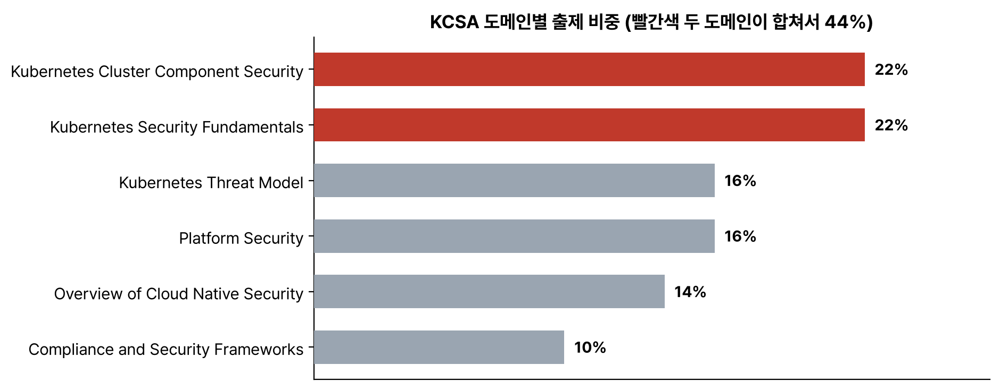

KCNA 정리를 9월에 마치고 KCSA로 넘어왔다. KCNA의 보안 항목은 '무엇이 무엇을 막나'를 구분하는 정도였는데, KCSA는 구성 요소마다 어떤 설정을 잠가야 하는지, 공격자가 어떤 경로로 들어와서 무엇을 노리는지까지 묻는다. 시험 형식과 공식 범위부터 정리했다.

## 요약

- 온라인 감독 객관식 60문항, 90분이다. 75% 이상이면 합격이고, 재시험 1회가 포함돼 있다. 자격은 2년 유효하다.
- 선수 조건은 없다. 같은 보안 분야의 실기 시험인 CKS는 유효한 CKA가 있어야 볼 수 있다.
- 6개 도메인이다. Overview of Cloud Native Security 14%, Kubernetes Cluster Component Security 22%, Kubernetes Security Fundamentals 22%, Kubernetes Threat Model 16%, Platform Security 16%, Compliance and Security Frameworks 10%.
- 구성 요소 보안과 보안 기초가 합쳐서 44%다. 항목 수도 이 두 도메인이 가장 많다.

## 1. 시험 정보 (2026년 10월 기준)

| 항목 | 내용 |
|---|---|
| 형식 | 온라인 감독 객관식, 60문항 |
| 시간 | 90분 |
| 합격 기준 | 75% 이상 |
| 재시험 | 1회 포함 |
| 응시 기한 | 구매 후 12개월 |
| 유효 기간 | 2년 |
| 선수 조건 | 없음 |
| 응시료 | US$250(시험만 살 때) |

## 2. 출제 범위

_구성 요소 보안과 보안 기초가 22%씩, 합쳐서 44%다_

공식 범위는 [cncf/curriculum 저장소의 KCSA PDF](https://github.com/cncf/curriculum/blob/master/KCSA%20Curriculum.pdf)에 있다. 파일 이름에 밑줄 대신 공백이 들어 있다. KCNA처럼 범위가 바뀌었다는 공지는 찾지 못했다. 세부 항목은 44개이고, 어느 글에 정리했는지 같이 적었다.

| 도메인 | 비중 | 항목 | 정리한 글 |
|---|---:|---|---|
| Overview of Cloud Native Security | 14% | The 4Cs of Cloud Native Security, Cloud Provider and Infrastructure Security, Controls and Frameworks, Isolation Techniques, Artifact Repository and Image Security, Workload and Application Code Security | 클라우드 네이티브 보안 개요 |
| Kubernetes Cluster Component Security | 22% | API Server, Controller Manager, Scheduler, Kubelet, Container Runtime, KubeProxy, Pod, Etcd, Container Networking, Client Security, Storage | 클러스터 구성 요소 보안 |
| Kubernetes Security Fundamentals | 22% | Pod Security Standards, Pod Security Admissions, Authentication | Pod Security와 인증, 인가 |
| | | Secrets, Isolation and Segmentation, Audit Logging, Network Policy | Secret, 격리, 감사 로그, NetworkPolicy |
| Kubernetes Threat Model | 16% | Kubernetes Trust Boundaries and Data Flow, Persistence, Denial of Service, Malicious Code Execution and Compromised Applications in Containers, Attacker on the Network, Access to Sensitive Data, Privilege Escalation | 위협 모델 |
| Platform Security | 16% | Supply Chain Security, Image Repository, Observability, Service Mesh, PKI, Connectivity, Admission Control | 플랫폼 보안 |
| Compliance and Security Frameworks | 10% | Compliance Frameworks, Threat Modeling Frameworks, Supply Chain Compliance, Automation and Tooling | 컴플라이언스와 보안 프레임워크 |

Security Fundamentals에는 Authentication만 있고 Authorization이라는 항목은 없다. 그래도 인증과 인가는 같이 다니고 RBAC가 빠질 리 없어서, RBAC는 인증과 같은 글에 넣었다.

## 3. KCNA, CKS와 무엇이 다른가

| | KCNA | KCSA | CKS |
|---|---|---|---|
| 형식 | 객관식 | 객관식 | 실기 |
| 선수 조건 | 없음 | 없음 | 유효한 CKA |
| 보안 범위 | Container Orchestration의 한 항목 | 시험 전체 | 시험 전체, 손으로 설정한다 |
| 묻는 수준 | 개념 구분 | 설정의 이유, 위협과 대응, 프레임워크 | 실제로 잠그고 고치기 |

KCSA는 '왜 이 설정을 잠가야 하는가'를 묻는 시험으로 보인다. 예를 들어 kubelet의 익명 인증을 끄라는 걸 넘어서, 끄지 않으면 누가 무엇을 할 수 있는지를 이해해야 보기를 고를 수 있다.

## 4. 기준으로 삼은 자료

- 쿠버네티스 문서의 보안 항목: 보안 체크리스트, Pod Security Standards, RBAC 모범 사례, Secret 모범 사례, 멀티 테넌시, API 서버 우회 위험
- CNCF TAG Security and Compliance의 Cloud Native Security Whitepaper
- CIS Kubernetes Benchmark
- NSA와 CISA의 Kubernetes Hardening Guide
- MITRE ATT&CK Containers 매트릭스, Microsoft Threat Matrix for Kubernetes

4C는 범위에 그대로 있지만, 지금 kubernetes.io 문서에는 4C 그림이 없다. 예전 문서의 'Overview of Cloud Native Security' 페이지에 있던 내용이고, 지금 문서는 보안을 개발, 배포 준비, 배포, 운영 같은 수명 주기로 설명한다. 시험 범위가 예전 문서를 기준으로 만들어졌다는 점을 기억해 둔다.

> **쉬운 설명**
>
> KCNA가 건물 전체 안내도라면, KCSA는 보안팀이 보는 건물 도면이다. 출입구가 어디고, 금고(etcd)는 어디 있고, 누가 어떤 열쇠(인증서, 토큰)를 갖고 있고, 도둑이 들면 어느 길로 움직일지(위협 모델)가 그려져 있다. CKS는 그 도면을 보고 실제로 자물쇠를 달고 CCTV를 거는 실기 시험이다.

## 헷갈렸던 것들

- KCSA는 선수 조건이 없다. 유효한 CKA가 필요한 건 CKS다.
- 범위 PDF 파일 이름에 공백이 있어서 저장소에서 검색이 잘 안 된다.
- 범위에 Authorization 항목은 따로 없지만 RBAC는 나온다고 보고 준비한다.
- 4C는 지금 kubernetes.io 문서에는 없고 예전 문서에 있던 개념이다.

## 용어 정리

| 용어 | 뜻 |
|---|---|
| KCSA | Kubernetes and Cloud Native Security Associate. 쿠버네티스와 클라우드 네이티브 보안의 객관식 자격 |
| CKS | Certified Kubernetes Security Specialist. 보안 실기 자격. 유효한 CKA가 필요하다 |
| 하드닝 | 기본 설정에서 쓰지 않는 기능을 끄고 권한을 좁혀 공격 면을 줄이는 작업 |
| 공격 면 | 공격자가 노릴 수 있는 입구와 기능의 총합 |

## 복습 문제

**1.** Which two KCSA domains have the largest weights?

- A. Overview of Cloud Native Security and Compliance and Security Frameworks
- B. Kubernetes Threat Model and Platform Security
- C. Kubernetes Cluster Component Security and Kubernetes Security Fundamentals
- D. Platform Security and Compliance and Security Frameworks

**2.** What is the passing score for the KCSA exam?

- A. 75%
- B. 66%
- C. 70%
- D. 80%

**3.** In the KCSA curriculum, which domain includes Pod Security Admission?

- A. Platform Security
- B. Kubernetes Threat Model
- C. Overview of Cloud Native Security
- D. Kubernetes Security Fundamentals

**4.** Which statement about KCSA prerequisites is correct?

- A. KCSA requires an active CKA certification.
- B. KCSA has no prerequisite.
- C. KCSA requires a passed KCNA.
- D. KCSA requires an active CKS certification.

## 답과 풀이

1. **C** 구성 요소 보안과 보안 기초가 22%씩이다.
2. **A** 75%다. CKA와 CKAD는 66%, CKS는 67%다.
3. **D** Pod Security Standards와 Pod Security Admission은 Kubernetes Security Fundamentals에 있다.
4. **B** 선수 조건이 없다. CKS가 유효한 CKA를 요구한다.

## 참고 자료

- CNCF, KCSA 시험 안내: <https://www.cncf.io/training/certification/kcsa/>
- Linux Foundation, KCSA 시험 안내: <https://training.linuxfoundation.org/certification/kubernetes-and-cloud-native-security-associate-kcsa/>
- CNCF, KCSA 출제 범위 PDF: <https://github.com/cncf/curriculum/blob/master/KCSA%20Curriculum.pdf>
- Linux Foundation, 객관식 시험 자주 묻는 질문: <https://docs.linuxfoundation.org/tc-docs/certification/faq-mc>
- CNCF, Cloud Native Security Whitepaper: <https://www.cncf.io/reports/cloud-native-security-whitepaper/>
- Kubernetes 문서, 보안 체크리스트: <https://kubernetes.io/docs/concepts/security/security-checklist/>

