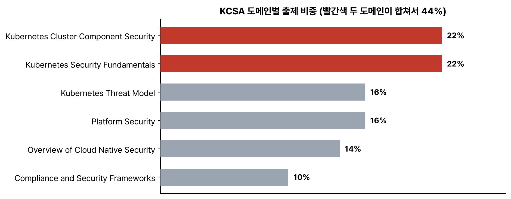

KCNA 정리를 9월에 마치고 KCSA로 넘어왔다. kubelet의 익명 인증을 끄라는 설정을 외우는 건 어렵지 않다. 왜 끄는지 설명하려면 누가 kubelet에 닿을 수 있고 인가를 통과한 뒤 무엇을 할 수 있는지까지 봐야 한다. 그래서 설정마다 막는 공격 경로를 같이 적었다.

## 요약

- 온라인 감독 객관식 60문항, 90분이다. 75% 이상이면 합격이고, 재시험 1회가 포함돼 있다. 자격은 2년 유효하다.
- KCSA에는 선수 조건이 없다.
- 6개 도메인이다. Overview of Cloud Native Security 14%, Kubernetes Cluster Component Security 22%, Kubernetes Security Fundamentals 22%, Kubernetes Threat Model 16%, Platform Security 16%, Compliance and Security Frameworks 10%.
- 구성 요소 보안과 보안 기초가 합쳐서 44%다. 항목 수는 구성 요소 보안이 11개로 가장 많다.

## 1. 시험 정보 (2026년 11월 확인)

| 항목 | 내용 |
|---|---|
| 형식 | 온라인 감독 객관식, 60문항 |
| 시간 | 90분 |
| 합격 기준 | 75% 이상 |
| 재시험 | 1회 포함 |
| 응시 기한 | 구매 후 12개월 |
| 유효 기간 | 2년 |
| 선수 조건 | 없음 |
| 응시료 | US$250(시험만 살 때) |

## 2. 출제 범위

_구성 요소 보안과 보안 기초가 22%씩, 합쳐서 44%다_

아래 표는 [Linux Foundation 시험 페이지](https://training.linuxfoundation.org/certification/kubernetes-and-cloud-native-security-associate-kcsa/)의 세부 항목 43개를 기준으로 했다(2026년 11월 확인). [CNCF PDF](https://github.com/cncf/curriculum/blob/main/KCSA%20Curriculum.pdf)에는 인가(Authorization)가 따로 적혀 있지 않아 42개다. [같은 저장소의 README](https://github.com/cncf/curriculum/blob/main/kcsa/README.md)는 도메인 이름과 비중도 다르다. 이 글에서는 Linux Foundation과 CNCF의 시험 안내 페이지가 일치하는 도메인 비중을 따른다.

| 도메인 | 비중 | 항목 | 정리한 글 |
|---|---:|---|---|
| Overview of Cloud Native Security | 14% | The 4Cs of Cloud Native Security, Cloud Provider and Infrastructure Security, Controls and Frameworks, Isolation Techniques, Artifact Repository and Image Security, Workload and Application Code Security | [클라우드 네이티브 보안 개요](../01-01-클라우드-네이티브-보안-개요/) |
| Kubernetes Cluster Component Security | 22% | API Server, Controller Manager, Scheduler, Kubelet, Container Runtime, KubeProxy, Pod, Etcd, Container Networking, Client Security, Storage | [클러스터 구성 요소 보안](../02-01-클러스터-구성-요소-보안/) |
| Kubernetes Security Fundamentals | 22% | Pod Security Standards, Pod Security Admission, Authentication, Authorization | [Pod Security와 인증, 인가](../03-01-pod-security와-인증-인가/) |
| | | Secrets, Isolation and Segmentation, Audit Logging, Network Policy | [Secret, 격리, 감사 로그, NetworkPolicy](../03-02-secret-격리-감사-로그-networkpolicy/) |
| Kubernetes Threat Model | 16% | Kubernetes Trust Boundaries and Data Flow, Persistence, Denial of Service, Malicious Code Execution and Compromised Applications in Containers, Attacker on the Network, Access to Sensitive Data, Privilege Escalation | [위협 모델](../04-01-위협-모델/) |
| Platform Security | 16% | Supply Chain Security, Image Repository, Observability, Service Mesh, PKI, Connectivity, Admission Control | [플랫폼 보안](../05-01-플랫폼-보안/) |
| Compliance and Security Frameworks | 10% | Compliance Frameworks, Threat Modeling Frameworks, Supply Chain Compliance, Automation and Tooling | [컴플라이언스와 보안 프레임워크](../06-01-컴플라이언스와-보안-프레임워크/) |

## 3. KCNA, CKS와 무엇이 다른가

| | KCNA | KCSA | CKS |
|---|---|---|---|
| 형식 | 객관식 | 객관식 | 실기 |
| 선수 조건 | 없음 | 없음 | CKA 합격 이력(만료된 자격도 인정) |
| 보안 범위 | Container Orchestration의 한 항목 | 시험 전체 | 시험 전체, 손으로 설정한다 |
| 묻는 수준 | 개념 구분 | 설정의 이유, 위협과 대응, 프레임워크 | 실제로 잠그고 고치기 |

## 4. 기준으로 삼은 자료

- 쿠버네티스 문서의 보안 항목: 보안 체크리스트, Pod Security Standards, RBAC 모범 사례, Secret 모범 사례, 멀티 테넌시, API 서버 우회 위험
- CNCF TAG Security and Compliance의 Cloud Native Security Whitepaper
- CIS Kubernetes Benchmark
- NSA와 CISA의 Kubernetes Hardening Guide
- MITRE ATT&CK Containers 매트릭스, Microsoft Threat Matrix for Kubernetes

시험 범위에는 4C가 명시되어 있다. 4C는 보호 대상을 Cloud, Cluster, Container, Code로 나누고, CNCF 백서는 보안을 개발부터 운영까지 수명 주기로 나눈다. 같은 통제도 두 관점에서 살펴볼 수 있다.

6개 도메인을 다 정리한 뒤에는 [복습 문제 30문항](../07-모의-문제-30문항/)과 [실전 모의고사 60문항](../08-실전-모의고사-60문항/)을 따로 만들었다.

## 참고 자료

- CNCF, KCSA 시험 안내: <https://www.cncf.io/training/certification/kcsa/>
- Linux Foundation, KCSA 시험 안내: <https://training.linuxfoundation.org/certification/kubernetes-and-cloud-native-security-associate-kcsa/>
- CNCF, KCSA 출제 범위 PDF: <https://github.com/cncf/curriculum/blob/main/KCSA%20Curriculum.pdf>
- Linux Foundation, 객관식 시험 자주 묻는 질문: <https://docs.linuxfoundation.org/tc-docs/certification/faq-mc>
- Linux Foundation, CKS 응시 조건 변경 안내: <https://training.linuxfoundation.org/blog/now-updated-cks-exam/>
- CNCF, Cloud Native Security Whitepaper: <https://www.cncf.io/reports/cloud-native-security-whitepaper/>
- Kubernetes 문서, 보안 체크리스트: <https://kubernetes.io/docs/concepts/security/security-checklist/>

