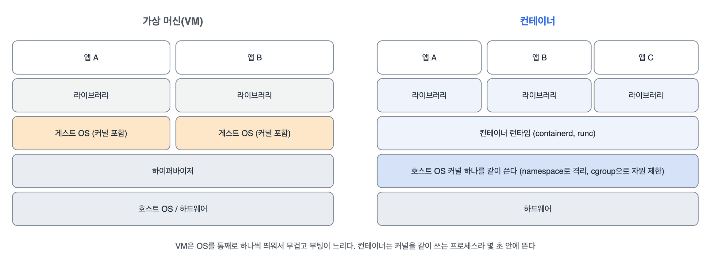

기초 개념 첫 번째. 쿠버네티스를 보기 전에 쿠버네티스가 다루는 대상인 컨테이너부터 다시 봤다. 도커 명령은 써 봤지만 컨테이너가 실제로 무엇인지는 설명하지 못하는 상태였다. 오늘 정리한 결론은 '컨테이너는 가벼운 VM이 아니라, 커널 기능으로 격리하고 자원을 묶어 둔 프로세스'라는 것이다.

## 요약

- 컨테이너는 호스트 커널을 같이 쓰는 프로세스다. namespace로 보이는 범위를 나누고, cgroup으로 쓸 수 있는 CPU·메모리를 묶는다.
- 이미지는 읽기 전용 레이어를 쌓은 것이고, 컨테이너는 그 위에 쓰기 레이어를 하나 얹은 것이다. 컨테이너를 지우면 쓰기 레이어도 사라진다.
- 이미지와 실행 방식은 OCI 표준이라서, 도커로 만든 이미지를 쿠버네티스(containerd)가 그대로 실행한다.
- 쿠버네티스의 kubelet은 CRI라는 약속된 방식으로 containerd 같은 런타임에 컨테이너 실행을 맡긴다.
- 서버 한 대에서는 런타임이면 충분하고, 여러 서버를 묶어 배치·복구·확장을 맡기려면 오케스트레이터가 필요하다.

## 1. 컨테이너는 격리된 프로세스


_VM은 앱마다 게스트 OS를 따로 띄우고, 컨테이너는 호스트 커널 하나를 같이 쓰면서 프로세스마다 보이는 범위와 자원만 나눈다_

리눅스 커널의 두 기능이 핵심이었다.

| 기능 | 하는 일 | 예 |
|---|---|---|
| namespace | 프로세스가 볼 수 있는 범위를 나눈다 | pid(프로세스 번호), net(네트워크 인터페이스·IP), mnt(파일시스템), uts(호스트 이름), ipc, user(uid 매핑), cgroup |
| cgroup | 쓸 수 있는 자원 양을 묶는다 | CPU 시간, 메모리 상한, 디스크 I/O |

그래서 컨테이너 안에서 ps를 치면 자기 프로세스만 보이고 메인 프로세스가 PID 1이다. 호스트에서 보면 그냥 프로세스 하나다. 메모리 상한을 넘으면 커널이 그 프로세스를 죽인다(OOM).

```bash
docker run -d --name web --memory 128m --cpus 0.5 nginx:1.27
docker exec web hostname                 # 컨테이너 ID 앞부분. uts namespace가 따로라서
docker top web                           # 호스트 쪽에서 본 nginx 프로세스들
docker stats --no-stream web             # MEM USAGE / LIMIT 열에 128MiB 상한이 보인다
docker rm -f web
```

맥에서는 Docker Desktop이 리눅스 VM을 하나 띄우고 그 안에서 컨테이너를 돌린다. 리눅스 컨테이너는 리눅스 커널이 있어야 돌기 때문이다.

## 2. 이미지와 레이어

이미지는 파일시스템 변경분(레이어)을 쌓은 것이다. Dockerfile의 RUN, COPY, ADD가 레이어를 하나씩 만든다.

```dockerfile
FROM python:3.12-slim
WORKDIR /app
COPY requirements.txt .
RUN pip install --no-cache-dir -r requirements.txt
COPY . .
CMD ["python", "app.py"]
```

의존성 설치를 소스 복사보다 먼저 두면, 소스만 바뀌었을 때 pip install 레이어를 캐시에서 그대로 쓴다. 레이어는 이미지끼리 공유돼서, 같은 베이스 이미지를 쓰는 이미지 열 개를 받아도 베이스는 한 번만 내려받는다.

| 개념 | 내용 |
|---|---|
| 레이어 | 읽기 전용 변경분. 해시로 구분하고 이미지끼리 공유한다 |
| 쓰기 레이어 | 컨테이너마다 하나. 지우면 사라지니 남길 데이터는 볼륨에 둔다 |
| 태그 | nginx:1.27 같은 사람이 붙인 이름. 같은 태그가 다른 이미지를 가리키게 바뀔 수 있다 |
| 다이제스트 | nginx@sha256:... 내용의 해시. 절대 안 바뀌어서 정확히 고정할 때 쓴다 |
| 레지스트리 | 이미지를 올리고 받는 저장소(Docker Hub, ECR, GHCR 등) |

```bash
docker image history nginx:1.27          # 레이어와 각 레이어를 만든 명령
docker image inspect nginx:1.27 --format '{{.RepoDigests}}'
```

## 3. 표준과 실행 구조: OCI, containerd, runc, CRI

도커 하나가 다 하는 줄 알았는데, 실제로는 여러 층으로 나뉘어 있었다.


flowchart TB
  subgraph DK["도커로 실행할 때"]
    direction LR
    A["docker CLI"] --> B["dockerd"] --> C1["containerd"] --> R1["runc"] --> X1["컨테이너"]
  end
  subgraph KB["쿠버네티스 노드에서"]
    direction LR
    K["kubelet"] -->|"CRI (gRPC)"| C2["containerd<br>또는 CRI-O"] --> R2["runc"] --> X2["컨테이너"]
  end
  DK ~~~ KB


| 이름 | 역할 |
|---|---|
| OCI | 이미지 형식, 실행 방식, 배포 방식을 정한 표준. 도커 이미지도 이 형식이다 |
| runc | OCI 실행 표준의 기본 구현. 실제로 namespace와 cgroup을 만들어 프로세스를 띄운다 |
| containerd | 이미지 받기, 저장, 컨테이너 생명주기를 관리하는 런타임 |
| CRI | kubelet이 런타임과 이야기하는 인터페이스. containerd와 CRI-O가 지원한다 |

쿠버네티스는 v1.24에서 도커 엔진을 런타임으로 쓰는 연결 코드(dockershim)를 뺐다. 그래도 도커로 만든 이미지는 OCI 이미지라 containerd에서 그대로 돈다. 바뀐 건 노드에서 컨테이너를 실행하는 프로그램뿐이다.

## 4. 그래서 오케스트레이션

서버 한 대에서는 런타임만으로 충분하다. 서버가 여러 대가 되면 '어디에 띄우고, 죽으면 어디에 다시 띄우고, 어떻게 서로 찾게 할지'를 정해 줄 누군가가 필요하다.

| 런타임이 하는 일 | 오케스트레이터가 더하는 일 |
|---|---|
| 이 서버에서 컨테이너 시작·중지 | 여러 서버 중 어디에 띄울지 고르기(스케줄링) |
| 컨테이너 하나의 자원 제한 | 클러스터 전체 자원 관리, 네임스페이스별 할당 |
| 재시작 정책(이 서버 안에서) | 서버가 죽으면 다른 서버에 다시 만들기 |
| 포트 연결 | 서비스 이름으로 찾기, 부하 분산 |
| 이미지 받기 | 롤링 업데이트, 롤백, 설정·비밀값 배포, 스토리지 연결 |

Docker Swarm, Nomad, AWS ECS 같은 오케스트레이터도 있지만, 클라우드마다 관리형 서비스가 있고 생태계가 가장 큰 쿠버네티스를 공부하기로 했다.

> **쉬운 설명**
>
> VM은 단독주택이다. 집마다 기초 공사(게스트 OS)를 따로 해서 튼튼하지만 짓는 데 오래 걸린다. 컨테이너는 아파트 한 세대다. 건물 골조(커널)는 같이 쓰고, 세대마다 벽(namespace)으로 나누고, 전기 차단기(cgroup)로 쓸 수 있는 양을 정해 둔다. 이미지는 세대 인테리어를 층층이 쌓아 둔 자재 묶음이라, 같은 자재(레이어)는 여러 세대가 같이 쓴다. 오케스트레이터는 아파트 단지 관리사무소다. 어느 동 몇 호에 입주시킬지, 고장 난 세대는 어디로 옮길지를 정한다.

## 헷갈렸던 것들

- 컨테이너는 VM이 아니다. 커널을 같이 쓰는 프로세스라서, 리눅스 컨테이너는 리눅스 커널 위에서만 돈다.
- 컨테이너 안에서 쓴 파일은 컨테이너를 지우면 사라진다. 남길 데이터는 볼륨에 둔다.
- 태그는 바뀔 수 있다. latest는 특히 언제 무엇을 가리킬지 모른다. 운영에서는 버전 태그나 다이제스트를 쓴다.
- dockershim이 빠졌다고 도커 이미지를 못 쓰는 게 아니다. 노드의 실행 프로그램이 containerd로 바뀐 것뿐이다.
- docker stop은 프로세스를 멈추는 것이고, 이미지는 그대로다. 이미지를 지우는 건 docker rmi다.

## 용어 정리

| 용어 | 뜻 |
|---|---|
| namespace(리눅스) | 프로세스가 볼 수 있는 자원 범위를 나누는 커널 기능. 쿠버네티스 네임스페이스와는 다른 것 |
| cgroup | 프로세스 묶음이 쓸 수 있는 CPU·메모리 양을 제한하는 커널 기능 |
| 이미지 레이어 | 이미지를 이루는 읽기 전용 파일시스템 변경분 |
| OCI | Open Container Initiative. 컨테이너 이미지·실행 표준 |
| 컨테이너 런타임 | 컨테이너를 실제로 만들고 실행하는 프로그램(containerd, CRI-O, runc) |
| CRI | Container Runtime Interface. kubelet과 런타임 사이의 약속 |

## 복습 문제

**1.** 메모리 상한 64MiB인 nginx:1.27 컨테이너를 띄우고, 상한이 걸렸는지 확인해라.

**2.** python:3.12-slim 이미지가 레이어 몇 개로 이루어졌는지, 각 레이어를 어떤 명령이 만들었는지 확인해라.

**3.** 쿠버네티스 노드에서 컨테이너를 실제로 띄우는 순서를 kubelet부터 적어라.

## 답과 풀이

1. docker stats의 LIMIT 열을 본다.

```bash
docker run -d --name small --memory 64m nginx:1.27
docker stats --no-stream small          # MEM USAGE / LIMIT: ... / 64MiB
docker rm -f small
```

2. history는 레이어와 그 레이어를 만든 명령을 위에서부터(최신 순) 보여 준다. 크기가 0B인 줄은 메타데이터만 바꾼 명령(ENV, CMD 등)이다.

```bash
docker pull python:3.12-slim
docker image history python:3.12-slim
```

3. kubelet → CRI(gRPC) → containerd(또는 CRI-O) → runc → 컨테이너 프로세스. runc가 namespace와 cgroup을 만든 뒤 프로세스를 실행한다.

## 참고 자료

- Kubernetes 문서, 컨테이너: <https://kubernetes.io/docs/concepts/containers/>
- Kubernetes 문서, 이미지: <https://kubernetes.io/docs/concepts/containers/images/>
- Kubernetes 문서, 컨테이너 런타임: <https://kubernetes.io/docs/setup/production-environment/container-runtimes/>
- Kubernetes 문서, CRI: <https://kubernetes.io/docs/concepts/architecture/cri/>
- Open Container Initiative: <https://opencontainers.org/>
- Docker 문서, 스토리지 드라이버와 레이어: <https://docs.docker.com/engine/storage/drivers/>
- Linux man page, namespaces(7): <https://man7.org/linux/man-pages/man7/namespaces.7.html>
- Linux man page, cgroups(7): <https://man7.org/linux/man-pages/man7/cgroups.7.html>
