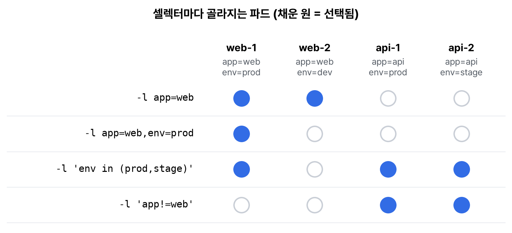

기초 개념 세 번째. 쿠버네티스에서 하는 일은 결국 오브젝트를 YAML로 적어서 API 서버에 내는 것이다. 그래서 오브젝트의 생김새, YAML에서 자주 틀리는 부분, 오브젝트끼리 서로를 찾는 방법(라벨과 셀렉터), 오브젝트를 나눠 담는 공간(네임스페이스)을 한 번에 정리했다.

## 요약

- 오브젝트는 apiVersion, kind, metadata, spec 네 부분으로 쓰고, status는 쿠버네티스가 채운다.
- spec은 내가 원하는 상태, status는 지금 상태다. 컨트롤러가 둘의 차이를 메운다.
- 직접 만들 때는 kubectl create --dry-run=client -o yaml로 뼈대를 뽑고, 파일로 관리하며 kubectl apply로 적용하는 게 편하다.
- 라벨은 오브젝트에 붙이는 이름표이고, 셀렉터는 라벨로 오브젝트를 고르는 조건이다. 서비스와 디플로이먼트가 파드를 찾는 방법이 이것이다.
- 네임스페이스는 이름이 겹치지 않게 나누는 공간이다. 네트워크를 막는 벽은 아니다.

## 1. 오브젝트의 생김새

```yaml
apiVersion: apps/v1
kind: Deployment
metadata:
  name: web
  namespace: default
  labels:
    app: web
spec:
  replicas: 2
  selector:
    matchLabels:
      app: web
  template:
    metadata:
      labels:
        app: web
    spec:
      containers:
      - name: nginx
        image: nginx:1.27
        ports:
        - containerPort: 80
```

| 필드 | 누가 쓰나 | 뜻 |
|---|---|---|
| apiVersion | 나 | 이 종류가 속한 API 그룹과 버전. Pod는 v1, Deployment는 apps/v1 |
| kind | 나 | 오브젝트 종류 |
| metadata | 나(일부는 시스템) | 이름, 네임스페이스, 라벨, 어노테이션. uid, 생성 시각 등은 시스템이 채운다 |
| spec | 나 | 원하는 상태 |
| status | 쿠버네티스 | 지금 상태. 컨트롤러와 kubelet이 계속 고친다 |

```bash
kubectl apply -f web.yaml
kubectl get deployment web -o yaml | sed -n '/^status:/,$p'   # availableReplicas, conditions 등
kubectl explain deployment.spec.strategy                      # 필드 설명은 explain으로
kubectl api-resources | grep -i deployment                    # 그룹·버전·짧은 이름(deploy)
```

## 2. YAML에서 자주 틀린 것

| 실수 | 결과 | 고치기 |
|---|---|---|
| 탭으로 들여쓰기 | 파싱 오류 | 공백 두 칸으로 맞춘다 |
| 목록에 - 를 빼먹음 | containers가 목록이 아니라는 오류 | 목록 항목마다 - 로 시작한다 |
| 환경 변수 값에 숫자를 그대로 | cannot unmarshal number ... of type string 같은 오류 | "8080"처럼 따옴표로 문자열로 쓴다 |
| 한 파일에 여러 오브젝트 | 하나만 적용된 것처럼 보임 | 오브젝트 사이에 --- 를 넣는다 |
| 들여쓰기 한 칸 차이 | 필드가 엉뚱한 부모 아래로 들어감 | kubectl apply --dry-run=server로 먼저 확인한다 |

환경 변수가 제일 자주 틀렸다. 포트 번호처럼 생긴 값도 env의 value는 문자열이어야 한다.

```yaml
    env:
    - name: PORT
      value: "8080"      # 따옴표가 없으면 숫자로 읽혀서 거절된다
    - name: DEBUG
      value: "true"      # true도 마찬가지
```

## 3. 명령형과 선언형

| 방식 | 예 | 쓰는 때 |
|---|---|---|
| 명령형 | kubectl run, kubectl create deployment, kubectl scale | 빠르게 하나 만들어 볼 때 |
| 명령형 + 파일 | kubectl create -f web.yaml | 파일로 한 번 만들 때. 이미 있으면 오류 |
| 선언형 | kubectl apply -f web.yaml (또는 -f 디렉터리) | 파일을 고쳐 가며 계속 맞출 때. 없으면 만들고 있으면 고친다 |

손으로 YAML을 처음부터 치지 않고 뼈대를 뽑아서 고쳤다.

```bash
kubectl create deployment web --image=nginx:1.27 --replicas=2 --dry-run=client -o yaml > web.yaml
kubectl diff -f web.yaml        # 적용하면 무엇이 바뀌는지 미리 본다
kubectl apply -f web.yaml
```

## 4. 라벨과 셀렉터

라벨은 키=값 이름표다. 쿠버네티스는 오브젝트끼리 이름이 아니라 라벨로 찾는다. 디플로이먼트는 selector에 맞는 파드를 자기 것으로 보고, 서비스는 selector에 맞는 파드로 트래픽을 보낸다.


_파드 네 개에 app과 env 라벨을 붙이고 셀렉터 네 가지로 골라 봤다. 쉼표는 AND이고, in은 값 목록 중 하나에 맞으면 고른다_

```bash
kubectl run web-1 --image=nginx:1.27 --labels=app=web,env=prod
kubectl get pods --show-labels
kubectl get pods -l app=web,env=prod
kubectl get pods -l 'env in (prod,stage)'
kubectl get pods -L app,env                  # 라벨 값을 열로 보기
kubectl label pod web-1 tier=frontend        # 라벨 추가(바꿀 때는 --overwrite)
kubectl label pod web-1 tier-                # 라벨 지우기
```

| 구분 | 라벨 | 어노테이션 |
|---|---|---|
| 용도 | 고르고 묶는 데 쓴다 | 설명, 도구용 정보를 남긴다 |
| 셀렉터로 찾기 | 된다 | 안 된다 |
| 예 | app=web, env=prod | 변경 사유, 빌드 번호, 도구 설정 |

권장 라벨로 app.kubernetes.io/name, app.kubernetes.io/version, app.kubernetes.io/part-of 같은 이름이 정해져 있다. Helm 차트들이 이 라벨을 쓴다.

## 5. 네임스페이스

```bash
kubectl get namespaces
# default, kube-system, kube-public, kube-node-lease (+ kind는 local-path-storage)
kubectl create namespace dev
kubectl get pods -n dev
kubectl get pods -A                                        # 모든 네임스페이스
kubectl config set-context --current --namespace=dev       # 기본 네임스페이스 바꾸기
kubectl api-resources --namespaced=false                   # 네임스페이스에 속하지 않는 종류
```

| 기본 네임스페이스 | 용도 |
|---|---|
| default | 따로 정하지 않으면 여기에 만들어진다 |
| kube-system | 쿠버네티스 구성 요소(CoreDNS, kube-proxy 등) |
| kube-public | 누구나 읽을 수 있는 공개 정보 |
| kube-node-lease | 노드가 살아 있다는 신호(Lease)를 두는 곳 |

노드, 네임스페이스 자체, PersistentVolume, StorageClass, ClusterRole 같은 건 클러스터 전체에 하나라서 네임스페이스가 없다. 네임스페이스를 지우면 그 안의 오브젝트가 전부 지워진다.

> **쉬운 설명**
>
> 오브젝트는 주문서다. apiVersion과 kind는 '어떤 양식, 몇 판'인지, metadata는 주문서 번호와 이름표, spec은 주문 내용이다. status 칸은 가게가 처리하면서 채운다. 라벨은 주문서에 붙이는 색깔 포스트잇이라서 '빨간 포스트잇 붙은 주문서 다 가져와'처럼 고를 때 쓴다(셀렉터). 네임스페이스는 부서별 서류함이다. 영업팀 서류함과 개발팀 서류함에 같은 이름의 서류가 있어도 되지만, 서류함은 잠금장치가 아니라서 서로 못 보게 막아 주지는 않는다.

## 헷갈렸던 것들

- status는 내가 쓰는 칸이 아니다. YAML에 써도 무시되거나 덮어써진다.
- 디플로이먼트의 selector는 만든 뒤 바꿀 수 없다. 그리고 template의 라벨과 맞아야 한다.
- 환경 변수 value는 문자열이다. 숫자, true도 따옴표로 감싼다.
- create는 이미 있으면 실패하고, apply는 있으면 고친다.
- 네임스페이스는 이름 공간일 뿐 네트워크 격리가 아니다. 다른 네임스페이스 파드와도 기본으로 통신된다. 막으려면 NetworkPolicy를 쓴다.
- 라벨로는 고를 수 있고 어노테이션으로는 못 고른다.

## 용어 정리

| 용어 | 뜻 |
|---|---|
| 오브젝트 | 클러스터에 저장되는 '원하는 상태'의 기록(파드, 디플로이먼트, 서비스 등) |
| spec | 원하는 상태 |
| status | 실제 상태 |
| 라벨 | 오브젝트에 붙이는 키=값 이름표 |
| 셀렉터 | 라벨 조건으로 오브젝트를 고르는 식 |
| 어노테이션 | 고르는 데는 쓰지 않는 부가 정보 |
| 네임스페이스 | 오브젝트 이름이 겹치지 않게 나누는 공간 |

## 복습 문제

**1.** 디플로이먼트 api(nginx:1.27, 복제본 3개)의 YAML 뼈대를 파일로 뽑고, 그 안에서 원하는 상태가 적힌 부분과 비어 있는 status를 찾아라.

**2.** 파드 세 개를 각각 app=shop,env=prod / app=shop,env=dev / app=blog,env=prod 라벨로 만들고, env가 prod인 파드와 app이 shop이 아닌 파드를 각각 골라라.

**3.** 네임스페이스 lab을 만들어 현재 컨텍스트의 기본 네임스페이스로 바꾸고, 네임스페이스에 속하지 않는 리소스 종류를 다섯 개만 적어라.

## 답과 풀이

1. dry-run으로 뽑은 파일에는 spec이 채워져 있고 status는 빈 객체다.

```bash
kubectl create deployment api --image=nginx:1.27 --replicas=3 --dry-run=client -o yaml > api.yaml
grep -n -A3 '^spec:' api.yaml
grep -n '^status' api.yaml              # status: {}
```

2. 쉼표 없이 조건 하나씩 쓰면 된다. !=는 그 라벨이 아예 없는 파드도 고른다.

```bash
kubectl run p1 --image=nginx:1.27 --labels=app=shop,env=prod
kubectl run p2 --image=nginx:1.27 --labels=app=shop,env=dev
kubectl run p3 --image=nginx:1.27 --labels=app=blog,env=prod
kubectl get pods -l env=prod            # p1, p3
kubectl get pods -l 'app!=shop'         # p3
```

3. 예: nodes, namespaces, persistentvolumes, storageclasses, clusterroles.

```bash
kubectl create namespace lab
kubectl config set-context --current --namespace=lab
kubectl config view --minify | grep namespace
kubectl api-resources --namespaced=false
```

## 참고 자료

- Kubernetes 문서, 쿠버네티스 오브젝트: <https://kubernetes.io/docs/concepts/overview/working-with-objects/>
- Kubernetes 문서, 오브젝트 관리 방법: <https://kubernetes.io/docs/concepts/overview/working-with-objects/object-management/>
- Kubernetes 문서, 라벨과 셀렉터: <https://kubernetes.io/docs/concepts/overview/working-with-objects/labels/>
- Kubernetes 문서, 권장 라벨: <https://kubernetes.io/docs/concepts/overview/working-with-objects/common-labels/>
- Kubernetes 문서, 네임스페이스: <https://kubernetes.io/docs/concepts/overview/working-with-objects/namespaces/>
- Kubernetes 문서, 어노테이션: <https://kubernetes.io/docs/concepts/overview/working-with-objects/annotations/>
