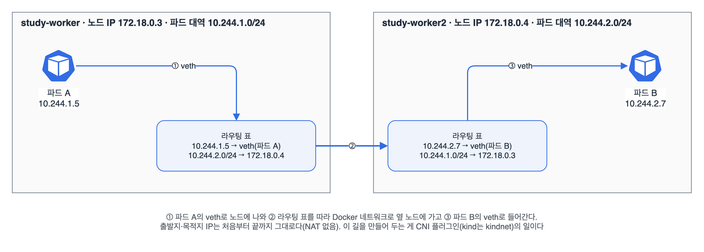

서비스나 인그레스를 보기 전에, 그 아래에 깔린 파드 네트워크부터 정리했다. 쿠버네티스는 '파드끼리는 이렇게 통신돼야 한다'는 약속만 정해 두고, 실제 구현은 CNI 플러그인에 맡긴다. kind에서 파드 IP가 어떻게 나뉘고 패킷이 어떤 길로 가는지 노드 안을 직접 들여다봤다.

## 요약

- 쿠버네티스 네트워크가 푸는 문제는 네 가지다. 컨테이너끼리(파드 안), 파드끼리, 파드에서 서비스로, 외부에서 서비스로.
- 약속은 세 줄이다. 파드마다 클러스터에서 유일한 IP를 받고, 어느 노드의 파드와도 NAT 없이 통신하고, 노드의 에이전트는 자기 노드 파드와 통신할 수 있다.
- 노드마다 파드 대역(podCIDR)을 하나씩 받고, 파드는 그 대역에서 IP를 받는다. kind는 10.244.0.0/16을 노드당 /24로 나눈다.
- 이 길을 실제로 만드는 게 CNI 플러그인이다. 파드가 생길 때 kubelet이 CNI를 불러 veth를 만들고 IP를 주고 경로를 깐다.
- 파드 IP는 파드가 다시 만들어지면 바뀐다. 그래서 고정 주소가 필요하면 서비스를 쓴다(다음 글).

## 1. 쿠버네티스 네트워크가 푸는 네 가지 문제

| 문제 | 해결 방법 | 정리한 글 |
|---|---|---|
| 같은 파드의 컨테이너끼리 | 네트워크 namespace를 공유하니 localhost | 파드 |
| 파드끼리(노드가 달라도) | 파드마다 IP, NAT 없는 평평한 네트워크(CNI) | 이번 글 |
| 파드에서 서비스로 | 고정 가상 IP와 DNS 이름(Service, kube-proxy, CoreDNS) | 다음 두 글 |
| 클러스터 밖에서 서비스로 | NodePort, LoadBalancer, Ingress | 서비스, 인그레스 글 |

## 2. 네트워크 모델의 약속

| 약속 | 뜻 |
|---|---|
| 파드마다 고유 IP | 파드 안 컨테이너들은 이 IP 하나를 같이 쓴다 |
| 파드끼리 NAT 없이 | 파드 A가 본 자기 IP와, 파드 B가 받은 패킷의 출발지 IP가 같다 |
| 노드 에이전트와 파드 | kubelet 같은 노드의 프로세스는 그 노드의 모든 파드와 통신할 수 있다 |

도커만 쓸 때는 컨테이너 포트를 호스트 포트로 매핑(-p 8080:80)해야 했고 포트가 겹치지 않게 신경 써야 했다. 쿠버네티스에서는 파드마다 IP가 따로라서, 모든 nginx 파드가 각자 80번을 써도 된다. 파드를 작은 VM처럼 다룰 수 있다는 게 이 약속의 장점이다.

## 3. kind에서 파드 IP 따라가기

```bash
kubectl get nodes -o custom-columns=NAME:.metadata.name,IP:.status.addresses[0].address,PODCIDR:.spec.podCIDR
```

```
NAME                  IP           PODCIDR
study-control-plane   172.18.0.2   10.244.0.0/24
study-worker          172.18.0.3   10.244.1.0/24
study-worker2         172.18.0.4   10.244.2.0/24
```

노드 IP는 kind가 만든 Docker 네트워크의 주소이고(내 환경에서는 172.18.0.x), 파드 대역은 노드마다 /24씩 나뉘어 있다. 서로 다른 노드에 파드를 하나씩 띄워 ping을 보냈다.

```bash
kubectl run a --image=busybox:1.36 --overrides='{"spec":{"nodeName":"study-worker"}}' -- sleep 3600
kubectl run b --image=busybox:1.36 --overrides='{"spec":{"nodeName":"study-worker2"}}' -- sleep 3600
kubectl get pods a b -o wide                     # a는 10.244.1.x, b는 10.244.2.x
kubectl exec a -- ping -c 2 <b의 IP>             # 응답이 온다
docker exec study-worker ip route                # 노드 안의 경로
```

```
default via 172.18.0.1 dev eth0
10.244.0.0/24 via 172.18.0.2 dev eth0
10.244.1.5 dev vethxxxxxxxx scope host
10.244.2.0/24 via 172.18.0.4 dev eth0
172.18.0.0/16 dev eth0 proto kernel scope link src 172.18.0.3
```

경로 표가 그대로 답이었다. 자기 노드의 파드는 veth로 바로 가고, 다른 노드의 파드 대역은 그 노드의 IP로 보낸다.


_kindnet은 노드마다 다른 노드의 파드 대역을 그 노드 IP로 보내는 경로를 깔아 둔다. 다른 CNI는 이 부분을 VXLAN이나 BGP, eBPF로 구현한다_

## 4. CNI가 하는 일

파드가 만들어질 때 kubelet이 컨테이너 런타임에 파드 샌드박스(pause 컨테이너)를 만들게 하고, 런타임이 CNI 플러그인을 불러 네트워크를 붙인다.

| 단계 | 하는 일 |
|---|---|
| veth 만들기 | 파드 네트워크 namespace와 노드를 잇는 가상 케이블 한 쌍을 만든다 |
| IP 주기(IPAM) | 노드의 파드 대역에서 IP 하나를 고른다 |
| 경로 깔기 | 노드 사이에서 파드 대역으로 가는 길을 만든다(라우팅, 오버레이 등) |
| 정리 | 파드가 지워지면 IP를 돌려받고 veth를 지운다 |

```bash
docker exec study-worker ls /etc/cni/net.d       # 10-kindnet.conflist
docker exec study-worker ls /opt/cni/bin         # 플러그인 실행 파일들
```

| CNI | 방식 | 특징 |
|---|---|---|
| kindnet | 노드 간 단순 라우팅 | kind 전용의 가벼운 플러그인 |
| Flannel | VXLAN 오버레이가 기본 | 설정이 간단하다. NetworkPolicy는 직접 지원하지 않는다 |
| Calico | BGP 라우팅, IP-in-IP·VXLAN | NetworkPolicy 지원, 대규모에서 많이 쓴다 |
| Cilium | eBPF | NetworkPolicy, 관측 기능, kube-proxy 대체까지 한다 |
| AWS VPC CNI | VPC IP를 파드에 직접 | EKS 기본. 파드가 VPC 주소를 받는다 |

> **쉬운 설명**
>
> 클러스터는 아파트 단지이고 노드는 동, 파드는 세대다. 동마다 호수 범위(파드 대역)가 정해져 있어서 101동은 1xx호, 102동은 2xx호를 쓴다. 세대마다 주소가 따로라 옆 세대와 같은 우편함 번호(포트)를 써도 된다. 다른 동 세대에 편지를 보내면 주소를 바꿔 적지 않고(NAT 없이) 그대로 배달된다. 단지 안에 길을 내고 호수를 배정하는 공사 업체가 CNI다. 업체마다 길 내는 방식(라우팅, 터널, eBPF)이 다를 뿐 '어느 세대든 주소 그대로 배달'이라는 약속은 같다.

## 헷갈렸던 것들

- 파드 IP는 고정이 아니다. 파드가 다시 만들어지면 바뀐다. 고정 주소는 서비스로 얻는다.
- 파드 대역(10.244.0.0/16)과 서비스 대역(kind 기본 10.96.0.0/16)은 다르다. 서비스 IP는 가상 주소라 경로 표에 없다.
- 노드 IP와 파드 IP는 다르다. hostNetwork: true인 파드만 노드 IP를 그대로 쓴다.
- 쿠버네티스는 네트워크를 직접 구현하지 않는다. CNI 플러그인이 없으면 노드가 NotReady로 남는다.
- NetworkPolicy는 오브젝트를 만들어도, CNI가 지원해야 실제로 막힌다.

## 용어 정리

| 용어 | 뜻 |
|---|---|
| 네트워크 모델 | 파드마다 IP, 파드끼리 NAT 없는 통신이라는 쿠버네티스의 약속 |
| podCIDR | 노드 하나에 배정된 파드 IP 대역 |
| CNI | Container Network Interface. 파드에 네트워크를 붙이는 플러그인 규격 |
| veth | 두 네트워크 namespace를 잇는 가상 이더넷 한 쌍 |
| 오버레이 | 노드 네트워크 위에 패킷을 한 번 더 감싸서 보내는 방식(VXLAN 등) |
| IPAM | IP Address Management. 대역에서 IP를 나눠 주고 회수하는 일 |

## 복습 문제

**1.** 노드마다 배정된 파드 대역을 확인하고, 새로 만든 파드의 IP가 어느 노드 대역에서 나왔는지 맞혀라.

**2.** 서로 다른 노드에 있는 파드 둘 사이에 ping이 되는지 확인하고, 그 경로가 노드의 라우팅 표 어디에 있는지 찾아라.

**3.** 파드를 지우고 같은 이름으로 다시 만들면 IP가 같은지 확인해라.

## 답과 풀이

1. -o wide의 IP 앞 세 자리가 그 파드가 있는 노드의 podCIDR와 같다.

```bash
kubectl get nodes -o custom-columns=NAME:.metadata.name,PODCIDR:.spec.podCIDR
kubectl run c --image=nginx:1.27
kubectl get pod c -o wide
```

2. 상대 노드의 파드 대역이 상대 노드 IP로 가는 줄을 찾는다.

```bash
kubectl exec a -- ping -c 2 $(kubectl get pod b -o jsonpath='{.status.podIP}')
docker exec study-worker ip route | grep 10.244.2.0
```

3. 대부분 다른 IP를 받는다. 그래서 파드 IP를 설정 파일에 적어 두면 안 된다.

```bash
kubectl get pod c -o jsonpath='{.status.podIP}{"\n"}'
kubectl delete pod c && kubectl run c --image=nginx:1.27
kubectl get pod c -o jsonpath='{.status.podIP}{"\n"}'
```

## 참고 자료

- Kubernetes 문서, 서비스·로드 밸런싱·네트워킹(네트워크 모델): <https://kubernetes.io/docs/concepts/services-networking/>
- Kubernetes 문서, 클러스터 네트워킹: <https://kubernetes.io/docs/concepts/cluster-administration/networking/>
- Kubernetes 문서, 네트워크 플러그인: <https://kubernetes.io/docs/concepts/extend-kubernetes/compute-storage-net/network-plugins/>
- CNI 명세: <https://github.com/containernetworking/cni>
- kind 문서, 네트워킹 설정: <https://kind.sigs.k8s.io/docs/user/configuration/#networking>
