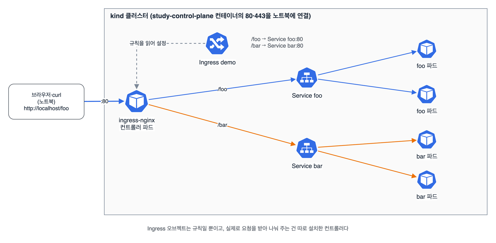

서비스마다 NodePort나 LoadBalancer를 하나씩 열면 포트와 로드 밸런서가 서비스 수만큼 늘어난다. 인그레스는 입구를 하나만 두고, 도메인과 경로를 보고 뒤의 서비스로 나눠 준다. kind에서 ingress-nginx를 설치해 /foo와 /bar를 다른 서비스로 보내 봤다.

## 요약

- 인그레스는 HTTP·HTTPS 요청을 호스트 이름과 경로로 나눠 서비스로 보내는 규칙이다.
- 인그레스 오브젝트만 만들면 아무 일도 안 일어난다. 규칙을 읽어 실제로 요청을 받는 인그레스 컨트롤러(ingress-nginx 등)를 따로 설치해야 한다.
- ingressClassName으로 어느 컨트롤러가 이 인그레스를 맡을지 정한다.
- 경로마다 pathType(Prefix, Exact, ImplementationSpecific)을 꼭 쓴다.
- TLS는 인증서를 담은 Secret(kubernetes.io/tls)을 tls 항목에 지정한다.

## 1. kind에서 인그레스 준비하기

kind 노드는 컨테이너라서, 노트북의 80·443 포트를 노드 컨테이너에 연결해 둬야 브라우저로 들어갈 수 있다. 포트 연결은 클러스터를 만들 때만 정할 수 있어서 study 클러스터를 지우고 다시 만들었다. kind 문서의 인그레스 설정을 그대로 따랐다.

```yaml
kind: Cluster
apiVersion: kind.x-k8s.io/v1alpha4
nodes:
- role: control-plane
  kubeadmConfigPatches:
  - |
    kind: InitConfiguration
    nodeRegistration:
      kubeletExtraArgs:
        node-labels: "ingress-ready=true"
  extraPortMappings:
  - containerPort: 80
    hostPort: 80
    protocol: TCP
  - containerPort: 443
    hostPort: 443
    protocol: TCP
- role: worker
- role: worker
```

```bash
kind delete cluster --name study
kind create cluster --name study --config kind-ingress.yaml
kubectl apply -f https://kind.sigs.k8s.io/examples/ingress/deploy-ingress-nginx.yaml
kubectl wait --namespace ingress-nginx --for=condition=ready pod \
  --selector=app.kubernetes.io/component=controller --timeout=90s
kubectl get ingressclass            # nginx
```

kind용 ingress-nginx 매니페스트는 컨트롤러를 ingress-ready=true 라벨이 있는 노드에 띄우고 그 노드의 80·443을 직접 쓰게 돼 있다. 그래서 위 설정에서 컨트롤 플레인 노드에 라벨과 포트 연결을 같이 줬다.

## 2. 경로로 나누기

뒤에 둘 서비스 두 개를 만들었다. 서비스 실습 때 쓴 agnhost serve-hostname이라 응답에 파드 이름이 찍혀서 어느 서비스로 갔는지 바로 보인다.

```bash
for app in foo bar; do
  kubectl create deployment $app --image=registry.k8s.io/e2e-test-images/agnhost:2.40 --replicas=2 -- /agnhost serve-hostname
  kubectl expose deployment $app --port=80 --target-port=9376
done
```

```yaml
apiVersion: networking.k8s.io/v1
kind: Ingress
metadata:
  name: demo
spec:
  ingressClassName: nginx
  rules:
  - http:
      paths:
      - path: /foo
        pathType: Prefix
        backend:
          service:
            name: foo
            port:
              number: 80
      - path: /bar
        pathType: Prefix
        backend:
          service:
            name: bar
            port:
              number: 80
```

```bash
kubectl apply -f demo-ingress.yaml
curl localhost/foo          # foo-xxxxxxxxxx-xxxxx
curl localhost/bar          # bar-xxxxxxxxxx-xxxxx
curl -i localhost/nothing   # 404. 맞는 규칙이 없으면 컨트롤러의 기본 응답
kubectl describe ingress demo
```


_노트북의 80번으로 들어온 요청을 ingress-nginx 컨트롤러가 받아, Ingress 규칙대로 /foo는 foo 서비스로, /bar는 bar 서비스로 보낸다_

| pathType | 맞는 방식 |
|---|---|
| Prefix | 경로를 / 단위로 나눠 앞부분이 같으면 맞는다. /foo는 /foo, /foo/a와 맞고 /foobar와는 안 맞는다 |
| Exact | 정확히 같아야 맞는다 |
| ImplementationSpecific | 컨트롤러가 정한 방식을 따른다 |

## 3. 호스트로 나누기와 TLS

규칙에 host를 쓰면 도메인별로 나눌 수 있다. DNS가 없으니 Host 헤더를 직접 넣어 시험했다.

```yaml
apiVersion: networking.k8s.io/v1
kind: Ingress
metadata:
  name: by-host
spec:
  ingressClassName: nginx
  tls:
  - hosts:
    - shop.example.com
    secretName: shop-tls
  rules:
  - host: shop.example.com
    http:
      paths:
      - path: /
        pathType: Prefix
        backend:
          service:
            name: foo
            port:
              number: 80
```

```bash
openssl req -x509 -nodes -days 30 -newkey rsa:2048 -subj '/CN=shop.example.com' -keyout tls.key -out tls.crt
kubectl create secret tls shop-tls --cert=tls.crt --key=tls.key
kubectl apply -f by-host.yaml
curl -i -H 'Host: shop.example.com' localhost/                        # 308. TLS를 건 호스트라 HTTPS로 돌려보낸다
curl -k --resolve shop.example.com:443:127.0.0.1 https://shop.example.com/   # 자체 서명 인증서라 -k
```

TLS를 건 호스트에 HTTP로 들어오면 ingress-nginx가 기본으로 HTTPS 주소로 308 리다이렉트를 돌려준다. 처음에 foo가 안 나와서 한참 헤맸다.

공부하다 보니 인그레스의 다음 세대로 Gateway API가 자리 잡고 있다는 걸 알게 됐다. 2023년 10월에 1.0이 GA가 됐고, 인프라 담당자(Gateway)와 앱 담당자(HTTPRoute)의 역할을 나누고 가중치 분배 같은 기능을 표준으로 넣었다. 기초가 끝나면 따로 보기로 했다.

> **쉬운 설명**
>
> 인그레스는 큰 건물 1층 로비의 안내 데스크다. 손님(요청)은 정문(80·443) 하나로만 들어오고, 안내 데스크가 '쇼핑몰 가시는 분은 3층(foo), 병원 가시는 분은 5층(bar)' 하고 행선지(경로, 호스트)를 보고 보낸다. Ingress 오브젝트는 데스크에 붙여 둔 안내표이고, 실제로 손님을 안내하는 직원이 인그레스 컨트롤러다. 안내표만 붙이고 직원을 뽑지 않으면 아무도 안내받지 못한다.

## 헷갈렸던 것들

- 인그레스 컨트롤러는 쿠버네티스에 기본으로 들어 있지 않다. 따로 설치해야 한다.
- ingressClassName이 없거나 틀리면 아무 컨트롤러도 맡지 않아 인그레스가 무시된다.
- pathType은 필수다. 예전 자료(v1beta1)의 serviceName·servicePort는 이제 service.name·service.port.number다.
- 인그레스가 가리키는 서비스는 인그레스와 같은 네임스페이스에 있어야 한다.
- 인그레스는 HTTP·HTTPS용이다. TCP·UDP를 그대로 넘기려면 서비스(LoadBalancer, NodePort)를 쓴다.
- kind는 포트 연결을 클러스터 생성 때만 정할 수 있다.

## 용어 정리

| 용어 | 뜻 |
|---|---|
| 인그레스 | 호스트·경로별로 HTTP 요청을 서비스에 나눠 보내는 규칙 오브젝트 |
| 인그레스 컨트롤러 | 인그레스 규칙을 읽어 실제로 요청을 받아 전달하는 프로그램(ingress-nginx 등) |
| IngressClass | 어떤 컨트롤러가 인그레스를 처리할지 나타내는 오브젝트 |
| pathType | 경로를 어떻게 비교할지 정하는 필드 |
| TLS Secret | 인증서와 키를 담은 kubernetes.io/tls 타입 Secret |
| Gateway API | 인그레스의 후속으로 만든 역할 분리형 라우팅 API |

## 참고 자료

- Kubernetes 문서, 인그레스: <https://kubernetes.io/docs/concepts/services-networking/ingress/>
- Kubernetes 문서, 인그레스 컨트롤러: <https://kubernetes.io/docs/concepts/services-networking/ingress-controllers/>
- kind 문서, 인그레스: <https://kind.sigs.k8s.io/docs/user/ingress/>
- ingress-nginx 문서: <https://kubernetes.github.io/ingress-nginx/>
- Gateway API: <https://gateway-api.sigs.k8s.io/>
