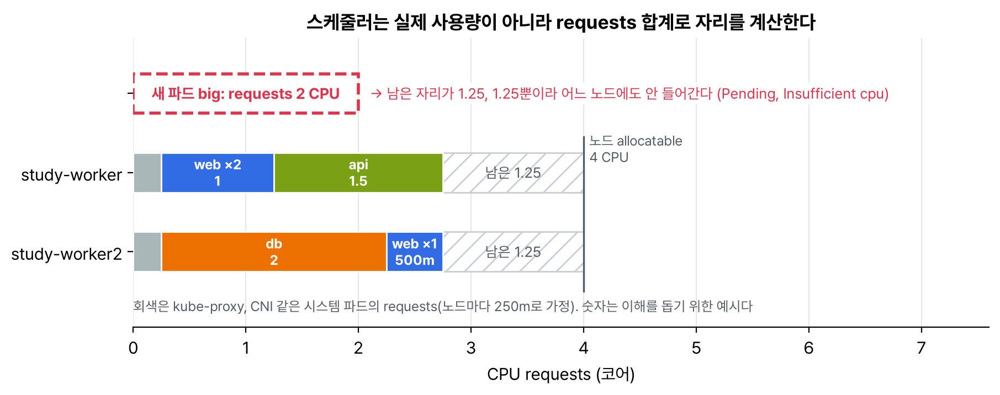

보안과 운영 맛보기 두 번째. 지금까지 만든 파드에는 자원 설정도 상태 검사도 없었다. 운영에서는 이 두 가지가 기본이라고 해서 따로 정리했다. 스케줄러가 노드를 고를 때 보는 숫자(requests)와, kubelet이 파드가 건강한지 판단하는 신호(프로브)다.

## 요약

- requests는 '최소 이만큼은 필요하다'는 예약이고, 스케줄러는 실제 사용량이 아니라 requests 합계로 노드에 자리가 있는지 본다.
- limits는 상한이다. CPU는 넘으면 느려지고(스로틀링), 메모리는 넘으면 컨테이너가 죽는다(OOMKilled).
- requests와 limits를 어떻게 줬는지에 따라 QoS 클래스(Guaranteed, Burstable, BestEffort)가 정해지고, 노드 메모리가 모자랄 때 BestEffort부터 쫓겨난다.
- readinessProbe가 실패하면 서비스 엔드포인트에서 빠지고, livenessProbe가 실패하면 컨테이너가 재시작된다. startupProbe는 기동이 느린 앱을 기다려 준다.
- 프로브는 kubelet이 노드에서 실행한다.

## 1. requests와 limits

```yaml
    resources:
      requests:
        cpu: 100m          # 0.1 코어
        memory: 64Mi
      limits:
        memory: 128Mi
```

| 항목 | requests | limits |
|---|---|---|
| 누가 쓰나 | 스케줄러(자리 계산), kubelet(최소 보장) | kubelet과 커널(cgroup)이 상한을 건다 |
| CPU | 이만큼은 보장 | 넘으면 스로틀링. 죽지는 않는다 |
| 메모리 | 이만큼은 보장 | 넘으면 OOMKilled로 죽고 재시작된다 |
| 안 쓰면 | 0으로 본다(LimitRange 기본값이 없으면) | 상한이 없다 |

단위는 CPU가 코어(1 = vCPU 하나, 500m = 0.5), 메모리가 바이트다. Mi, Gi는 1024 단위이고 M, G는 1000 단위라 128M과 128Mi는 다르다.


_두 노드 모두 실제로는 한가할 수 있어도, requests 합계로 남은 자리가 1.25코어씩이라 2코어를 요청한 파드는 어디에도 못 간다_

```bash
kubectl describe node study-worker | sed -n '/Allocatable:/,/System Info:/p'
kubectl describe node study-worker | sed -n '/Allocated resources:/,/Events:/p'   # requests 합계와 비율
kubectl run big --image=nginx:1.27 --overrides='{"spec":{"containers":[{"name":"big","image":"nginx:1.27","resources":{"requests":{"cpu":"100"}}}]}}'
kubectl describe pod big | tail -3
# 0/3 nodes are available: 1 node(s) had untolerated taint {node-role.kubernetes.io/control-plane: }, 2 Insufficient cpu. ...
kubectl delete pod big
```

CPU 100코어를 요청해서 일부러 Pending을 만들었다. 이벤트에 노드마다 왜 안 되는지가 다 나온다.

## 2. QoS 클래스

| QoS | 조건 | 메모리가 모자랄 때 |
|---|---|---|
| Guaranteed | 모든 컨테이너가 CPU·메모리 requests와 limits를 같게 줬다 | 가장 마지막에 쫓겨난다 |
| Burstable | requests나 limits를 일부만 줬다 | 중간 |
| BestEffort | 아무것도 안 줬다 | 가장 먼저 쫓겨난다 |

```bash
kubectl get pod <파드> -o jsonpath='{.status.qosClass}'
```

## 3. 프로브 세 가지

| 프로브 | 실패하면 | 쓰는 때 |
|---|---|---|
| readinessProbe | 서비스 엔드포인트에서 뺀다. 재시작은 안 한다 | 아직 준비 안 됨, 잠깐 과부하 |
| livenessProbe | 컨테이너를 재시작한다 | 프로세스는 살아 있는데 멈춰 버린 경우 |
| startupProbe | 허용 시간이 지나면 재시작한다. 성공 전까지 나머지 프로브를 막는다 | 기동이 오래 걸리는 앱 |

검사 방법은 httpGet(200~399면 성공), tcpSocket(연결되면 성공), exec(종료 코드 0이면 성공), grpc 네 가지다. readiness가 서비스와 어떻게 이어지는지 직접 확인했다.

```yaml
apiVersion: apps/v1
kind: Deployment
metadata:
  name: web
spec:
  replicas: 3
  selector:
    matchLabels:
      app: web
  template:
    metadata:
      labels:
        app: web
    spec:
      containers:
      - name: nginx
        image: nginx:1.27
        ports:
        - containerPort: 80
        resources:
          requests:
            cpu: 100m
            memory: 64Mi
          limits:
            memory: 128Mi
        readinessProbe:
          httpGet:
            path: /
            port: 80
          periodSeconds: 2
        livenessProbe:
          tcpSocket:
            port: 80
          periodSeconds: 10
```

```bash
kubectl apply -f web-probe.yaml
kubectl expose deployment web --port=80
kubectl get endpoints web                                  # 파드 IP 3개
POD=$(kubectl get pod -l app=web -o name | head -1)
kubectl exec $POD -- rm /usr/share/nginx/html/index.html   # / 가 403이 된다
kubectl get pods -l app=web                                # 하나가 READY 0/1, RESTARTS는 0
kubectl get endpoints web                                  # 파드 IP 2개
kubectl exec $POD -- sh -c 'echo back > /usr/share/nginx/html/index.html'
kubectl get endpoints web                                  # 다시 3개
```

준비 안 된 파드는 재시작되지 않고 트래픽만 안 받는다. liveness는 포트만 보게 해 둬서 nginx 프로세스가 살아 있는 한 재시작하지 않았다. liveness를 readiness처럼 민감하게 걸면 잠깐 느려질 때마다 재시작돼서 더 나빠진다고 한다.

> **쉬운 설명**
>
> requests는 식당 예약 인원이다. 식당(노드)은 실제로 몇 명이 왔는지가 아니라 예약 인원으로 남은 자리를 계산한다. 그래서 다들 넉넉하게 예약해 두면 홀이 비어 있어도 새 손님을 못 받는다. limits는 1인당 주문 상한인데, 음료(CPU)는 상한을 넘으면 천천히 내주고, 음식(메모리)은 넘으면 그 손님을 내보낸다. readiness는 '주문 가능' 팻말이라 팻말을 내리면 손님만 안 오고 직원은 그대로다. liveness는 직원이 쓰러졌는지 보는 것이라 쓰러지면 교대한다.

## 헷갈렸던 것들

- 스케줄러는 실제 사용량이 아니라 requests로 자리를 계산한다. 사용량은 kubectl top으로 따로 본다(metrics-server 필요).
- limits만 주고 requests를 안 주면 requests가 limits와 같은 값으로 잡힌다.
- CPU limit을 넘으면 느려지고, 메모리 limit을 넘으면 죽는다.
- readiness 실패는 재시작이 아니다. 엔드포인트에서만 빠진다.
- 프로브는 다른 파드가 아니라 노드의 kubelet이 실행한다.
- 128M과 128Mi는 다르다.

## 용어 정리

| 용어 | 뜻 |
|---|---|
| requests | 컨테이너에 보장되는 최소 자원. 스케줄링 기준 |
| limits | 컨테이너가 쓸 수 있는 최대 자원 |
| allocatable | 노드 자원 중 파드에 나눠 줄 수 있는 양 |
| QoS 클래스 | requests·limits 설정에 따른 파드 등급 |
| 스로틀링 | CPU limit에 닿은 컨테이너의 CPU 시간을 커널이 제한하는 것 |
| 프로브 | kubelet이 컨테이너 상태를 주기적으로 검사하는 방법 |

## 복습 문제

**1.** CPU 요청 200m, 메모리 요청·상한 256Mi인 nginx:1.27 파드 q를 만들고 QoS 클래스를 확인해라.

**2.** 2코어를 요청하는 파드를 만들었더니 Pending이다. 어느 노드에 얼마나 남았는지 확인하는 명령을 적어라.

**3.** readinessProbe가 실패한 파드의 STATUS, READY, RESTARTS가 어떻게 보이는지 적어라.

## 답과 풀이

1. CPU limit이 없어서 requests와 limits가 다 같지 않으니 Burstable이다.

```bash
kubectl run q --image=nginx:1.27 --overrides='{"spec":{"containers":[{"name":"q","image":"nginx:1.27","resources":{"requests":{"cpu":"200m","memory":"256Mi"},"limits":{"memory":"256Mi"}}}]}}'
kubectl get pod q -o jsonpath='{.status.qosClass}'     # Burstable
```

2. 노드마다 Allocated resources의 requests 합계와 Allocatable을 비교한다.

```bash
kubectl describe nodes | grep -A6 'Allocated resources'
kubectl describe pod <Pending 파드> | tail -3
```

3. STATUS는 Running, READY는 0/1, RESTARTS는 그대로다. 재시작하는 건 liveness다.

## 참고 자료

- Kubernetes 문서, 파드와 컨테이너의 리소스 관리: <https://kubernetes.io/docs/concepts/configuration/manage-resources-containers/>
- Kubernetes 문서, 파드 QoS 클래스: <https://kubernetes.io/docs/concepts/workloads/pods/pod-qos/>
- Kubernetes 문서, 프로브 구성: <https://kubernetes.io/docs/tasks/configure-pod-container/configure-liveness-readiness-startup-probes/>
- Kubernetes 문서, 노드 압박에 의한 축출: <https://kubernetes.io/docs/concepts/scheduling-eviction/node-pressure-eviction/>
