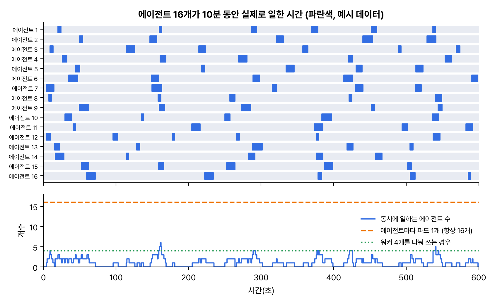

KubeCon NA 2026의 11월 10일 기조연설에 Agent Substrate가 7분짜리로 올라왔다. 3월에 Agent Sandbox를 정리하면서 '파드 하나 띄우는 데 1초쯤 걸려서 웜 풀을 둔다'고 적었고, 10월에는 놀고 있는 샌드박스가 붙잡은 메모리를 swap으로 줄이는 벤치마크를 읽었다. Agent Substrate는 같은 문제를 다른 방향에서 푼다. 에이전트 하나에 파드 하나를 주지 않는다. 소식 글에 몇 줄로 넣으려다가, 저장소 문서를 읽을수록 쿠버네티스 위에 제어 영역을 하나 더 얹는 구조라 따로 정리했다. 기준은 v1.0.1(11월 20일)과 저장소 main 브랜치 문서다.

## 요약

- Agent Substrate는 에이전트처럼 대부분의 시간을 기다리며 보내는 워크로드를 위한 오픈소스 런타임이다. 많은 액터(에이전트 인스턴스)를 미리 띄워 둔 적은 수의 워커 파드에 번갈아 올린다.
- 쉬는 액터는 메모리와 파일 시스템까지 스냅샷으로 떠서 내리고, 요청이 오면 비어 있는 워커에 되살린다. 공식 수치는 재개 500ms 미만, 초당 500회 넘는 활성화, 일반 컨테이너보다 10배 높은 밀도다.
- 노드와 워커 파드는 쿠버네티스가 맡고, 자주 바뀌는 액터 상태는 별도 제어 영역(ate-api-server와 PostgreSQL)이 맡는다. 액터를 깨울 때 kube-apiserver, etcd, 스케줄러, kubelet을 거치지 않는다.
- 모든 액터는 gVisor나 Cloud Hypervisor microVM 안에서 돈다. 일반 리눅스 컨테이너는 지원하지 않는다. API 키 같은 자격 증명은 샌드박스 밖의 이그레스 게이트웨이가 요청에 넣어 준다.
- 5월에 공개됐고 10월에 CNCF Sandbox 투표를 통과했다. 11월 초에 v1.0.0이 나왔고, Google이 gVisor와 함께 CNCF 기증을 발표했다. kagent 1.0은 런타임을 Agent Substrate로 바꿨다.

## 1. 에이전트 워크로드는 어떻게 생겼나

웹 서비스는 비교적 적은 수의 인스턴스가 오래 떠서 계속 요청을 받는다. 에이전트는 한 단계(명령 하나 실행, 파일 하나 수정, 모델 한 번 호출)를 하고 나서 다음 입력을 기다린다. Google 오픈소스 블로그는 대화형 세션에서 에이전트가 시간의 90~95%를 모델 응답, 외부 API, 사람의 검토를 기다리며 보낸다고 했다. 그동안 CPU는 거의 쓰지 않지만 컨테이너를 지울 수는 없다. 메모리에는 언어 런타임이 떠 있고, 디스크에는 클론한 저장소와 커밋하지 않은 수정이 남아 있다.


_예시 데이터로 그렸다. 에이전트마다 3~14초 일하고 70~170초 쉬게 했더니 일한 시간이 전체의 약 7%였고, 동시에 일한 에이전트는 많아야 6개, 평균 1.1개였다_

그려 보니 문제가 바로 보였다. 에이전트마다 파드를 하나씩 두면 16개 몫의 메모리를 10분 내내 잡아 두는데, 실제로 동시에 일하는 건 대부분 0~2개다. 반대로 쉴 때 파드를 지우면(scale to zero) 다시 깨울 때 저장소를 다시 클론하고 패키지를 다시 설치해야 한다. Google 글은 이렇게 하면 깨우는 데 20초 넘게 걸린다고 했다.

강화학습(RL)이나 벤치마크는 반대로 한꺼번에 몰린다. 샌드박스 수천 개를 분 단위로 만들고 지우는데, 그때마다 파드를 만들면 kube-apiserver, 어드미션, etcd, 스케줄러, kubelet, 이미지 받기, 네트워크 설정을 모두 거친다. NVIDIA 글은 10ms짜리 bash 명령 하나를 돌리려고 몇 초씩 걸리는 파드 생성을 거쳐야 한다고 꼬집었다. etcd와 API 서버가 버티지 못하고 서브넷 IP도 모자란다고 한다.

| 방법 | 좋은 점 | 문제 |
|---|---|---|
| 에이전트마다 파드를 계속 띄움 | 바로 응답한다 | 쉬는 시간에도 CPU와 메모리를 잡는다 |
| 쉴 때 파드를 지움 | 쉬는 동안 비용이 없다 | 깨울 때마다 콜드 스타트, 상태를 처음부터 다시 만든다 |
| 샌드박스마다 파드를 새로 만듦(RL) | 구조가 단순하다 | 제어 영역 과부하, 파드 시작 지연 |

KCNA 공부 때 파드를 쿠버네티스의 가장 작은 배포 단위로 외웠는데, 이 워크로드에서는 파드 단위로 켜고 끄는 일 자체가 너무 무겁다.

## 2. 액터와 워커를 떼어 놓는다

Agent Substrate는 에이전트 상태와 실행 자리를 분리하는 데서 시작한다.

| 개념 | 무엇인가 | 어디에 있나 |
|---|---|---|
| 액터(Actor) | 에이전트 세션 하나. 자기 메모리, 파일 시스템, 네트워크 규칙을 가진다 | Substrate 제어 영역의 기록. 쉬는 동안은 스냅샷으로만 남는다 |
| 워커(Worker) | 미리 띄워 둔 파드. 안에 샌드박스 런타임이 준비돼 있다 | WorkerPool이 만든 Deployment의 파드 |
| WorkerPool | 워커 파드를 몇 개, 어떤 크기로 띄울지 | 쿠버네티스 CRD |
| ActorTemplate | 액터를 만들 이미지, 자원 한도, 스냅샷 설정. 고칠 수 없어서 새 버전은 새 템플릿으로 만든다 | Substrate API 리소스(쿠버네티스 오브젝트가 아니다) |
| Atespace | 액터와 템플릿을 묶는 격리 단위. 액터 주소는 atespace/이름 | Substrate 제어 영역. 쿠버네티스 네임스페이스와 별개 |

워커 하나는 액터 여러 개를 동시에 담을 수 있다. 액터는 각자 자기 샌드박스 안에 있고, 워커의 CPU·메모리 한도와 --max-actors(기본 1000) 중 먼저 차는 쪽에서 더 받지 않는다. README의 데모 영상은 액터 약 250개를 파드 8개에 번갈아 올렸고, 이걸 10~30배 초과 구독(oversubscription)이라고 부른다.

저장 위치를 나눈 이유가 가장 눈에 띄었다. 아키텍처 문서는 쿠버네티스 API가 여러 컨트롤러가 비동기로 상태를 맞춰 가는 데는 강하지만, 수백만 개의 오브젝트를 저장하거나 초당 수천 건씩 쓰기를 받는 데는 맞지 않는다고 직접 적었다. 그래서 거의 바뀌지 않는 인프라 설정(WorkerPool, SandboxConfig)만 CRD로 두어 RBAC, 감사 로그, 정책을 그대로 쓰고, 수시로 바뀌는 Actor와 Worker 기록은 PostgreSQL에 둔다.

| 리소스 | 저장 위치 | 바뀌는 빈도 |
|---|---|---|
| WorkerPool, SandboxConfig | 쿠버네티스(etcd) | 드물다. 운영자가 고칠 때 |
| ActorTemplate, Atespace, Tag | Substrate 제어 영역 | 드물다. 에이전트 버전을 올릴 때 |
| Actor, Worker | Substrate 제어 영역(PostgreSQL) | 잦다. 깨우고 재울 때마다 |

1월에 정리한 갱 스케줄링은 Workload API를 쿠버네티스 안에 새로 넣는 방식이었다. Agent Substrate는 쿠버네티스 옆에 작은 제어 영역을 하나 더 두는 쪽을 골랐다.

## 3. 구성 요소


flowchart TB
  subgraph r1["Substrate 제어 영역 (ate-system)"]
    direction LR
    R["atenet-router<br>요청을 받고 액터를 깨운다"] --> API["ate-api-server<br>워커 배정, 수명 주기"] --> PG[("PostgreSQL<br>Actor, Worker 기록")]
  end
  subgraph r2["각 노드"]
    direction LR
    L["atelet (DaemonSet)<br>스냅샷을 옮긴다"] --> W["워커 파드<br>ateworker, atunnel"] --> A["액터<br>gVisor나 microVM 안"]
  end
  subgraph r3["쿠버네티스와 저장소"]
    direction LR
    K["kube-apiserver<br>WorkerPool CRD, 워커 파드"] ~~~ S[("오브젝트 스토리지<br>GCS, S3 스냅샷")]
  end
  r1 -->|"복원, 체크포인트 지시"| r2
  r2 -->|"스냅샷 업로드, 다운로드"| r3


| 구성 요소 | 하는 일 |
|---|---|
| ate-api-server | 제어 영역. gRPC API, 액터를 워커에 배정하는 스케줄러, 복원과 체크포인트 순서를 밟는 워크플로 엔진이 들어 있다. 호출자를 mTLS나 OIDC로 인증하고, atespace마다 OpenFGA로 인가한다 |
| PostgreSQL | Actor, Worker 기록 저장소 |
| atecontroller | WorkerPool CRD를 Deployment로 바꾸는 쿠버네티스 컨트롤러 |
| atelet | 노드마다 뜨는 DaemonSet. 이미지를 받아 OCI 번들을 만들고, 스냅샷을 오브젝트 스토리지와 주고받는다 |
| ateworker | 워커 파드 안에서 샌드박스 런타임을 실제로 부른다. ateworker-gvisor와 ateworker-microvm 두 종류가 있다 |
| atenet-router | Envoy와 ext_proc로 만든 인그레스. ate-target-actor 헤더(atespace/액터)를 보고, 잠든 액터면 깨운 뒤 요청을 넘긴다 |
| atunnel | ateworker 안의 터널. 라우터와 mTLS CONNECT(8443 포트)로 이어지고 요청을 액터에게 전한다 |
| atenet-egress | 액터가 밖으로 나가는 트래픽의 관문. 목적지 정책을 적용하고 자격 증명을 넣는다 |
| objectstore-plugin | GCS, S3와 스냅샷을 주고받는 사이드카 |
| kubectl-ate | kubectl 플러그인. 액터를 만들고, 재우고, 로컬 프록시를 연다 |

이름 앞의 ate는 처음 이름 Agent Task/Execution Engine에서 왔다고 한다. 프로젝트 사이트 주소도 ate.dev다.

## 4. 요청 하나가 액터를 깨우기까지


sequenceDiagram
  participant C as 클라이언트
  participant R as atenet-router
  participant API as ate-api-server
  participant L as atelet
  participant W as 워커(ateworker)
  C->>R: 요청 (ate-target-actor 헤더)
  R->>API: ResumeActor
  API->>L: 이 워커에 복원해라
  L->>W: 스냅샷을 받아 RestoreWorkload
  W-->>L: 준비 끝
  L-->>API: 워커 IP
  API-->>R: 배정된 워커
  R->>W: mTLS 터널로 원래 요청 전달
  W-->>R: 액터의 응답
  R-->>C: 응답 전달


1. 클라이언트가 atenet-router로 요청을 보낸다. 어느 액터에게 갈지는 ate-target-actor 헤더에 적는다.
2. 라우터의 ext_proc가 ate-api-server에 ResumeActor를 부른다. 이미 돌고 있는 액터면 위치만 받아 온다.
3. ate-api-server가 WorkerPool에서 자리가 남은 워커를 고르고, 그 노드의 atelet에 복원을 맡긴다.
4. atelet이 스냅샷을 받아(노드에 사본이 남아 있으면 그대로 쓴다) ateworker에 RestoreWorkload를 보낸다.
5. 라우터가 그 워커의 atunnel로 mTLS 터널을 열고 원래 요청을 넘긴다.

이 흐름에는 쿠버네티스 API 서버가 없다. 워커 파드는 이미 떠 있고, 파드 안에서 샌드박스만 되살린다. 파드를 만드는 데 걸리던 몇 초가 통째로 빠진다.

템플릿에 wakeupProbe를 적어 두면 ResumeActor는 이 HTTP 검사가 통과한 뒤에야 돌아온다. 이름이 비슷해서 readinessProbe와 헷갈렸는데, readinessProbe는 파드가 사는 동안 계속 돌면서 트래픽을 막고 여는 반면 wakeupProbe는 깨어날 때마다 한 번만 확인한다.

워커가 다 차 있을 때도 있다. 위 그림처럼 워커 4개로 버티면 600초 중 4초 동안은 일하려는 에이전트가 4개를 넘었다. 예전에는 라우터가 이때 바로 503을 돌려줬는데, 지금은 요청을 잡아 두고(request parking) 다른 액터가 내려가 워커가 빌 때까지 다시 시도한다. 기다리는 시간과 기다릴 수 있는 요청 수에는 상한이 있다.

액터의 상태는 이렇게 바뀐다.


stateDiagram-v2
  [*] --> SUSPENDED : CreateActor
  SUSPENDED --> RESUMING : ResumeActor
  RESUMING --> RUNNING : 복원이나 부팅 완료
  RUNNING --> SUSPENDING : SuspendActor
  SUSPENDING --> SUSPENDED : 체크포인트 완료
  SUSPENDED --> [*] : DeleteActor


새 액터가 SUSPENDED로 시작하는 게 처음엔 이상했다. 만들 때는 기록만 생기고, 첫 요청이 들어올 때 템플릿의 골든 스냅샷(아래 5절)에서 깨어나는 구조라서 그렇다.

하나 잘못 알고 있던 것도 있다. 쉬는 액터를 Substrate가 알아서 재우는 줄 알았는데, 문서상 일시 중지는 누군가 SuspendActor를 불러야 일어난다. 언제가 쉬는 때인지는 액터를 쓰는 위쪽(kagent, 에이전트 하네스, 직접 만든 게이트웨이)이 정한다. 같은 GitHub 조직의 always-on-agent 예제가 이 구조를 잘 보여 준다. 메신저 연결은 게이트웨이가 계속 붙잡고 있고, 대화마다 하나씩 있는 액터는 답할 때만 깨어난다.

일시 중지는 두 방식이 있다.

| 방식 | SuspendActor가 언제 돌아오나 | 주의 |
|---|---|---|
| 비동기(기본) | 노드에 체크포인트를 쓰자마자 | 업로드는 atelet이 뒤에서 한다. 업로드 전에 노드가 죽으면 그 상태를 잃을 수 있다 |
| 동기(--mode=sync) | 오브젝트 스토리지 업로드까지 끝난 뒤 | 느리지만 돌아오는 순간 안전하게 저장돼 있다 |

두 방식 모두 노드에 사본을 잠시 남겨서, 같은 노드에서 다시 깨우면 다운로드 없이 되살린다. 정해진 시간(--snapshot-detach-delay)이 지나면 노드의 사본을 지운다.

## 5. 스냅샷에는 무엇이 남나

ActorTemplate의 snapshotConfig.preferredFidelity로 정한다. 아래 단계일수록 위 단계 내용을 포함한다.

| 단계 | 남는 것 | 깨울 때 |
|---|---|---|
| VOLUMES | DurableDir 볼륨 내용만 | 이미지에서 새로 부팅하고 볼륨만 되돌린다 |
| ROOTFS | 볼륨과 컨테이너 루트 파일 시스템에 쓴 파일 | 새로 부팅하지만 파일은 그대로 있다 |
| MEMORY(기본) | 위 둘과 프로세스, 메모리 | 멈췄던 지점에서 그대로 이어서 실행한다 |

counter 데모가 이 차이를 숫자로 보여 준다. 요청마다 카운터 세 개를 1씩 올리는데, 하나는 메모리에, 하나는 루트 파일 시스템의 파일에, 하나는 DurableDir 볼륨의 파일에 있다. MEMORY면 일시 중지 뒤에도 셋 다 이어지고, ROOTFS면 메모리 카운터만 1로 돌아가고, VOLUMES면 볼륨 카운터만 남는다.

골든 스냅샷도 알아 둘 만하다. ActorTemplate을 만들면 Substrate가 한 번 부팅해서 체크포인트를 떠 둔다. 새 액터는 이 스냅샷에서 시작하니 첫 요청부터 부팅 과정을 건너뛴다.

MEMORY 스냅샷은 찍을 때의 샌드박스 런타임 버전에 묶인다. 그 버전을 가진 워커에 자리가 없으면 ROOTFS 상태로 기본 런타임에서 새로 부팅한다. 메모리 상태는 잃지만 액터는 뜬다.

## 6. 샌드박스 두 종류

KCNA 컨테이너화를 정리할 때 runc 컨테이너는 호스트 커널을 같이 쓴다고 적었다. 모델이 즉석에서 만든 코드를 돌리는 에이전트에게는 이 경계가 약하다. 그래서 Substrate는 일반 리눅스 컨테이너를 아예 지원하지 않고, WorkerPool마다 둘 중 하나를 고르게 한다.

| | gVisor(기본) | microVM |
|---|---|---|
| 격리 | 사용자 공간 커널 runsc가 시스템 콜을 가로챈다 | Kata Containers 게스트를 Cloud Hypervisor로 띄운 KVM 가상 머신 |
| 노드 조건 | 일반 리눅스 노드 | /dev/kvm이 있는 노드 |
| 일시 중지와 재개 | runsc의 체크포인트와 복원 | VM 메모리 스냅샷. 되살릴 때 userfaultfd로 필요한 페이지만 그때그때 읽는다 |
| 컨테이너별 자원 한도 | API로 받기는 하지만 실제로는 액터 전체 한도만 적용한다 | 게스트 cgroup으로 컨테이너마다 적용한다. 한도를 넘은 컨테이너만 OOM으로 죽고 나머지는 산다 |
| 보이는 CPU 수 | 최소 2개. 1000m를 줘도 2개로 보이고 실제 사용량은 쿼터로 조인다 | 밀리코어를 1000으로 나눠 올림한 수, 최소 1개 |

Google 글에 따르면 gVisor는 메모리와 프로세스 테이블을 자기가 가상화하기 때문에, 돌던 환경을 얼려서 메모리 페이지를 저장하고 다른 노드에서 되살리기 쉽다. Google은 이번 KubeCon에서 Agent Substrate와 함께 gVisor도 CNCF에 기증했다.

## 7. 보안 모델

KCSA 공부와 가장 많이 겹치는 부분이다. Substrate는 모든 액터를 믿을 수 없고 서로 적대적이라고 가정한다. 보안 문서의 첫 문장이 이 방향을 그대로 말한다. 모든 에이전트는 신원은 있지만 자격 증명도, 열린 네트워크도, 샌드박스 밖으로 나갈 길도 없다.

| 경계 | 내용 |
|---|---|
| 샌드박스 | 액터마다 gVisor나 microVM 하나, 자기 네트워크 네임스페이스와 저장 공간 |
| 게이트웨이 | 들어오는 트래픽은 인증된 호출자만 atenet-router로 들어온다. 나가는 트래픽은 atenet-egress와 DNS 릴레이로만 나간다. 기본은 모두 거부 |
| 제어 영역 | 액터는 Substrate API, PostgreSQL, 쿠버네티스 API에 직접 닿을 수 없다 |
| 저장소 | 샌드박스는 스냅샷 저장소를 직접 만지지 않는다. GCS에서는 atelet이 그 액터 하나에만 쓰는 자격 증명으로 스냅샷을 옮긴다 |

자격 증명을 다루는 방식이 특히 좋았다. API 키나 클라우드 토큰을 샌드박스에 넣지 않는다. 액터가 밖으로 요청을 보내면 이그레스 게이트웨이가 정책을 확인한 뒤 요청에 자격 증명을 끼워 넣는다. 프롬프트 인젝션으로 에이전트가 넘어가도 빼낼 비밀이 없다. 신원은 액터마다 1시간짜리 SPIFFE X.509 인증서로 주고, 필요하면 게이트웨이가 액터 JWT를 발급한다. 구성 요소끼리는 모두 mTLS로 통신하는데, 이 인증서는 podcertcontroller가 파드 인증서로 발급한다. 8월 v1.37에서 GA가 된 Pod 인증서 API를 쓰고, 서명자(signer)만 업스트림에 아직 없어서 대신 채워 넣은 구성 요소라고 한다.

문서가 진행 상태를 숨기지 않고 표로 적어 둔 점도 눈에 띄었다. 아직 진행 중이거나 계획만 있는 것들을 옮겼다.

| 항목 | 상태 |
|---|---|
| 워커 파드 권한 | privileged: false지만 아직 root로 돌고 SYS_ADMIN, NET_ADMIN 권한이 있다. 워커용 사용자 네임스페이스는 아직 없다 |
| 액터 사이 인가 | 계획 단계. 그전에는 인증 프록시를 두거나 앱에서 처리해야 한다 |
| 쿼터와 호출 제한 | 계획 단계 |
| 액터별 스냅샷 암호화 | 계획 단계 |
| atespace 사이 네트워크 정책과 쿼터 | 진행 중 |

사람 사용자의 인증과 인가, 어떤 에이전트가 어떤 하위 에이전트를 만들었는지 같은 계보 관리는 Substrate 위의 앱이 맡는다고 적혀 있다. KCSA에서 정리한 공동 책임 모델이 여기서도 똑같이 나온다.

## 8. counter 데모 따라가 보기

맥북에 Docker가 없어서 아직 직접 띄우지는 못했다. 대신 빠른 시작 문서를 한 줄씩 따라가며 뒤에서 무슨 일이 일어나는지 적었다. kind 클러스터에 설치하고, 스냅샷은 클러스터 안의 S3 호환 저장소(rustfs)에 둔다. Go, kubectl, Docker가 있어야 한다.

```bash
git clone https://github.com/agent-substrate/substrate.git && cd substrate
hack/create-kind-cluster.sh                     # kind 클러스터와 로컬 이미지 레지스트리
export ATE_INSTALL_KIND=true                    # ate-setup이 kind를 대상으로 하게
go run ./cmd/ate-setup deploy ate-system --credential-provider='{"name":"k8s.io"}' \
  --ingress-allowed-spiffe-ids=spiffe://cluster.local/ns/ate-system/sa/atenet-client
go run ./cmd/ate-setup deploy demo counter      # WorkerPool, atespace, ActorTemplate을 만든다
go install ./cmd/kubectl-ate
kubectl ate create actor my-counter-1 -a ate-demo-counter --template counter
kubectl ate proxy actor my-counter-1 -a ate-demo-counter   # 로컬 8000 포트를 라우터를 거쳐 액터로
```

deploy demo counter가 만드는 WorkerPool이다. 워커 이미지 줄은 빼고 주석을 달았다.

```yaml
apiVersion: ate.dev/v1
kind: WorkerPool
metadata:
  name: counter
  namespace: ate-demo-counter
  labels:
    workload: counter          # ActorTemplate의 workerSelector가 이 라벨로 풀을 고른다
spec:
  replicas: 3                  # 미리 띄워 둘 워커 파드 수
  sandboxClasses:
  - name: gvisor
  template:
    resources:
      limits:                  # 워커 하나의 수용량. 여기 올라간 액터들이 나눠 쓴다
        cpu: "1"
        memory: 1Gi
      requests:
        cpu: 250m
        memory: 1Gi
```

ActorTemplate은 kubectl apply가 아니라 Substrate API로 만든다(ate-setup이 대신 부른다). 데모 파일에서 필요한 부분만 옮겼다.

```yaml
metadata:
  atespace: ate-demo-counter
  name: counter
workerSelector:
  matchLabels:
    workload: counter
containers:
- name: counter
  image: <데모 이미지>
  wakeupProbe:                 # 깨어날 때마다 한 번 확인한다
    httpGet:
      path: /readyz
      port: 80
  volumeMounts:
  - name: data
    mountPath: /home/counter
resources:
  limits:
    cpuMillicores: 1000
    memoryBytes: 536870912     # 512Mi. 액터를 올리면 워커 수용량에서 이만큼 빠진다
snapshotConfig:
  preferredFidelity: SNAPSHOT_FIDELITY_MEMORY
volumes:
- name: data
  durableDir: {}
```

다른 터미널에서 요청을 보내고, 재운 뒤 다시 보내면 문서 기준으로 이렇게 나온다.

```bash
curl -X POST http://localhost:8000
# preserved memory count: 1 | preserved file counter: 1 | preserved rootfs counter: 1
kubectl ate suspend actor my-counter-1 -a ate-demo-counter
curl -X POST http://localhost:8000
# preserved memory count: 2 | preserved file counter: 2 | preserved rootfs counter: 2
kubectl ate get actor my-counter-1 -a ate-demo-counter   # WORKER POD 열이 바뀌었을 수 있다
```

두 번째 curl이 잠든 액터를 깨운다. 라우터가 요청을 잡고, 워커를 배정받고, 스냅샷을 되살린 뒤에 응답이 온다. 다른 워커 파드에서 깨어났는데도 메모리 카운터가 2로 이어지면 프로세스 상태가 통째로 옮겨 간 것이다. 샌드박스를 1000개 넘게 돌릴 리눅스 호스트는 커널 이웃 테이블(gc_thresh) 값을 늘려야 한다는 주의도 적혀 있었다.

## 9. 비슷한 것들과 어디가 다른가

3월에 Agent Sandbox를 정리해서 이 둘이 가장 헷갈렸다.

| | Agent Sandbox | Agent Substrate |
|---|---|---|
| 만드는 곳 | 쿠버네티스 SIG Apps(kubernetes-sigs) | 독립 프로젝트, CNCF Sandbox. 메인테이너 19명 중 16명이 Google, 3명이 Solo.io |
| 기본 단위 | Sandbox CRD 하나에 파드 하나 | 워커 파드 하나에 액터 여러 개 |
| 상태 저장 | 쿠버네티스 API(etcd) | 자체 제어 영역(PostgreSQL) |
| 빨리 띄우는 방법 | SandboxWarmPool에 미리 띄운 샌드박스를 가져온다 | 미리 띄운 워커에 액터 스냅샷을 되살린다 |
| 격리 | RuntimeClass로 gVisor, Kata 등을 고른다 | gVisor나 microVM만 |
| 어울리는 경우 | 파드로 다뤄야 하는, 수가 많지 않은 샌드박스 | 대부분 쉬고 있는 아주 많은 액터 |

Google Cloud 글도 파드 단위로 다뤄야 하는 워크로드에는 Agent Sandbox를 같이 쓰라고 했다. 둘은 쓰임새가 다르다고 이해했다.


flowchart TB
  A["에이전트 프레임워크, 하네스<br>kagent, Claude Code, Hermes, ADK"] --> B["Agent Substrate<br>액터 수명 주기, 라우팅, 스냅샷"]
  B --> C["샌드박스<br>gVisor, Cloud Hypervisor microVM"]
  C --> D["쿠버네티스<br>워커 파드, 노드, 오토스케일링"]


| 이름 | 위치 | 관계 |
|---|---|---|
| kagent | 에이전트 프레임워크(CNCF Sandbox) | 1.0에서 Deployment 기반 런타임을 버리고 대화마다 액터 하나를 두는 구조로 바꿨다 |
| NVIDIA Dynamo | 모델 추론 | 첫 토큰까지 걸릴 예상 시간 같은 신호를 넘겨 주면, Substrate가 긴 추론을 기다리는 동안 액터를 재울지 정할 수 있다. 일부는 실험 단계다 |
| KAI Scheduler | 쿠버네티스 워크로드 배치 | 워커 파드도 평범한 파드라 GPU 학습, 추론 파드와 함께 배치한다 |
| Knative, KEDA | 0까지 줄이기 | 상태 없는 서비스용이다. 깨울 때 메모리 상태까지 되살리지는 않는다 |

업스트림 쿠버네티스에도 비슷한 흐름이 있다. 파드 단위 체크포인트와 복원(KEP-5823)이 v1.38 alpha 목표로 올라 있다. Substrate가 쿠버네티스 밖에서 하는 일을 언젠가 쿠버네티스가 일부 가져갈지도 지켜볼 생각이다.

## 10. 일정과 숫자

GitHub 기록은 한국 시간으로 바꿨고, 블로그는 게시일 그대로 적었다.

| 날짜(2026년) | 일 |
|---|---|
| 5월 14일 | GitHub 저장소 공개 |
| 9월 9일 | CNCF Sandbox 신청 |
| 9월 16일 | GKE에서 사용 가능 발표. 운영 환경 지원은 허용 목록으로 |
| 10월 21일 | CNCF TOC 투표 통과 |
| 11월 5일 | Google 오픈소스 블로그가 Agent Substrate와 gVisor의 CNCF 기증 발표 |
| 11월 6일 | v1.0.0 |
| 11월 9~12일 | KubeCon NA(솔트레이크시티). 9일 ATECon, 10일 기조연설, 11일 Tim Hockin과 Kelsey Hightower 대담 |
| 11월 20일 | v1.0.1 |

| 숫자 | 출처 | 메모 |
|---|---|---|
| 재개 500ms 미만, 초당 500회 넘는 활성화 | README, Google Cloud 블로그 | 지금 공식으로 내세우는 수치 |
| 일반 컨테이너보다 10배 밀도, 호스트 하나에 쉬는 에이전트 1,000개 넘게 | Google Cloud 블로그 | GKE 기준 |
| 파드 8개에 액터 약 250개, 10~30배 초과 구독 | README 데모 | |
| 활성화 p95 100ms, 클러스터당 액터 10억 개, 초당 1,000회 | 아키텍처 문서 | 지향하는 목표치. kagent 블로그는 100ms 미만 재개를 보장한다고 적었는데, 공식 수치 500ms와 맞지 않는다 |

모두 프로젝트 쪽에서 낸 수치이고 내가 직접 잰 값은 아니다.

## 읽으면서 남은 의문

- 스냅샷이 새로운 데이터 관리 문제가 된다. 문서도 '쉬는 파드 문제를 수백만 액터의 상태 저장 문제로 바꾼 것'이라고 인정했다. 메모리 스냅샷 크기와 오브젝트 스토리지 비용이 어느 정도인지는 아직 못 찾았다.
- 기본값인 비동기 일시 중지는 업로드 전에 노드가 죽으면 상태를 잃을 수 있다. 잃으면 안 되는 세션은 동기 모드를 써야 할 것 같다.
- 라우터로 기본 포트가 아닌 포트에 들어갈 때는 아직 HTTP(S)만 된다. 원시 TCP는 지원하지 않는다.
- 지원하는 쿠버네티스는 최신 안정 버전과 그 바로 전 마이너 버전이다. 11월 기준으로는 v1.37과 v1.36이다.
- README는 1.0이 됐으니 공개 API를 깨지 않겠다고 했지만, NVIDIA 글은 API가 아직 바뀌는 중이고 GPU 지원은 DRA 위에서 다시 만들고 있다고 했다. GPU 상태까지 스냅샷하는 설계는 아직 제안 단계다.

> **쉬운 설명**
>
> Agent Substrate는 공유 오피스와 비슷하다. 직원(에이전트)마다 개인 사무실(파드)을 주면 대부분 비어 있는데도 임대료가 나간다. 공유 오피스는 책상(워커) 몇 개만 두고, 직원이 자리를 비우면 책상 위 서류와 노트북 화면을 그대로 상자(스냅샷)에 담아 창고에 넣는다. 직원이 돌아오면 빈 책상 아무 데나 상자를 풀어 아까 그 상태로 되돌려 놓는다. 안내 데스크(atenet-router)는 손님이 찾는 직원이 어느 책상에 있는지 알려 주고, 책상이 다 차 있으면 손님을 잠깐 기다리게 한다(request parking). 직원은 회사 카드를 갖고 다니지 않는다. 결제가 필요하면 출입구 직원(이그레스 게이트웨이)이 대신 카드를 긁어 주니, 누가 직원을 속여도 카드를 빼낼 수 없다.

## 용어 정리

| 용어 | 뜻 |
|---|---|
| 액터(Actor) | Substrate가 관리하는 에이전트 인스턴스 하나. 재우고 깨우는 단위 |
| 워커(Worker) | 액터를 올려 돌리는, 미리 띄워 둔 파드 |
| WorkerPool | 워커 파드 묶음을 선언하는 쿠버네티스 CRD |
| ActorTemplate | 액터의 이미지, 자원 한도, 스냅샷 설정을 담은 고칠 수 없는 정의 |
| Atespace | 액터와 템플릿을 묶는 Substrate의 격리 단위 |
| 골든 스냅샷 | 템플릿을 만들 때 한 번 부팅해서 떠 두는 스냅샷. 새 액터가 여기서 시작한다 |
| 스냅샷 단계(fidelity) | 스냅샷에 무엇까지 담을지. VOLUMES, ROOTFS, MEMORY |
| request parking | 워커가 모자랄 때 라우터가 요청을 잠깐 잡아 두는 동작 |
| 초과 구독(oversubscription) | 실제 자원보다 많은 작업을 받아 번갈아 돌리는 것 |
| 이그레스 게이트웨이 | 샌드박스에서 나가는 트래픽을 검사하고 자격 증명을 넣는 관문 |
| SPIFFE | 워크로드에 표준 형식의 신원(인증서)을 주는 규격 |

## 참고 자료

- Agent Substrate 저장소: <https://github.com/agent-substrate/substrate>
- Agent Substrate 아키텍처 문서: <https://github.com/agent-substrate/substrate/blob/main/docs/concepts/architecture.md>
- Agent Substrate 보안 개요: <https://github.com/agent-substrate/substrate/blob/main/docs/security/security.md>
- Agent Substrate 샌드박스 종류: <https://github.com/agent-substrate/substrate/blob/main/docs/reference/sandbox-classes.md>
- Agent Substrate counter 데모: <https://github.com/agent-substrate/substrate/blob/main/demos/counter/README.md>
- Google Cloud 블로그, Agent Substrate brings high-density, scalable, trusted infrastructure to GKE: <https://cloud.google.com/blog/products/containers-kubernetes/agent-substrate-available-on-gke>
- Google 오픈소스 블로그, Sandboxing Untrusted AI Agents at Scale: Google Donates Agent Substrate and gVisor to the CNCF: <https://opensource.googleblog.com/2026/11/sandboxing-untrusted-ai-agents-at-scale.html>
- NVIDIA 기술 블로그, Agent Substrate: Advancing Kubernetes for Agents at Scale: <https://developer.nvidia.com/blog/agent-substrate-advancing-kubernetes-for-agents-at-scale>
- kagent 문서, Agent Substrate: <https://kagent.dev/docs/kagent/0.x/concepts/agent-substrate/>
- kagent 블로그, The Future of kagent: <https://kagent.dev/blog/the-future-of-kagent>
- CNCF Sandbox 신청 이슈: <https://github.com/cncf/sandbox/issues/523>
- Agent Sandbox 저장소: <https://github.com/kubernetes-sigs/agent-sandbox>

