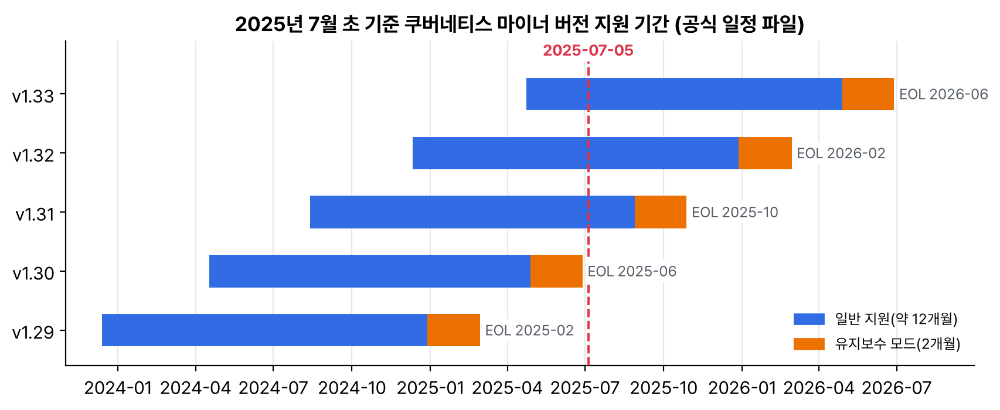

공식 일정상 v1.30의 지원 종료(EOL)일이 6월 28일이었다. 내가 시험 본 v1.32는 언제까지 패치를 받는지 궁금해서, 쿠버네티스 웹사이트 저장소의 릴리스 일정 파일과 패치 릴리스 정책 페이지를 읽고 정리했다. 6월에 있었던 쿠버네티스 Slack 소동도 짧게 덧붙였다.

## 요약

- 쿠버네티스는 최근 마이너 버전 세 개를 유지한다. 버전마다 약 14개월 지원하고, 앞 12개월은 일반 지원, 마지막 2개월은 유지보수 모드다.
- 유지보수 모드에서는 CVE가 붙은 취약점, 의존성 문제(베이스 이미지 포함), 주요 구성 요소의 치명적 문제만 고친다.
- 2025년 7월 초 공식 일정 기준으로 v1.30은 6월 28일 EOL, v1.31은 8월 28일 유지보수 모드·10월 28일 EOL, v1.32는 2026년 2월 28일 EOL이다.
- 컨트롤 플레인은 마이너 버전을 건너뛰어 올릴 수 없다. v1.30에서 v1.33으로 가려면 세 번 올려야 한다.
- 6월 16일 쿠버네티스 Slack이 무료 플랜으로 바뀐다는 공지가 나왔다가, 며칠 뒤 다운그레이드하지 않는다는 업데이트가 붙었다.

## 1. 지원 기간이 정해지는 방식

| 구간 | 기간 | 하는 일 |
|---|---|---|
| 일반 지원 | 출시 후 약 12개월 | 매달 패치 릴리스. 버그 수정과 보안 수정 |
| 유지보수 모드 | 그 뒤 2개월 | CVE가 붙은 취약점, 의존성·베이스 이미지 문제, 주요 구성 요소의 치명적 문제만 |
| EOL | 유지보수 모드 끝 | 더는 패치가 없다. 브랜치 체리픽도 곧 닫는다 |

유지보수 모드 시작일과 EOL을 매달 28일로 맞추는 이유는 단순하다. 모든 달에 28일이 있어서다.


_웹사이트 저장소의 일정 파일(2025년 7월 초 커밋)로 그렸다. 파란 부분이 일반 지원, 주황 부분이 유지보수 모드다_

| 버전 | 출시 | 유지보수 모드 | EOL |
|---|---|---|---|
| v1.29 | 2023-12-13 | 지남 | 2025-02-28 |
| v1.30 | 2024-04-17 | 2025-04-28 | 2025-06-28 |
| v1.31 | 2024-08-13 | 2025-08-28 | 2025-10-28 |
| v1.32 | 2024-12-11 | 2025-12-28 | 2026-02-28 |
| v1.33 | 2025-04-23 | 2026-04-28 | 2026-06-28 |

EKS, GKE, AKS 같은 관리형 서비스는 이 일정과 별도로 자기 지원 기간과 연장 지원 정책을 둔다. 쓰는 서비스의 표를 따로 봐야 한다.

## 2. 버전 차이와 업그레이드 경로

CKA 때 외운 버전 차이 정책이 여기서 다시 쓰인다.

| 구성 요소 | 허용 범위 |
|---|---|
| 컨트롤 플레인 업그레이드 | 마이너를 건너뛸 수 없다. 1.30 → 1.31 → 1.32 → 1.33 |
| kubelet | API 서버보다 최대 세 마이너 낮아도 된다 |
| kubectl | API 서버와 위아래 한 마이너까지 |

v1.30 클러스터를 지금 올린다면 세 번 업그레이드해야 한다. 매번 지원 중단 API를 확인하고, 노드 kubelet은 컨트롤 플레인을 다 올린 뒤에 따라 올린다. v1.33에서 Endpoints가 지원 중단된 것처럼 버전마다 바뀌는 게 있어서, 한 번에 몰아서 올리면 확인할 게 많아진다. 1년에 세 번 나오니 적어도 1년에 한두 번은 올려야 지원 범위 안에 있을 수 있다.

## 3. 커뮤니티 소식: Slack 소동

6월 16일에 쿠버네티스 블로그에 'Changes to Kubernetes Slack' 글이 올라왔다. 지난 10년 동안 Slack이 무료로 지원해 준 기업용 계정을 더는 줄 수 없어서, 6월 20일부터 일반 무료 플랜으로 바뀐다는 내용이었다. 무료 플랜이 되면 기록이 90일만 남고 여러 앱과 워크플로를 꺼야 해서, 채널 담당자들에게 기록을 백업하라고 했다. CNCF는 Discord로 옮기는 안도 제안했다.

그런데 며칠 뒤 같은 글 맨 위에 'Salesforce로부터 6월 20일에 다운그레이드하지 않는다는 통보를 받았다, 급하게 백업할 필요는 없다'는 업데이트가 붙었다. 시험 공부할 때 질문을 많이 찾아본 곳이라 조마조마했는데 일단은 그대로 쓰게 됐다.

## 내 클러스터에서 확인할 것

```bash
kubectl version                                  # 서버(컨트롤 플레인) 버전
kubectl get nodes -o custom-columns=NAME:.metadata.name,KUBELET:.status.nodeInfo.kubeletVersion
```

- 서버 버전이 EOL이 지났거나 유지보수 모드에 들어갔는지 표와 비교한다.
- kubelet이 API 서버보다 세 마이너 넘게 뒤처진 노드가 없는지 본다.
- 관리형 서비스라면 그 서비스의 지원 종료일과 연장 지원 요금을 따로 확인한다.

> **쉬운 설명**
>
> 쿠버네티스 버전은 넉 달마다 나오는 스마트폰 운영체제 같다. 새 버전이 나오면 1년 동안은 기능 버그까지 고쳐 주고(일반 지원), 마지막 두 달은 보안 문제만 고쳐 준다(유지보수 모드). 그 뒤로는 업데이트가 끊긴다(EOL). 그리고 이 운영체제는 한 번에 한 단계씩만 올릴 수 있어서, 오래 미루면 여러 번 연달아 올려야 한다.

## 용어 정리

| 용어 | 뜻 |
|---|---|
| 마이너 버전 | 1.30, 1.31처럼 가운데 숫자. 넉 달마다 나온다 |
| 패치 릴리스 | 1.30.14처럼 마지막 숫자. 보통 매달 나온다 |
| 유지보수 모드 | EOL 전 2개월. 보안·의존성·치명적 문제만 고친다 |
| EOL | End of Life. 더는 패치가 없는 상태 |
| 버전 차이 정책 | 구성 요소끼리 허용되는 버전 차이 규칙 |

## 참고 자료

- Kubernetes 릴리스: <https://kubernetes.io/releases/>
- Kubernetes 패치 릴리스와 지원 기간: <https://kubernetes.io/releases/patch-releases/>
- Kubernetes 버전 차이 정책: <https://kubernetes.io/releases/version-skew-policy/>
- 릴리스 일정 파일(2025년 7월 초 커밋): <https://github.com/kubernetes/website/blob/7a8a8b9b4e7f2a60c978706d2062c94548c2f045/data/releases/schedule.yaml>
- Kubernetes 블로그, Changes to Kubernetes Slack: <https://kubernetes.io/blog/2025/06/16/changes-to-kubernetes-slack/>
