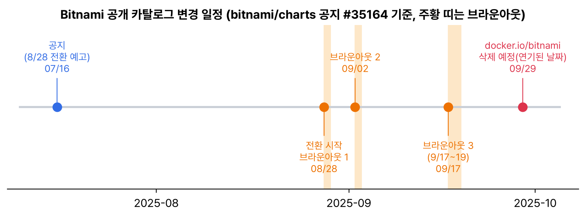

이번 소식은 쿠버네티스 본체가 아니라 생태계 이야기다. 헬름 차트로 데이터베이스나 메시지 큐를 올릴 때 가장 흔히 쓰던 Bitnami가 7월 16일에 공개 카탈로그를 크게 바꾼다고 공지했고, 8월 28일부터 실제로 바뀌기 시작했다. 설치해 둔 차트가 어느 날 ImagePullBackOff에 빠질 수 있는 일이라 공지 원문(bitnami/charts 이슈 #35164)을 읽고 정리했다.

## 요약

- 8월 28일부터 docker.io/bitnami에는 강화된 일부 이미지만 남고, 그것도 개발용으로 latest 태그만 받을 수 있다.
- 기존 이미지와 버전 태그(예: 2.50.0, 10.6)는 docker.io/bitnamilegacy로 옮겨진다. 여기는 더는 업데이트가 없고 임시 이전용이다.
- 운영용 이미지와 차트는 유료 Bitnami Secure Images로 넘어간다. 컨테이너와 차트의 소스 코드는 GitHub에 Apache 2.0으로 계속 공개된다.
- 반발이 커서 docker.io/bitnami 삭제는 9월 29일로 미뤄졌고, 그 전에 이미지 10개씩을 하루 동안 막는 브라운아웃을 세 번 한다.
- 버전 태그로 Bitnami 이미지를 쓰는 차트는 삭제 뒤 이미지를 못 받는다. 지금 쓰는 차트와 이미지 주소를 찾아 옮길 곳을 정해야 한다.

## 1. 무엇이 바뀌나

| 저장소 | 8월 28일 이후 |
|---|---|
| docker.io/bitnami | 커뮤니티용으로 강화된 일부 이미지만, latest 태그만. 9월 29일 삭제 예정(연기된 날짜) |
| docker.io/bitnamisecure | 무료 강화 이미지. 개발용, latest 태그만 |
| docker.io/bitnamilegacy | 기존 이미지와 버전 태그 보관소. 업데이트 없음, 임시 이전용. 아주 오래된 배포판 기반(debian-8~10, centos-7 등)은 옮기지 않음 |
| Bitnami Secure Images | 유료. 운영용 이미지·차트, 버전 지원, SBOM, CVE 정보 등 |
| GitHub(bitnami/containers, bitnami/charts) | 소스 코드는 Apache 2.0으로 계속 공개 |

8월 28일부터는 Docker Hub에 새 Bitnami 이미지와 OCI 형식 헬름 차트를 더는 올리지 않는다고 했다.


_7월 16일 공지 때는 8월 28일 전환만 예고됐다. 이후 삭제를 9월 29일로 미루고, 그 전에 브라운아웃을 세 번 하기로 바뀌었다_

브라운아웃은 미리 정한 이미지 몇 개를 일부러 잠깐 막아서, 의존하고 있던 사람이 미리 알아채게 하는 방법이다. 첫 번째는 8월 28일 08:00 UTC부터 24시간이었고, 대상은 external-dns, kafka, memcached, wordpress, grafana, cassandra, prometheus, openldap, thanos, python이었다. 끝난 뒤 태그는 다시 복구됐다. 다음은 9월 2일, 그다음은 9월 17일부터 19일까지다.

## 2. 쿠버네티스에서 어떤 일이 생기나

bitnami/postgresql, bitnami/redis 같은 차트는 values.yaml에 docker.io/bitnami/이미지:버전 형태로 이미지를 적어 둔다. 삭제 뒤에는 이 주소에서 이미지를 받을 수 없으니 이렇게 된다.

| 상황 | 결과 |
|---|---|
| 노드에 이미지가 이미 있는 파드 | 당장은 돈다(IfNotPresent) |
| 새 노드로 옮겨지거나 새로 늘어난 파드 | ErrImagePull, ImagePullBackOff |
| 차트 업그레이드, 새 설치 | 이미지 주소를 바꾸지 않으면 실패 |
| CI에서 Bitnami 베이스 이미지로 빌드 | 빌드가 깨진다 |

공지에서 제시한 방법은 두 가지다. 계속 지원받으려면 Bitnami Secure Images를 구독하고, 임시로는 같은 차트 버전을 그대로 두고 이미지 저장소 값만 bitnamilegacy로 바꾼다. 다만 legacy는 보안 패치가 없으니 정말 옮겨 가는 동안만 쓰는 게 맞다. 길게 보면 공식 이미지(postgres, redis 등)를 쓰는 다른 차트나 오퍼레이터로 옮기는 걸 생각해야 한다.

기초 공부 때 WordPress와 MySQL을 Docker 공식 이미지로 올렸는데, 그때 Bitnami 차트를 썼다면 지금 고칠 거리가 됐을 것이다.

## 내 클러스터에서 확인할 것

```bash
# 지금 돌고 있는 모든 컨테이너 이미지 중 bitnami 것
kubectl get pods -A -o jsonpath='{range .items[*]}{range .spec.containers[*]}{.image}{"\n"}{end}{end}' | grep -i bitnami | sort | uniq -c
helm list -A                                   # 설치된 차트 중 bitnami/* 찾기
helm get values <릴리스> -n <네임스페이스> --all | grep -A3 'image:'
```

- bitnami 이미지를 쓰는 워크로드와 차트 목록을 만든다.
- 9월 29일 전에 옮길 곳(구독, 공식 이미지 차트, 사내 레지스트리 미러)을 정한다.
- 당장 막히면 이미지 저장소 값을 bitnamilegacy로 바꾸되, 업데이트가 없는 임시 조치라는 걸 기록해 둔다.
- 사내 레지스트리로 미러링해 두면 외부 저장소 정책이 바뀌어도 당장 배포가 멈추지는 않는다.

> **쉬운 설명**
>
> 동네에서 누구나 공짜로 쓰던 공구 대여점(Bitnami)이 '이제 최신 공구 몇 개만 무료로 빌려주고, 나머지는 창고(legacy)로 옮겨 수리 없이 보관하겠다, 제대로 쓰려면 유료 회원이 되라'고 알렸다. 설계도(소스)는 계속 공개한다. 공구를 빌려 쓰던 집(클러스터)은 지금 손에 있는 공구로는 버티지만, 새로 빌려야 하는 순간(새 노드, 재설치) 빈손이 된다. 그래서 대여점이 '하루만 문 닫아 보기(브라운아웃)'로 미리 경고하고 있다.

## 용어 정리

| 용어 | 뜻 |
|---|---|
| Bitnami | 오픈소스 앱을 컨테이너 이미지와 헬름 차트로 패키징해 배포하던 프로젝트(Broadcom 소유) |
| bitnamilegacy | 기존 Bitnami 이미지를 옮겨 둔 업데이트 없는 보관 저장소 |
| 브라운아웃 | 서비스 종료 전에 일부러 잠깐 끊어서 의존하는 사람에게 미리 알리는 방법 |
| ImagePullBackOff | 이미지를 못 받아 kubelet이 재시도 간격을 늘리며 기다리는 상태 |
| 레지스트리 미러 | 외부 이미지를 사내 레지스트리에 복사해 두고 쓰는 방식 |

## 참고 자료

- bitnami/charts 이슈 #35164, Upcoming changes to the Bitnami catalog: <https://github.com/bitnami/charts/issues/35164>
- Docker Hub, bitnamilegacy: <https://hub.docker.com/u/bitnamilegacy>
- Docker Hub, bitnamisecure: <https://hub.docker.com/u/bitnamisecure>
- bitnami/containers(소스): <https://github.com/bitnami/containers>
