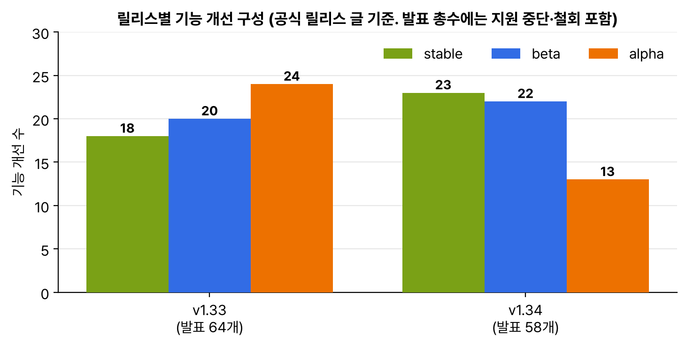

8월 27일에 Kubernetes v1.34 Of Wind & Will(O' WaW)이 나왔다. 미리보기 글에서 본 것들이 실제로 어떻게 들어왔는지 릴리스 글과 DRA, kuberc 상세 글을 읽고 확인했다. 미리보기와 달라진 부분도 있고, CKA 때 외운 내용과 이어지는 변경도 꽤 있었다.

## 요약

- 기능 개선 58개다. 23개 stable, 22개 beta, 13개 alpha다.
- DRA 기본 기능이 GA가 되면서 resource.k8s.io/v1이 기본으로 켜졌다. 앞으로 깨지는 변경은 없다고 못 박았다.
- 노드 swap(LimitedSwap)이 stable이 됐다. 파드는 자기 메모리 limit 안에서만 swap을 쓴다.
- kubectl 개인 설정 파일 kuberc가 beta가 됐다. KYAML 출력은 alpha라 KUBECTL_KYAML=true를 켜야 -o kyaml이 된다.
- kubelet의 cgroupDriver 수동 설정이 지원 중단됐고, containerd 1.x를 지원하는 마지막 쿠버네티스는 v1.35라고 예고했다.

## 1. 숫자와 주요 변화


_v1.34는 alpha가 줄고 stable이 늘었다. 새 기능을 들이기보다 있던 기능을 정식으로 올린 릴리스에 가깝다_

| 기능 | 단계 | 한 줄 정리 |
|---|---|---|
| DRA 기본 기능(ResourceClaim, DeviceClass, ResourceSlice) | stable | GPU·TPU·NIC 같은 장치를 요청하고 할당한다. v1 API가 기본 |
| 이미지 풀에 ServiceAccount 토큰 사용 | beta | kubelet 자격 증명 공급자가 파드마다 짧게 사는 토큰으로 레지스트리 인증 |
| 노드 swap(LimitedSwap) | stable | v1.22에 들어와 alpha·beta를 거쳐 정식 |
| 파드 단위 requests·limits | beta | 컨테이너 여럿이 파드 전체 예산을 나눠 쓴다. HPA도 지원 |
| in-place 리사이즈 개선 | beta 유지 | 메모리 줄이기 지원, 파드 단위 리소스와 연동 |
| kuberc | beta | kubectl 기본 옵션과 별칭을 kubeconfig와 분리 |
| KYAML 출력 | alpha | KUBECTL_KYAML=true kubectl get ... -o kyaml |
| Restricted 기준 강화 | - | 프로브·라이프사이클 훅의 host 필드를 비워 둬야 Restricted를 만족한다 |
| 컨테이너별 재시작 규칙 | alpha | 파드 하나의 컨테이너마다 다른 재시작 동작 |
| 파드 인증서(mTLS) | alpha | 파드에 인증서를 발급해 mTLS에 쓴다 |

미리보기 글에서는 KYAML 출력이 그냥 들어온다고 했는데, 실제로는 alpha라 환경 변수를 켜야 했다. 미리보기 글이 '바뀔 수 있다'고 한 이유를 실감했다.

## 2. CKA 공부와 이어지는 변경

| 변경 | 내가 외운 것 | 이제는 |
|---|---|---|
| 노드 swap | kubeadm 설치 전에 swap을 끈다 | 끄는 게 여전히 기본(NoSwap)이지만, LimitedSwap을 정식으로 쓸 수 있다 |
| cgroup 드라이버 | containerd와 kubelet 모두 systemd로 맞춘다 | kubelet이 CRI에 물어 자동으로 맞추는 방식이 stable. kubelet 설정의 cgroupDriver는 지원 중단(제거는 v1.36 이전에는 안 함) |
| containerd 버전 | 1.7을 깔면 된다 | v1.35가 containerd 1.x를 지원하는 마지막 버전. 2.0 이상으로 옮길 준비 |
| trafficDistribution | PreferClose | PreferClose는 지원 중단, PreferSameZone이 같은 뜻. PreferSameNode 추가(beta) |

containerd 1.x 문제는 노드에서 바로 확인할 수 있다고 한다. kubelet이 kubelet_cri_losing_support 지표를 내서, 곧 지원이 끊길 런타임 버전을 쓰는 노드를 찾을 수 있다.

## 3. kuberc와 KYAML 써 보기

kuberc는 ~/.kube/kuberc에 둔다. 공식 글의 예를 그대로 옮겨 봤다. delete는 기본으로 대화형, apply는 서버 사이드, gns는 네임스페이스 목록을 JSON으로 보는 별칭이다.

```yaml
apiVersion: kubectl.config.k8s.io/v1beta1
kind: Preference
defaults:
- command: delete
  options:
  - name: interactive
    default: "true"
- command: apply
  options:
  - name: server-side
    default: "true"
aliases:
- name: gns
  command: get
  prependArgs:
  - namespace
  options:
  - name: output
    default: json
```

```bash
kubectl delete pod web                       # 정말 지울지 묻는다
kubectl delete pod web --interactive=false   # 직접 준 옵션이 이긴다
kubectl gns                                  # kubectl get namespace -o json
KUBECTL_KYAML=true kubectl get pod web -o kyaml
kubectl -v=5 get pods                        # kuberc가 어떻게 적용됐는지 보고 싶을 때
```

kubeconfig는 클러스터 주소와 인증 정보, kuberc는 내 취향이라 분리해 두면 여러 클러스터에서 같은 습관을 쓸 수 있다. 시험장에서는 별칭 k만 있었는데, 실무에서는 이걸로 훨씬 편해질 것 같다.

## 내 클러스터에서 확인할 것

```bash
kubectl get nodes -o custom-columns=NAME:.metadata.name,RUNTIME:.status.nodeInfo.containerRuntimeVersion
kubectl api-resources --api-group=resource.k8s.io      # DRA v1 리소스가 보이는지
```

- containerd://1.x인 노드가 있으면 2.0 이상으로 올리는 계획을 세운다.
- kubelet 설정 파일에 cgroupDriver를 직접 써 두었다면 런타임이 자동 감지를 지원하는지 보고 지워 갈 준비를 한다.
- Service에 trafficDistribution: PreferClose를 썼다면 PreferSameZone으로 바꾼다.
- Restricted 네임스페이스에서 host 필드를 쓰는 프로브가 있으면 v1.34에서 거절될 수 있다.

> **쉬운 설명**
>
> 이번 판은 '새 장(章)을 많이 쓰기보다 초안을 정식 본문으로 다듬은' 개정판이다. GPU 같은 특수 장비를 빌려 주는 규칙(DRA)이 정식 규정이 됐고, '여유 메모리가 부족할 때 창고(swap)를 써도 된다'는 규칙도 정식이 됐다. 그리고 '구형 주방 기구(containerd 1.x)는 다음 판까지만 지원한다'는 예고가 붙었다. kuberc는 내 책상 서랍에 넣어 두는 개인 단축키 메모라서, 어느 회사(클러스터)에 가도 같은 단축키를 쓸 수 있다.

## 용어 정리

| 용어 | 뜻 |
|---|---|
| DRA | GPU 같은 장치를 요청·할당하는 API(resource.k8s.io) |
| LimitedSwap | 파드가 자기 메모리 limit 안에서만 swap을 쓰게 하는 모드 |
| 파드 단위 리소스 | 컨테이너가 아니라 파드 전체에 requests·limits를 주는 기능 |
| kuberc | kubectl의 기본 옵션과 별칭을 담는 개인 설정 파일 |
| cgroup 드라이버 | kubelet과 런타임이 cgroup을 다루는 방식(systemd, cgroupfs) |

## 참고 자료

- Kubernetes 블로그, v1.34 Of Wind & Will: <https://kubernetes.io/blog/2025/08/27/kubernetes-v1-34-release/>
- Kubernetes 블로그, DRA GA: <https://kubernetes.io/blog/2025/09/01/kubernetes-v1-34-dra-updates/>
- Kubernetes 블로그, kubectl 1.34의 kuberc: <https://kubernetes.io/blog/2025/08/28/kubernetes-v1-34-kubectl-kuberc-beta/>
- Kubernetes 문서, kuberc: <https://kubernetes.io/docs/reference/kubectl/kuberc/>
