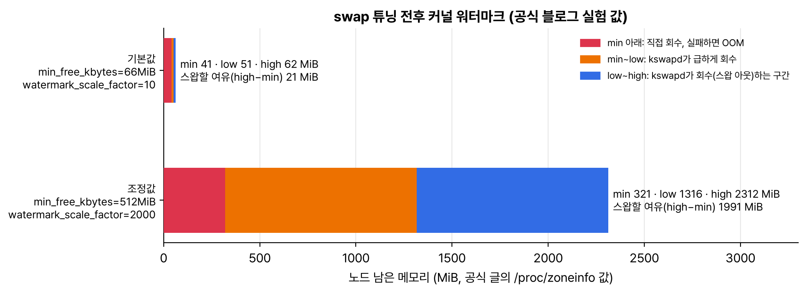

v1.34 후속 글 중에 노드 자원과 관련된 세 편을 묶었다. 컨테이너가 아니라 파드 전체에 자원을 주는 파드 단위 리소스, '사용률' 대신 '얼마나 기다렸나'로 압박을 재는 PSI 지표, 그리고 v1.34에서 정식이 된 swap을 실제로 켜고 커널 값을 조정해 본 실험 글이다.

## 요약

- 파드 단위 리소스는 v1.34에서 beta가 되면서 기본으로 켜졌다. 컨트롤 플레인과 모든 노드가 v1.34 이상이어야 한다.
- 파드 단위 limits는 컨테이너 합계의 절대 상한이 되고, 파드 단위 requests가 스케줄링 기준이 된다. 컨테이너 단위 requests를 준 컨테이너가 압박 때 먼저 몫을 받는다.
- v1.34에서는 파드 단위 리소스를 in-place로 바꿀 수 없고, CPU·메모리·hugepages만 된다. 윈도우 파드는 안 된다.
- PSI(Pressure Stall Information)는 자원이 모자라서 작업이 멈춰 기다린 시간을 잰다. kubelet이 container_pressure_* 지표로 내보내고, 커널 4.20 이상과 cgroup v2, KubeletPSI 기능 게이트가 필요하다.
- swap 실험 글은 기본 커널 값으로는 메모리가 빠르게 늘 때 OOM과 노드 재시작이 났고, min_free_kbytes와 watermark_scale_factor를 키워 스왑할 시간을 벌어야 했다고 한다.

## 1. 파드 단위 리소스

컨테이너가 여럿인 파드에서 컨테이너마다 requests·limits를 쪼개 주는 게 늘 번거로웠다. 이제 파드 전체 예산을 주고 컨테이너끼리 나눠 쓰게 할 수 있다. 공식 글의 예제를 이미지 태그만 붙여서 옮겼다.

```yaml
apiVersion: v1
kind: Pod
metadata:
  name: pod-resources-demo
spec:
  resources:
    requests:
      cpu: "1"
      memory: 100Mi
    limits:
      cpu: "1"
      memory: 200Mi
  containers:
  - name: main-app-container
    image: nginx:1.29
    resources:
      requests:
        cpu: 500m
        memory: 50Mi
  - name: auxiliary-container
    image: fedora:42
    command: ["sleep", "inf"]
```

| 항목 | 동작 |
|---|---|
| 파드 단위 limits | 모든 컨테이너 사용량 합계의 절대 상한 |
| 파드 단위 requests | 스케줄러가 노드를 고르는 기준이자 파드의 최소 보장 |
| 컨테이너끼리 | 남는 몫은 서로 빌려 쓴다(버스트). 파드 합계가 limits를 넘지 않는 한 |
| 컨테이너 단위 requests를 준 컨테이너 | 압박 때 그 몫을 먼저 보장받는다. 위 예에서는 main-app-container |
| 둘 다 쓰면 | 파드 단위 값이 우선한다 |

| 제약(v1.34) | 내용 |
|---|---|
| in-place 리사이즈 | 파드 단위 값은 실행 중에 바꿀 수 없다. 바꾸려 하면 거절된다 |
| 리소스 종류 | CPU, 메모리, hugepages만 |
| 윈도우 | 지원하지 않는다 |
| 리소스 매니저 | Topology·Memory·CPU Manager는 파드 단위 값을 보지 않는다 |

## 2. PSI 지표

사용률 80%가 꼭 문제인 건 아니다. 문제는 자원이 모자라서 작업이 멈춰 기다리는 시간이다. PSI는 리눅스 커널(4.20 이상)이 CPU, 메모리, I/O 각각에 대해 그 시간을 재는 기능이다.

| 구분 | 뜻 |
|---|---|
| some | 적어도 한 작업이 그 자원 때문에 멈춘 시간 비율 |
| full | 쉬지 않는 모든 작업이 동시에 멈춘 시간 비율. 더 심각한 병목 |
| 집계 구간 | 10초, 1분, 5분 이동 평균 |

KubeletPSI 기능 게이트를 켜면 kubelet이 Summary API와 /metrics/cadvisor로 container_pressure_cpu_waiting_seconds_total, container_pressure_memory_stalled_seconds_total 같은 지표를 내보낸다. 메모리 some 압박이 계속 오르면 메모리 누수를 의심하고, requests·limits를 다시 잡거나 자동 확장 기준으로 쓸 수 있다고 한다.

## 3. swap을 실제로 켜 보니

v1.34에서 swap(LimitedSwap)이 정식이 됐지만, 실험 글을 읽어 보니 켜기만 하면 되는 게 아니었다. 메모리를 빠르게(초당 300~500MB) 쓰는 파드를 띄웠을 때, 커널 기본값에서는 kswapd가 스왑으로 메모리를 비우기 전에 노드가 위험 수위에 닿아 kubelet 축출이 먼저 일어나거나, 더 나쁘게는 OOM이 압박 원인과 상관없는 파드를 죽이고 노드가 재시작되기도 했다.


_공식 글이 /proc/zoneinfo로 보여 준 값을 MiB로 바꿨다. 기본값에서는 스왑할 여유가 약 21MiB뿐이었고, 조정 뒤에는 약 2GiB로 넓어졌다_

| 커널 값 | 하는 일 | 글의 시작 권장값 |
|---|---|---|
| vm.swappiness | 익명 메모리를 스왑할지, 파일 캐시를 버릴지의 선호. 0이어도 스왑이 꺼지지는 않는다 | 60(리눅스 기본) |
| vm.min_free_kbytes | 늘 비워 둘 최소 메모리. 높이면 더 일찍 회수를 시작한다 | 500000(약 500MB, 노드 메모리의 2~3%) |
| vm.watermark_scale_factor | min·low·high 워터마크 사이 간격. 키우면 kswapd가 일할 구간이 넓어진다 | 2000 |

글이 짚은 위험도 같이 적어 둔다. 스왑은 메모리보다 훨씬 느려서 활발히 쓰는 메모리까지 밀려나면 성능이 크게 떨어지고, 메모리 누수를 가려서 원인을 늦게 찾게 하고, 잘못 조정하면 kubelet이 축출하기 전에 OOM이 먼저 온다. kubelet 축출 임계값도 이 워터마크에 맞춰 같이 조정하라고 한다.

## 내 클러스터에서 확인할 것

```bash
kubectl get nodes -o custom-columns=NAME:.metadata.name,KUBELET:.status.nodeInfo.kubeletVersion,KERNEL:.status.nodeInfo.kernelVersion
kubectl get --raw "/api/v1/nodes/<노드>/proxy/metrics/cadvisor" | grep container_pressure | head
cat /proc/sys/vm/swappiness /proc/sys/vm/min_free_kbytes /proc/sys/vm/watermark_scale_factor   # 노드에서
```

- 파드 단위 리소스를 쓰려면 노드까지 전부 v1.34 이상인지 본다.
- PSI 지표가 비어 있으면 cgroup v2인지, 커널이 4.20 이상인지, KubeletPSI가 켜졌는지 확인한다.
- swap을 켤 노드는 테스트 환경에서 실제 워크로드로 먼저 재 본다. 디스크 종류(SSD, HDD)에 따라 결과가 크게 달라진다고 한다.

> **쉬운 설명**
>
> 파드 단위 리소스는 룸메이트들에게 '한 사람당 용돈'이 아니라 '방 전체 생활비'를 주는 것이다. 각자 필요할 때 더 쓰고 덜 쓰되, 방 전체 한도는 넘을 수 없다. 다만 '나는 최소 이만큼은 써야 한다'고 미리 말해 둔 사람(컨테이너 requests)이 아쉬울 때 먼저 챙긴다. PSI는 '마트 계산대가 얼마나 붐비나'를 손님 수가 아니라 '줄 서서 기다린 시간'으로 재는 것이다. swap 튜닝은 방이 꽉 차기 전에 창고로 짐을 옮기기 시작하는 시점을 앞당겨, 갑자기 짐이 몰려도 쫓겨나는(OOM) 일이 없게 하는 것이다.

## 용어 정리

| 용어 | 뜻 |
|---|---|
| 파드 단위 리소스 | 파드 전체에 주는 requests·limits |
| PSI | 자원 부족으로 작업이 멈춘 시간을 재는 리눅스 커널 기능 |
| kswapd | 남은 메모리가 low 아래로 내려가면 깨어나 메모리를 회수하는 커널 스레드 |
| 워터마크(min, low, high) | 커널이 메모리 회수를 시작하고 멈추는 기준선 |
| 축출(eviction) | kubelet이 노드 자원을 지키려고 파드를 내보내는 것 |

## 참고 자료

- Kubernetes 블로그, 파드 단위 리소스 beta: <https://kubernetes.io/blog/2025/09/22/kubernetes-v1-34-pod-level-resources/>
- Kubernetes 블로그, PSI 지표 beta: <https://kubernetes.io/blog/2025/09/04/kubernetes-v1-34-introducing-psi-metrics-beta/>
- Kubernetes 블로그, 쿠버네티스용 리눅스 swap 튜닝: <https://kubernetes.io/blog/2025/08/19/tuning-linux-swap-for-kubernetes-a-deep-dive/>
- Kubernetes 문서, 파드 단위 리소스 지정: <https://kubernetes.io/docs/tasks/configure-pod-container/assign-pod-level-resources/>
