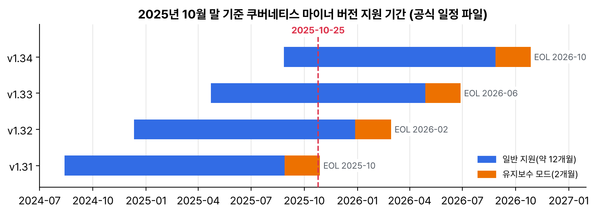

10월 28일이면 v1.31 지원이 끝난다. 작년 10월에 kind로 쿠버네티스를 처음 띄웠을 때 노드 버전이 v1.31.0이었으니, 처음 만진 버전이 1년 만에 지원 밖으로 나간다. 같은 주에 공식 블로그에 '흔한 쿠버네티스 실수 7가지' 글이 올라왔다. 읽다 보니 기초 공부할 때 내가 한 실수와 겹치는 게 많아서, 일곱 가지를 내 실습과 하나씩 맞대 봤다.

## 요약

- v1.31은 2025-10-28에 지원이 끝난다. 10월 24일 일정 파일 기준으로 지원 중인 버전은 v1.32, v1.33, v1.34이고, v1.32는 12월 28일에 유지보수 모드로 들어간다.
- 일정 파일의 '다음 패치' 칸에는 10월 14일 목표였던 1.31.14가 그대로 적혀 있었다. 그 전 패치는 9월 9일의 1.31.13이다.
- 공식 글이 꼽은 일곱 가지는 requests·limits 생략, 프로브 소홀, kubectl logs만 믿기, 개발과 운영을 똑같이 두기, 안 쓰는 리소스 방치, 네트워크를 너무 일찍 깊게 파기, 느슨한 보안과 RBAC다.
- 일곱 가지 모두 그 필드를 비워 둬도 쿠버네티스가 일단 돌아가게 해 줘서 생긴다. 필수가 아니니 빠뜨리기 쉽다.
- 개발과 운영의 차이는 kustomize의 base와 overlay로 나눈다. 공통 매니페스트는 base에 두고, 환경마다 다른 값만 overlay에 적는다.

## 1. v1.31 지원 종료

지원 기간이 정해지는 방식은 7월에 v1.30이 끝날 때 정리했다. 이번에는 10월 24일 커밋의 일정 파일로 표만 새로 그렸다.


_웹사이트 저장소의 일정 파일(10월 24일 커밋)로 그렸다. 빨간 점선이 이 글을 쓴 날이고, v1.31은 사흘 뒤에 끝난다_

| 버전 | 출시 | 유지보수 모드 | EOL | 10월 24일까지 나온 마지막 패치 |
|---|---|---|---|---|
| v1.34 | 2025-08-27 | 2026-08-27 | 2026-10-27 | 1.34.1 (09-09) |
| v1.33 | 2025-04-23 | 2026-04-28 | 2026-06-28 | 1.33.5 (09-09) |
| v1.32 | 2024-12-11 | 2025-12-28 | 2026-02-28 | 1.32.9 (09-09) |
| v1.31 | 2024-08-13 | 2025-08-28 | 2025-10-28 | 1.31.13 (09-09) |

7월에는 유지보수 모드와 EOL을 매달 28일로 맞춘다고 적었는데, v1.34만 27일로 적혀 있었다. 기초 실습용 study 클러스터는 1월에 v1.32로 다시 만들었고, 소식 글 실습은 그때그때 새 kind 클러스터로 해서 v1.31 노드는 이제 남아 있지 않다. 그래도 v1.32가 두 달 뒤 유지보수 모드라, 다음 kind 클러스터는 v1.34 노드로 만들 생각이다. EKS, GKE, AKS 같은 관리형 서비스는 자기 지원 표가 따로 있다.

## 2. 일곱 가지를 내 실습에 대 보기

| 실수 | 글의 처방 | 내 경우 |
|---|---|---|
| requests·limits를 안 쓴다 | 100m, 128Mi처럼 작게 시작하고 kubectl top이나 모니터링으로 실제 사용량을 보며 고친다 | 기초 1~4부 파드에는 자원 설정이 하나도 없었다. 5부 '리소스 요청과 프로브'에서야 붙였다 |
| 프로브를 가볍게 본다 | /healthz 같은 간단한 liveness, 준비될 때까지 트래픽을 막는 readiness. 검사는 단순하게 | WordPress 실습에서 MySQL이 늦게 떠서, readiness가 없으면 WordPress가 연결 오류를 냈다 |
| kubectl logs만 믿는다 | Fluentd나 Fluent Bit로 로그를 모으고, OpenTelemetry, Prometheus, Jaeger로 지표와 추적까지 본다 | 죽은 컨테이너 로그는 --previous로 봤지만, 파드를 지우면 그걸로 끝이었다. 로그 수집은 아직 안 해 봤다 |
| 개발과 운영을 똑같이 둔다 | kustomize overlay로 base를 공유하고 환경별 값만 바꾼다. 민감한 값은 Secret이나 Sealed Secrets로 | 클러스터가 하나라, CKAD 공부 때 overlay를 만들어 본 게 전부다 |
| 안 쓰는 리소스를 남겨 둔다 | owner나 purpose 라벨, 정기 점검, 가비지 컬렉션, Kyverno 같은 정책 도구 | kind는 클러스터를 지우면 끝이라 신경을 안 썼다. 클라우드였다면 로드밸런서 요금이 계속 나갔을 것이다 |
| 네트워크를 너무 일찍 깊게 판다 | 디플로이먼트, 서비스, 기본 인그레스 컨트롤러(예: Ingress-NGINX)로 시작해서 트래픽 흐름과 DNS부터 이해한다 | 기초 3부를 CNI, 서비스, DNS, 인그레스 순서로 봤는데 글이 권하는 순서와 같았다 |
| 보안과 RBAC를 느슨하게 둔다 | RBAC로 권한을 좁히고, 이미지 태그를 고정하고(latest 금지), Pod Security Admission이나 Kyverno로 non-root를 강제한다 | 이미지는 처음부터 nginx:1.27처럼 버전을 붙였다. PSA restricted 라벨을 붙여서 파드가 거절당하는 것도 해 봤다 |

글쓴이가 직접 겪은 일도 적혀 있다. 로컬 클러스터에서는 멀쩡하던 앱이 큰 환경에 올라가자 OOMKilled가 줄줄이 났고, 해커톤 뒤에 외부 로드밸런서가 붙은 test-svc를 안 지워서 3주 동안 요금을 냈고, 작은 내부 앱에 Istio를 붙였다가 앱보다 Istio를 디버깅하는 데 시간을 더 썼다고 한다.

일곱 가지의 공통점은 쿠버네티스가 requests도, 프로브도, 라벨도, securityContext도 비워 둔 채로 파드를 잘 띄워 준다는 점이다. 로컬에서는 그래도 아무 일이 없다. 글의 맺음말이 '쿠버네티스는 대단하지만 독심술사는 아니다'였는데, 이 한 줄이 일곱 가지를 다 설명한다.

## 3. 개발과 운영 나누기: kustomize base와 overlay

네 번째 실수를 직접 다시 해 봤다. 공통 매니페스트를 base에 두고, dev는 네임스페이스만, prod는 레플리카 수와 자원 값까지 바꾼다. 라벨로 주인을 붙이는 다섯 번째 실수 대책도 base에 같이 넣었다.


flowchart LR
  subgraph base["base/"]
    direction TB
    B1["deployment.yaml<br>replicas 1<br>requests 100m, 128Mi<br>프로브 포함"]
    B2["service.yaml"]
    B3["kustomization.yaml<br>owner: me 라벨"]
  end
  subgraph dev["overlays/dev/"]
    D1["namespace: dev<br>나머지는 base 그대로"]
  end
  subgraph prod["overlays/prod/"]
    P1["namespace: prod<br>replicas 3<br>requests 250m, 256Mi<br>limits 512Mi"]
  end
  base --> dev
  base --> prod
  dev --> O1["kubectl apply -k overlays/dev"]
  prod --> O2["kubectl apply -k overlays/prod"]


base/deployment.yaml에는 자원 값과 프로브를 처음부터 넣었다.

```yaml
apiVersion: apps/v1
kind: Deployment
metadata:
  name: web
spec:
  replicas: 1
  selector:
    matchLabels:
      app: web
  template:
    metadata:
      labels:
        app: web
    spec:
      containers:
      - name: web
        image: nginx:1.29
        ports:
        - containerPort: 80
        resources:
          requests:
            cpu: 100m
            memory: 128Mi
          limits:
            memory: 256Mi
        readinessProbe:
          httpGet:
            path: /
            port: 80
        livenessProbe:
          tcpSocket:
            port: 80
```

base/kustomization.yaml과 overlays/prod/kustomization.yaml이다. dev는 resources와 namespace: dev 두 줄뿐이다.

```yaml
# base/kustomization.yaml
resources:
- deployment.yaml
- service.yaml
labels:
- pairs:
    owner: me
  includeTemplates: true
---
# overlays/prod/kustomization.yaml
resources:
- ../../base
namespace: prod
replicas:
- name: web
  count: 3
patches:
- target:
    kind: Deployment
    name: web
  patch: |-
    - op: replace
      path: /spec/template/spec/containers/0/resources
      value:
        requests:
          cpu: 250m
          memory: 256Mi
        limits:
          memory: 512Mi
```

```bash
kubectl kustomize overlays/prod     # 적용하지 않고 결과만 본다
kubectl diff -k overlays/prod       # 클러스터와 달라질 부분만
kubectl apply -k overlays/prod
```

kubectl kustomize overlays/prod 결과에서 디플로이먼트 부분만 옮겼다(kubectl v1.32.2, 내장 kustomize v5.5.0).

```yaml
metadata:
  labels:
    owner: me
  name: web
  namespace: prod
spec:
  replicas: 3
  template:
    metadata:
      labels:
        app: web
        owner: me
    spec:
      containers:
      - image: nginx:1.29
        resources:
          limits:
            memory: 512Mi
          requests:
            cpu: 250m
            memory: 256Mi
```

labels에 includeTemplates를 켜면 파드 템플릿에도 owner 라벨이 붙고, 셀렉터(matchLabels)는 그대로 둔다. 예전에 쓰던 commonLabels는 셀렉터까지 바꾼다. 디플로이먼트 셀렉터는 만든 뒤에 바꿀 수 없어서, 이미 배포된 앱에 commonLabels를 새로 넣으면 적용이 거절된다. kustomize v5부터 commonLabels가 지원 중단된 것도 같은 이유로 이해했다.

## 내 클러스터에서 확인할 것

```bash
kubectl version                     # 서버가 v1.31 이하면 업그레이드 계획부터
kubectl get pods -A -o custom-columns='NS:.metadata.namespace,POD:.metadata.name,CPU_REQ:.spec.containers[*].resources.requests.cpu,MEM_REQ:.spec.containers[*].resources.requests.memory,MEM_LIM:.spec.containers[*].resources.limits.memory'
kubectl get pods -A -o jsonpath='{range .items[*]}{range .spec.containers[*]}{.image}{"\n"}{end}{end}' | sort -u
kubectl get deploy,svc,cm,pvc -A -L owner
kubectl get ns -L pod-security.kubernetes.io/enforce
kubectl get clusterrolebindings -o wide | grep cluster-admin
```

- 서버가 v1.31이면 10월 28일 뒤로는 보안 패치도 없다. 관리형 서비스라면 그 서비스의 지원 표를 본다.
- 자원 칸이 전부 `<none>`인 파드는 BestEffort라서 노드 메모리가 모자랄 때 가장 먼저 쫓겨난다.
- 이미지 목록에 태그가 없거나 latest인 것이 있으면 버전을 붙인다.
- OWNER 칸이 빈 리소스부터 누가 왜 만들었는지 확인한다. LoadBalancer 타입 서비스는 특히 먼저 본다.
- enforce 라벨이 없는 네임스페이스는 Pod Security 검사를 받지 않는다.
- cluster-admin에 묶인 사용자와 서비스 어카운트가 생각보다 많으면 줄인다.

> **쉬운 설명**
>
> 쿠버네티스는 시키는 것만 하는 성실한 신입 같다. "손님 오면 받아"라고만 하면 오븐이 아직 안 데워졌어도 손님을 받고(readiness 없음), 재료를 얼마나 써도 되는지 말 안 하면 냉장고를 혼자 다 쓰고(limits 없음), 다 쓴 그릇을 치우라고 안 하면 그대로 둔다(리소스 방치). 일곱 가지 실수는 결국 '말 안 해도 알아서 하겠지'에서 나온다. kustomize overlay는 같은 레시피(base)에 '평일 점심은 1인분, 주말은 3인분' 같은 상황별 메모(overlay)만 붙여 두는 방법이다. 레시피를 두 벌 쓰지 않아도 된다.

## 용어 정리

| 용어 | 뜻 |
|---|---|
| EOL | 지원 종료. 더는 패치가 나오지 않는다 |
| 유지보수 모드 | EOL 전 2개월. 심각한 보안 문제와 치명적인 버그만 고친다 |
| kustomize | 템플릿 없이 덮어쓰기로 매니페스트를 환경별로 바꾸는 도구. kubectl에 들어 있다(-k) |
| base, overlay | 공통 매니페스트와 환경별 변경분 |
| 가비지 컬렉션 | 주인(ownerReferences)이 지워지면 딸린 오브젝트를 같이 지우는 동작 |
| Kyverno | YAML로 정책을 써서 리소스를 검사, 변경, 정리하는 CNCF 정책 엔진 |
| Pod Security Admission | 네임스페이스 라벨로 파드 보안 수준(privileged, baseline, restricted)을 강제하는 내장 어드미션 |

## 참고 자료

- Kubernetes 블로그, 7 Common Kubernetes Pitfalls (and How I Learned to Avoid Them): <https://kubernetes.io/blog/2025/10/20/seven-kubernetes-pitfalls-and-how-to-avoid/>
- Kubernetes 릴리스 일정: <https://kubernetes.io/releases/>
- Kubernetes 패치 릴리스: <https://kubernetes.io/releases/patch-releases/>
- 웹사이트 저장소 일정 파일(10월 24일 커밋): <https://github.com/kubernetes/website/blob/398004b4ce1420a8319335389fb9bd00e7970000/data/releases/schedule.yaml>
- Kubernetes 문서, Kustomize로 오브젝트 관리: <https://kubernetes.io/docs/tasks/manage-kubernetes-objects/kustomization/>
- Kubernetes 문서, 가비지 컬렉션: <https://kubernetes.io/docs/concepts/architecture/garbage-collection/>
- Kubernetes 문서, Pod Security Admission: <https://kubernetes.io/docs/concepts/security/pod-security-admission/>
