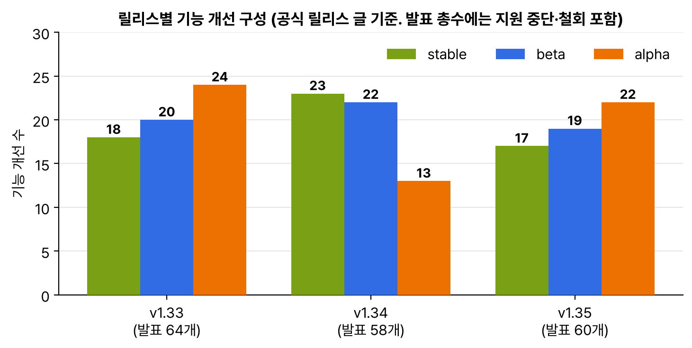

12월 17일에 v1.35가 나왔다. 이름은 Timbernetes(The World Tree Release)이고, 북유럽 신화의 세계수 위그드라실에서 따왔다고 한다. 로고에는 리뷰어, 릴리스 담당, 이슈 분류 담당을 상징하는 다람쥐 세 마리가 나무를 지킨다. 다음 날 kind v0.31.0이 나왔는데 기본 노드 이미지가 v1.35.0이라 바로 띄워 봤다. 이번에는 릴리스 글과 후속 글 중 in-place 리사이즈 GA, Job managedBy GA를 묶었다.

## 요약

- v1.35의 기능 개선은 60개다. stable 17개, beta 19개, alpha 22개. 개발 주기는 9월 15일부터 12월 17일까지 14주였다.
- 미리보기 때 정리한 대로 cgroup v1 지원이 빠졌고, kube-proxy ipvs 모드는 지원 중단돼 켜면 시작할 때 경고가 나온다. containerd 1.x는 이번이 마지막이다.
- in-place 파드 리사이즈가 GA가 됐다. beta 때 막혀 있던 메모리 limit 줄이기가 이제 된다. 다만 OOM을 피하려는 검사는 best-effort다.
- Job의 spec.managedBy가 GA가 됐다. 값을 기본값이 아닌 것으로 주면 내장 Job 컨트롤러가 그 Job을 건드리지 않고, 외부 컨트롤러(예: MultiKueue)가 맡는다. 한 번 정하면 못 바꾼다.
- 기본으로 켜진 것 중에 업그레이드 때 눈에 띌 만한 것이 있다. 모든 파드에 노드 토폴로지 라벨이 붙고, 노드에 캐시된 비공개 이미지도 파드에 풀 권한이 있는지 확인한다.

## 1. 숫자로 본 v1.35


_각 릴리스 글의 머리말 숫자로 그렸다. 발표 총수에는 지원 중단과 철회도 들어 있어서 막대 합과 다르다_

v1.34는 stable이 많았는데 v1.35는 다시 alpha가 많다. 머리말에는 stable 17개라고 적혀 있는데, 글 뒤쪽 졸업 목록에는 '모두 15개'라고 적혀 있고 실제로 나열된 항목은 14개였다. 세는 기준이 달라서 그런 것 같다. 이번 주기에는 85개 회사, 419명이 기여했다고 한다.

## 2. 내가 눈여겨본 변경

| 단계 | 기능 | 내용 |
|---|---|---|
| stable | in-place 파드 리사이즈 | 재시작 없이 CPU, 메모리를 바꾼다. 3절에 따로 정리 |
| stable | Job managedBy | 외부 컨트롤러에 Job을 맡긴다. 4절에 따로 정리 |
| stable | 파드 generation | 파드 spec이 바뀔 때마다 metadata.generation이 오르고, kubelet이 반영한 값은 status.observedGeneration에 나온다 |
| stable | PreferSameNode | 서비스 trafficDistribution에 같은 노드 엔드포인트 우선 옵션. PreferClose는 PreferSameZone으로 이름이 바뀌었다(옛 이름도 동작) |
| beta | 파드 인증서 | kubelet이 키를 만들고 PodCertificateRequest로 인증서를 받아 파드 파일 시스템에 써 준다 |
| beta | 토폴로지 라벨 Downward API | zone, region 같은 노드 토폴로지 라벨을 환경 변수나 파일로 받는다. 이를 위해 모든 파드에 토폴로지 라벨이 붙는다 |
| beta | 캐시 이미지 자격 증명 확인 | IfNotPresent라도 노드에 캐시된 비공개 이미지를 쓰려면 파드에 풀 권한이 있어야 한다. 기본으로 켜짐 |
| beta | 컨테이너별 재시작 규칙 | 컨테이너에 restartPolicy와 restartPolicyRules. 특정 종료 코드일 때만 그 컨테이너를 재시작한다 |
| beta | StatefulSet maxUnavailable | 롤링 업데이트 때 한 번에 여러 파드를 내린다. 기본값 1이라 예전 동작은 그대로 |
| beta | HPA 허용 오차 설정 | 고정 10%였던 tolerance를 HPA behavior에서 리소스별로 정한다 |
| beta | KYAML | 들여쓰기와 따옴표 문제를 줄인 YAML 부분 집합. 기본으로 켜졌고 KUBECTL_KYAML=false로 끈다 |
| beta | OCI 이미지 볼륨 | 기본으로 켜졌다. containerd v2.1 이상 같은 런타임이 필요하다 |
| alpha | 갱 스케줄링 | Workload API와 PodGroup. 파드 묶음 전체가 들어갈 자리가 있을 때만 한꺼번에 스케줄한다 |
| alpha | 숫자 톨러레이션 연산자 | 미리보기에서 본 Gt, Lt. SLA 같은 값으로 노드를 고른다 |
| alpha | 일시 정지한 Job의 리소스 변경 | suspend된 Job의 파드 템플릿 requests, limits를 고치고 다시 시작한다 |

지난번 설정 모범 사례 글에서 YAML 불리언 함정을 직접 확인했는데, KYAML이 바로 그 문제(글에서는 '노르웨이 버그'라고 부른다. 국가 코드 NO가 false가 되는 문제)를 줄이려는 형식이다. 그리고 kubelet을 재시작해도 멀쩡한 파드가 NotReady로 바뀌지 않게 고쳐졌다고 한다. 노드 유지보수 때 kubelet만 재시작해도 트래픽이 잠깐 빠지던 문제다.

## 3. in-place 리사이즈 GA

5월에 v1.33 beta로 해 봤던 실습을 kind v0.31.0(노드 v1.35.0)에서 다시 했다. 이번에는 beta에서 거절되던 메모리 limit 줄이기를 넣었다.

```bash
kind create cluster --name v135          # kind v0.31.0 → 노드 v1.35.0
kubectl run rz --image=nginx:1.29 --overrides='{"spec":{"containers":[{"name":"rz","image":"nginx:1.29","resources":{"requests":{"cpu":"100m","memory":"64Mi"},"limits":{"cpu":"200m","memory":"128Mi"}}}]}}'
kubectl patch pod rz --subresource resize --patch \
  '{"spec":{"containers":[{"name":"rz","resources":{"limits":{"memory":"96Mi"}}}]}}'
kubectl get pod rz -o jsonpath='{.status.containerStatuses[0].resources.limits.memory}{"\n"}'   # 96Mi
kubectl get pod rz -o jsonpath='{.metadata.generation} {.status.observedGeneration}{"\n"}'     # 두 값이 같으면 kubelet이 반영한 것
```

nginx는 메모리를 거의 안 써서 96Mi로 줄여도 문제가 없었다. 공식 글에 따르면 kubelet은 지금 사용량이 새 limit보다 낮을 때만 줄여 주는데, 이 검사가 best-effort라 OOM을 완전히 막아 주지는 않는다. 그리고 파드 generation이 같이 stable이 돼서, 리사이즈를 요청한 뒤 반영됐는지를 generation과 observedGeneration으로 확인할 수 있게 됐다.

| 바뀐 점(beta v1.33 → stable v1.35) | 내용 |
|---|---|
| 메모리 limit 줄이기 | 허용. 현재 사용량이 새 limit보다 낮을 때만 진행한다(best-effort) |
| 미뤄진 리사이즈 우선순위 | 노드 자리가 모자라 Deferred가 된 요청은 PriorityClass, QoS 클래스, 기다린 시간 순으로 다시 시도한다 |
| 파드 단위 리소스 리사이즈 | 별도 기능 게이트로 alpha |
| 관찰 | 리사이즈 전용 kubelet 지표와 파드 이벤트가 생겼다 |
| 아직 안 되는 것 | swap, 정적 CPU Manager, 정적 Memory Manager와 같이 쓸 때. CPU, 메모리 말고 다른 리소스 |

VPA의 InPlaceOrRecreate 모드도 beta가 됐다고 한다. 런타임 쪽 한계도 적혀 있었다. Java와 Python 런타임은 아직 재시작 없이 메모리 크기 변경을 지원하지 않는다고 한다. 컨테이너 limit은 바뀌어도 그 안의 런타임은 처음 크기 그대로일 수 있다는 뜻으로 이해했다.

## 4. Job managedBy GA

여러 클러스터에 배치 작업을 나눠 보내는 MultiKueue 때문에 생긴 기능이다. 관리 클러스터에 Job을 만들면 실제 실행은 워커 클러스터에서 하고, 상태만 관리 클러스터로 다시 복사해 온다. 그러려면 관리 클러스터의 내장 Job 컨트롤러가 그 Job으로 파드를 만들면 안 된다.


flowchart LR
  U["사용자"] -->|"Job 생성<br>spec.managedBy 지정"| M["관리 클러스터<br>내장 Job 컨트롤러는 건너뜀<br>MultiKueue가 맡음"]
  M -->|"Job 복사"| W1["워커 클러스터 1<br>내장 Job 컨트롤러가 실행<br>(managedBy 없음)"]
  M -.->|"자리가 있는 곳으로"| W2["워커 클러스터 2"]
  W1 -->|"상태를 다시 복사"| M
  U -->|"진행 상황 확인"| M


```yaml
apiVersion: batch/v1
kind: Job
metadata:
  name: delegated
spec:
  managedBy: example.com/batch-dispatcher
  template:
    spec:
      restartPolicy: Never
      containers:
      - name: main
        image: busybox:1.37
        command: ["sh", "-c", "echo done"]
```

| 값 | 동작 |
|---|---|
| 비워 두거나 kubernetes.io/job-controller | 내장 Job 컨트롤러가 평소처럼 처리 |
| 그 밖의 값 | 내장 Job 컨트롤러가 이 Job을 건너뛴다. 지정한 컨트롤러가 없으면 아무도 처리하지 않는다 |
| 바꾸기 | 불가. 실행 중인 Job을 다른 컨트롤러로 넘기다 파드가 고아가 되는 걸 막으려고 |

위 Job은 example.com/batch-dispatcher라는 컨트롤러가 없으니 만들어도 파드가 하나도 안 생긴다. 내장 Job 컨트롤러를 아예 끄면 되지 않느냐는 질문에 공식 글은 두 가지로 답했다. 관리형 쿠버네티스에서는 컨트롤러 매니저 플래그를 못 바꾸고, 큰 작업만 밖으로 보내고 작은 작업은 관리 클러스터에서 그냥 돌리고 싶을 때가 많아서 Job마다 정할 수 있어야 한다는 것이다. JobSet, Kubeflow Trainer, KubeRay, Tekton Pipelines 같은 프로젝트도 같은 필드를 넣고 있다고 한다.

## 내 클러스터에서 확인할 것

```bash
kubectl version
kubectl get nodes -o wide                                  # CONTAINER-RUNTIME이 containerd 1.x면 다음 업그레이드 전에 교체
kubectl get pods --show-labels | head                      # v1.35부터 토폴로지 라벨이 붙는다
kubectl get jobs -A -o custom-columns=NS:.metadata.namespace,JOB:.metadata.name,MANAGED_BY:.spec.managedBy
kubectl -n kube-system logs ds/kube-proxy | grep -i ipvs   # ipvs 모드면 지원 중단 경고
```

- 노드에 캐시된 비공개 이미지를 imagePullSecrets 없이 쓰던 파드가 있으면, v1.35에서 이미지 풀 단계에서 막힐 수 있다.
- 파드 라벨로 무언가를 고르는 스크립트가 있으면, 새로 붙는 토폴로지 라벨 때문에 결과가 달라지지 않는지 본다.
- MANAGED_BY가 비어 있지 않은 Job은 그 컨트롤러가 설치돼 있는지 확인한다.

> **쉬운 설명**
>
> in-place 리사이즈 GA는 이사 없이 방을 넓히거나 줄일 수 있게 된 것이다. 예전에는 방(메모리)을 줄이려면 짐이 넘칠까 봐 아예 막아 뒀는데, 이제는 '지금 짐이 새 방 크기보다 적으면' 줄여 준다. 다만 그 순간에 짐을 들여오면 넘칠 수 있다(best-effort). Job managedBy는 택배 접수처와 배송 기사를 나눈 것이다. 본사(관리 클러스터)는 접수와 배송 조회만 하고, 실제 배송은 지역 지점(워커 클러스터)이 한다. 접수증에 '본사 직원은 이건 손대지 마시오'라고 적어 두는 칸이 managedBy다.

## 용어 정리

| 용어 | 뜻 |
|---|---|
| resize 서브리소스 | 파드의 CPU, 메모리 값을 바꿀 때 쓰는 전용 API 경로. kubectl patch --subresource resize |
| observedGeneration | kubelet이 마지막으로 반영한 파드 spec의 generation |
| MultiKueue | Kueue의 여러 클러스터 배치 작업 분배 기능 |
| spec.managedBy | Job을 어떤 컨트롤러가 처리할지 정하는 필드. 바꿀 수 없다 |
| 갱 스케줄링 | 파드 묶음을 전부 넣을 수 있을 때만 한꺼번에 배치하는 방식 |
| KYAML | 쿠버네티스용으로 모호함을 줄인 YAML 부분 집합 |

## 참고 자료

- Kubernetes 블로그, Kubernetes v1.35: Timbernetes: <https://kubernetes.io/blog/2025/12/17/kubernetes-v1-35-release/>
- Kubernetes 블로그, In-Place Pod Resize Graduates to Stable: <https://kubernetes.io/blog/2025/12/19/kubernetes-v1-35-in-place-pod-resize-ga/>
- Kubernetes 블로그, Job Managed By Goes GA: <https://kubernetes.io/blog/2025/12/18/kubernetes-v1-35-job-managedby-for-jobs-goes-ga/>
- Kubernetes 문서, 컨테이너 CPU와 메모리 리사이즈: <https://kubernetes.io/docs/tasks/configure-pod-container/resize-container-resources/>
- Kubernetes 문서, Job: <https://kubernetes.io/docs/concepts/workloads/controllers/job/>
- kind v0.31.0 릴리스: <https://github.com/kubernetes-sigs/kind/releases/tag/v0.31.0>
