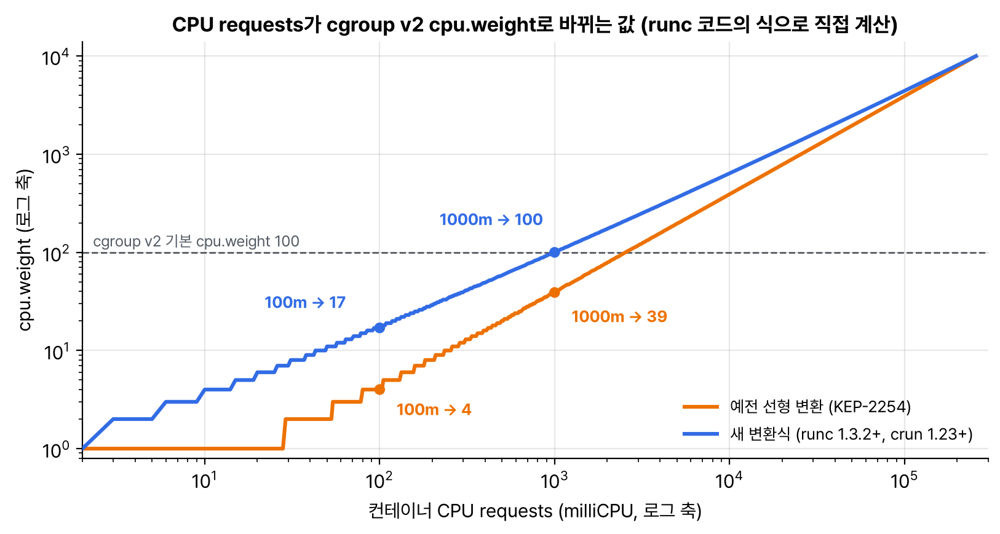

1월 말에 사흘 연속으로 읽을 만한 글이 나왔다. 운영위원회와 보안대응위원회가 같이 낸 Ingress NGINX 성명, kind에서 Gateway API를 띄워 보는 실습 글, 그리고 cgroup v1 CPU shares를 v2 CPU weight로 바꾸는 식이 바뀌었다는 글이다. 11월에 Ingress를 Gateway API로 옮기면서 구현체가 없어 gatewayClassName을 example로 비워 뒀는데, 이번 실습 글 덕분에 그 매니페스트를 실제로 띄워 봤다.

## 요약

- 1월 29일 성명은 Ingress NGINX가 클라우드 네이티브 환경의 절반쯤에서 쓰인다며, 3월 은퇴까지 두 달 남았다고 다시 경고했다. 그대로 대체할 수 있는 다른 도구는 없어서 계획과 작업 시간이 든다고 했다.
- cloud-provider-kind를 kind 옆에 띄우면 LoadBalancer 주소와 함께 cloud-provider-kind라는 GatewayClass가 생긴다. Gateway API CRD도 알아서 깔아 준다. 학습용이라 운영에는 쓰지 말라고 한다.
- 11월에 옮겨 둔 /foo, /bar HTTPRoute를 이 GatewayClass로 띄웠더니 그대로 동작했다.
- cgroup v2에서 CPU requests가 cpu.weight로 바뀌는 식이 선형에서 2차식으로 바뀌었다. 1 CPU가 39에서 기본값 100 근처로, 100m이 4에서 17로 올라간다.
- 새 식은 쿠버네티스가 아니라 OCI 런타임에 들어갔다. runc 1.3.2, crun 1.23부터다. 예전 식으로 cpu.weight를 계산해 확인하던 모니터링 도구는 고쳐야 한다.

## 1. Ingress NGINX, 두 달 남았다

11월 은퇴 발표 때와 내용은 같은데 말투가 훨씬 세다.

| 성명에서 짚은 것 | 내용 |
|---|---|
| 얼마나 쓰나 | Datadog 내부 조사로 클라우드 네이티브 환경의 약 50% |
| 남은 시간 | 3월 은퇴까지 두 달. 이후로는 버그 수정, 보안 패치, 어떤 업데이트도 없다 |
| 대체 | Gateway API나 다른 인그레스 컨트롤러. 그대로 바꿔 끼울 수 있는 건 없다 |
| 위험 | 기존 배포는 계속 동작해서, 직접 확인하지 않으면 공격당하고서야 알 수 있다 |
| 다시 살릴 수는 없나 | 사람이 생겨도 쌓인 기술 부채와 설계 때문에 계속 유지보수하는 건 이제 불가능하다고 했다 |

마지막 줄이 11월과 다른 점이다. 그때는 사람이 없어서 은퇴한다고 읽혔는데, 이번에는 사람이 있어도 안 된다고 못을 박았다.

## 2. kind에서 Gateway API 띄우기

cloud-provider-kind는 kind 클러스터에 클라우드가 있는 것처럼 흉내 내 주는 도구다. LoadBalancer 서비스에 주소를 주고, Gateway API 컨트롤러도 들어 있다. kind 클러스터 바깥에서 도커 컨테이너로 돈다.


flowchart LR
  subgraph host["내 컴퓨터의 도커"]
    direction TB
    CPK["cloud-provider-kind<br>컨테이너<br>LoadBalancer 컨트롤러<br>Gateway 컨트롤러"]
    subgraph kindnet["kind 네트워크 172.18.0.0/16"]
      direction TB
      N["kind 노드 컨테이너<br>Gateway, HTTPRoute<br>foo, bar 서비스와 파드"]
      GW["Gateway 주소<br>172.18.0.x:80"]
      C["curl 컨테이너"]
    end
  end
  CPK -->|"API 서버를 지켜보다가<br>GatewayClass 생성,<br>주소 할당"| N
  C -->|"Host: demo.exampledomain.example"| GW
  GW -->|"/foo, /bar"| N


```bash
kind create cluster --name gw                     # kind v0.31.0 → 노드 v1.35.0
VERSION="$(basename $(curl -s -L -o /dev/null -w '%{url_effective}' https://github.com/kubernetes-sigs/cloud-provider-kind/releases/latest))"
docker run -d --name cloud-provider-kind --rm --network host \
  -v /var/run/docker.sock:/var/run/docker.sock \
  registry.k8s.io/cloud-provider-kind/cloud-controller-manager:${VERSION}
kubectl get gatewayclass                           # cloud-provider-kind
```

뒤에 둘 foo, bar 서비스는 기초 공부 때 인그레스 실습과 똑같이 agnhost serve-hostname으로 만들었다. Gateway는 공식 글처럼 gateway-infra 네임스페이스에 두고, HTTPRoute는 11월에 옮긴 것에 hostnames와 parentRefs의 네임스페이스만 더했다.

```yaml
apiVersion: v1
kind: Namespace
metadata:
  name: gateway-infra
---
apiVersion: gateway.networking.k8s.io/v1
kind: Gateway
metadata:
  name: gateway
  namespace: gateway-infra
spec:
  gatewayClassName: cloud-provider-kind
  listeners:
  - name: default
    hostname: "*.exampledomain.example"
    port: 80
    protocol: HTTP
    allowedRoutes:
      namespaces:
        from: All
---
apiVersion: gateway.networking.k8s.io/v1
kind: HTTPRoute
metadata:
  name: demo
  namespace: default
spec:
  parentRefs:
  - name: gateway
    namespace: gateway-infra
  hostnames: ["demo.exampledomain.example"]
  rules:
  - name: foo
    matches:
    - path:
        type: PathPrefix
        value: /foo
    backendRefs:
    - name: foo
      port: 80
  - name: bar
    matches:
    - path:
        type: PathPrefix
        value: /bar
    backendRefs:
    - name: bar
      port: 80
```

```bash
kubectl get gateway -n gateway-infra gateway       # PROGRAMMED True, ADDRESS 172.18.0.x
GW_ADDR=$(kubectl get gateway -n gateway-infra gateway -o jsonpath='{.status.addresses[0].value}')
docker run --rm --network kind curlimages/curl:8.11.1 -s \
  --resolve demo.exampledomain.example:80:$GW_ADDR http://demo.exampledomain.example/foo   # foo-xxxxxxxxxx-xxxxx
```

맥에서는 도커 컨테이너의 172.18 대역 IP로 호스트에서 바로 닿지 않아서, curl을 kind 도커 네트워크 안의 컨테이너로 돌렸다. 리눅스라면 공식 글처럼 호스트에서 바로 curl을 쳐도 된다. allowedRoutes를 from: All로 둔 건 실습이라서다. 실제 클러스터에서는 Same이나 Selector로 붙을 수 있는 네임스페이스를 좁히라고 했다.

안 될 때 볼 곳도 정리해 뒀다.

| 어디 | 정상 | 흔한 문제 |
|---|---|---|
| Gateway status.conditions | Accepted, Programmed 둘 다 True, status.addresses에 IP | 컨트롤러가 안 떠 있으면 Accepted 자체가 안 생긴다 |
| HTTPRoute status.parents | Accepted, ResolvedRefs 둘 다 True | ResolvedRefs False, reason BackendNotFound면 서비스 이름이나 포트가 틀렸다 |
| HTTPRoute status.parents | | Accepted False면 네임스페이스 허용이나 hostname이 Gateway 리스너와 안 맞는다 |
| docker logs cloud-provider-kind | | 위 상태로 안 보이는 문제는 컨트롤러 로그에서 본다 |

hostname 규칙도 문서에서 확인했다. HTTPRoute에 hostnames를 안 적으면 리스너의 hostname 조건(*.exampledomain.example)만 적용되고, example.com처럼 리스너와 겹치지 않는 hostname을 적으면 그 리스너에 붙지 못해 Accepted가 False(reason NoMatchingListenerHostname)가 된다.

## 3. cgroup v2 CPU weight 새 변환식

쿠버네티스는 cgroup v1 시절에 CPU requests를 cpu.shares로 바꿨다. 1000m이 1024다. cgroup v2에는 shares 대신 1~10000 범위의 cpu.weight가 있어서 shares를 weight로 다시 바꾸는데, 그 식이 선형이라 문제가 있었다.

```text
예전(KEP-2254): cpu.weight = 1 + ((cpu.shares - 2) * 9999) / 262142
새 식:          cpu.weight = ceil(10 ^ ((L^2 + 125L) / 612 - 7/34)),  L = log2(cpu.shares)
```

새 식은 (2, 1), (1024, 100), (262144, 10000) 세 점을 지나는 2차식이다. 최솟값끼리, cgroup 기본값끼리, 최댓값끼리 맞춘 것이다. runc 코드의 식으로 몇 개를 직접 계산해서 그렸다.


_runc 1.3.2가 쓰는 변환 함수를 그대로 계산했다. 예전 식에서는 1 CPU가 기본값 100의 40%도 안 됐다_

| CPU requests | cpu.shares | 예전 weight | 새 weight |
|---|---|---|---|
| 10m | 10 | 1 | 4 |
| 100m | 102 | 4 | 17 |
| 250m | 256 | 10 | 35 |
| 500m | 512 | 20 | 59 |
| 1000m | 1024 | 39 | 100 |
| 2000m | 2048 | 79 | 174 |
| 4000m | 4096 | 157 | 303 |

| 예전 식의 문제 | 내용 |
|---|---|
| 노드의 다른 프로세스보다 밀림 | v1에서 1 CPU 요청 컨테이너는 shares 1024로 기본값과 같았다. v2에서는 39라서 쿠버네티스 밖의 시스템 데몬(기본 100)보다 우선순위가 낮아졌다 |
| 너무 거친 값 | 100m 요청이 weight 4라, 컨테이너 안에서 하위 cgroup으로 다시 나누기 어렵다 |

공식 글에는 1 CPU가 102가 된다고 적혀 있는데, 위 식으로 계산하면 정확히 100이 나왔다. log2(1024)가 10이라 지수가 딱 2가 되기 때문이다. 어느 쪽이든 기본값 100 근처로 돌아왔다는 요지는 같다.

| 알아 둘 점 | 내용 |
|---|---|
| 어디서 바뀌나 | 쿠버네티스가 아니라 OCI 런타임. runc 1.3.2, crun 1.23부터 |
| 영향받는 것 | 예전 식으로 기대 weight를 계산하는 모니터링, 자원 관리 도구 |
| 역변환 | cpu.weight에서 requests를 거꾸로 구하면 정확하지 않다. 정수로 잘리고 여러 값이 같은 weight로 모인다. requests는 파드 spec에서 읽는다 |
| 권고 | 런타임을 올리기 전에 운영이 아닌 환경에서 먼저 확인 |

## 내 클러스터에서 확인할 것

```bash
kubectl get pods --all-namespaces --selector app.kubernetes.io/name=ingress-nginx
kubectl get gatewayclass
docker exec gw-control-plane runc --version              # kind 노드 안의 runc 버전
kubectl run w --image=busybox:1.37 --overrides='{"spec":{"containers":[{"name":"w","image":"busybox:1.37","command":["sleep","3600"],"resources":{"requests":{"cpu":"100m"}}}]}}'
kubectl exec w -- cat /sys/fs/cgroup/cpu.weight          # 예전 식이면 4, 새 식이면 17
```

- 첫 줄에 파드가 나오면 3월 전에 옮길 계획이 있어야 한다.
- runc가 1.3.2 이상(crun은 1.23 이상)인 노드와 아닌 노드가 섞여 있으면, 같은 requests라도 노드마다 cpu.weight가 다르게 나온다.
- cpu.weight 값을 직접 보고 알림을 거는 대시보드가 있다면 기준값을 다시 잡는다.

> **쉬운 설명**
>
> cloud-provider-kind는 장난감 집(kind)에 붙이는 장난감 정문과 우편함이다. 진짜 건물(클라우드)이 아니어도 '정문 주소를 주세요'(LoadBalancer, Gateway)라고 하면 주소를 하나 붙여 줘서, Gateway API 연습을 집에서 할 수 있다. cgroup v2 CPU weight는 급식 줄의 우선권 점수다. 예전 계산법에서는 '밥 한 공기(1 CPU)'를 신청한 아이가 39점을 받아서, 아무것도 신청 안 한 선생님들(시스템 프로세스, 기본 100점)보다 뒤로 밀렸다. 새 계산법은 한 공기 신청이면 선생님과 같은 100점을 주고, 반 공기나 작은 공기도 너무 낮은 점수가 나오지 않게 곡선으로 고쳤다.

## 용어 정리

| 용어 | 뜻 |
|---|---|
| cloud-provider-kind | kind 클러스터에 LoadBalancer와 Gateway API 컨트롤러를 붙여 주는 학습용 도구 |
| GatewayClass | 어떤 컨트롤러가 Gateway를 처리할지 정하는 클러스터 리소스 |
| allowedRoutes | Gateway 리스너에 어느 네임스페이스의 Route가 붙을 수 있는지 정하는 필드 |
| cpu.shares | cgroup v1의 CPU 상대 가중치. 기본 1024, 범위 2~262144 |
| cpu.weight | cgroup v2의 CPU 상대 가중치. 기본 100, 범위 1~10000 |
| OCI 런타임 | 컨테이너를 실제로 만드는 저수준 런타임. runc, crun |

## 참고 자료

- Kubernetes 블로그, Ingress NGINX: Statement from the Kubernetes Steering and Security Response Committees: <https://kubernetes.io/blog/2026/01/29/ingress-nginx-statement/>
- Kubernetes 블로그, Experimenting with Gateway API using kind: <https://kubernetes.io/blog/2026/01/28/experimenting-gateway-api-with-kind/>
- Kubernetes 블로그, New Conversion from cgroup v1 CPU Shares to v2 CPU Weight: <https://kubernetes.io/blog/2026/01/30/new-cgroup-v1-to-v2-cpu-conversion-formula/>
- cloud-provider-kind: <https://github.com/kubernetes-sigs/cloud-provider-kind>
- runc 변환 함수(opencontainers/cgroups): <https://github.com/opencontainers/cgroups/blob/main/utils.go>
- Kubernetes 문서, cgroup v2: <https://kubernetes.io/docs/concepts/architecture/cgroups/>
