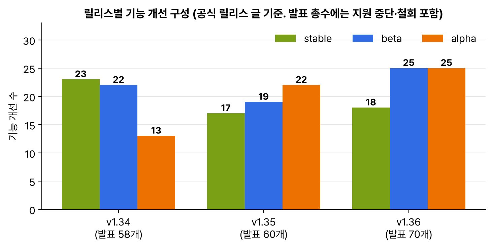

4월 22일에 v1.36이 나왔다. 이름은 ハル(Haru)다. 일본어로 봄(春), 맑은 하늘(晴れ), 아득히 먼(遥か)을 다 담은 소리라고 한다. 로고는 호쿠사이의 후가쿠 36경 중 붉은 후지(凱風快晴)를 다시 그린 것인데, 1.36이라 36경을 골랐다는 설명이 재미있었다. 산 아래에는 신사의 고마이누처럼 고양이 두 마리(Stella, Nacho)가 앉아 있다. 같은 주에 User Namespaces GA 글과 Gateway API v1.5 소개 글도 나와서 묶었다.

## 요약

- v1.36의 기능 개선은 70개다. stable 18개, beta 25개, alpha 25개. 개발 주기는 1월 12일부터 4월 22일까지 15주였다.
- User Namespaces가 GA가 됐다. 파드에 hostUsers: false만 주면 컨테이너 안의 root가 노드에서는 권한 없는 UID가 된다. 리눅스 전용이다.
- MutatingAdmissionPolicy(CEL로 쓰는 변경 어드미션), kubelet API 세분화 권한, 노드 로그 조회, PSI 지표, OCI 이미지 볼륨이 stable이 됐다.
- Service의 spec.externalIPs가 지원 중단돼 쓰면 경고가 나온다. v1.43에서 제거할 계획이다. gitRepo 볼륨은 완전히 막혔다.
- Gateway API v1.5(2월 27일 출시)는 ListenerSet, TLSRoute, CORS 필터, 클라이언트 인증서 검증, ReferenceGrant 등 여섯 가지를 Standard로 올렸다. 이제 쿠버네티스 1.30 이상이 필요하다.

## 1. 숫자로 본 v1.36


_각 릴리스 글의 머리말 숫자로 그렸다. v1.36은 발표 수가 70개로 세 릴리스 중 가장 많다_

이번 주기에는 106개 회사, 491명이 기여했다. 릴리스 글의 '기타' 항목에는 Ingress NGINX가 3월 24일에 은퇴했다는 내용도 들어 있었다. 쿠버네티스 릴리스와는 따로인 일이지만 그만큼 중요하다고 본 것 같다.

## 2. 내가 눈여겨본 변경

| 단계 | 기능 | 내용 |
|---|---|---|
| stable | User Namespaces | 아래 3절에 따로 정리 |
| stable | kubelet API 세분화 권한 | 모니터링 도구에 nodes/proxy 같은 넓은 권한 대신 필요한 kubelet API만 허용한다. v1.32 alpha, v1.33 beta |
| stable | MutatingAdmissionPolicy | 웹훅 서버 없이 API 서버 안에서 CEL로 요청을 고친다. 검증용 ValidatingAdmissionPolicy의 변경판 |
| stable | 노드 로그 조회 | 노드에 SSH로 들어가지 않고 kubelet API로 kubelet, kube-proxy 같은 서비스 로그를 본다. kubelet 설정 enableSystemLogQuery도 켜야 한다 |
| stable | PSI 지표 | 작년 10월에 beta로 정리한 그 기능. CPU, 메모리, I/O 압박을 기다린 시간으로 잰다 |
| stable | OCI 이미지 볼륨 | 레지스트리의 이미지나 아티팩트를 볼륨으로 마운트한다 |
| stable | VolumeGroupSnapshot | 여러 PVC를 같은 시점으로 한꺼번에 스냅샷한다 |
| stable | SELinux 볼륨 라벨 | 파일마다 재귀로 라벨을 바꾸지 않고 마운트 옵션 하나로 붙인다. 다음 버전에서 호환이 깨질 수 있다는 경고가 같이 붙었다 |
| beta | kuberc | ~/.kube/kuberc에 kubectl 별칭, 기본 플래그 같은 개인 설정을 kubeconfig와 따로 둔다. 자격 증명 플러그인 허용 목록도 넣을 수 있다 |
| beta | 일시 정지한 Job의 리소스 변경 | v1.35 alpha에서 beta로 |
| alpha | 워크로드 단위 스케줄링 확장 | 새 PodGroup API와 PodGroup 스케줄링 주기. 그룹 전체를 한 번에 평가해서 다 붙이거나 하나도 안 붙인다. Job 컨트롤러와도 연결된다 |
| alpha | HPA 0까지 줄이기 | Object, External 지표를 쓸 때 레플리카를 0까지 줄였다가 큐 길이 같은 지표가 오르면 다시 늘린다 |
| 지원 중단 | Service spec.externalIPs | CVE-2020-8554의 중간자 공격 통로. 쓰면 경고가 나오고 v1.43에서 제거 예정 |
| 제거 | gitRepo 볼륨 | v1.11부터 지원 중단이었는데 이제 다시 켤 수도 없다. 노드에서 root로 코드가 실행될 수 있는 문제 때문이다 |

1월에 정리한 갱 스케줄링이 한 릴리스 만에 PodGroup이라는 별도 API와 그룹 단위 스케줄링 주기로 커졌다. v1.35에서는 minCount만큼 자리가 있는지를 보고 파드를 하나씩 Permit에서 기다리게 했는데, 이번에는 그룹 전체를 한 번에 계산한다.

## 3. User Namespaces GA

컨테이너 안에서 root(UID 0)로 도는 프로세스는 커널이 보기에도 호스트의 root다. 그래서 컨테이너를 탈출하면 바로 노드의 root가 된다. User Namespaces를 켜면 컨테이너 안의 0번이 노드에서는 아무 권한 없는 큰 번호의 UID로 매핑된다.

```yaml
apiVersion: v1
kind: Pod
metadata:
  name: isolated-workload
spec:
  hostUsers: false
  containers:
  - name: app
    image: fedora:42
    command: ["sleep", "infinity"]
    securityContext:
      runAsUser: 0
```

| 알아 둘 점 | 내용 |
|---|---|
| 쓰는 법 | 파드 spec에 hostUsers: false. 이미지는 그대로 둔다. alpha 때와 같은 필드다 |
| 핵심 기술 | ID 매핑 마운트(리눅스 5.12부터). 볼륨 파일 소유자를 디스크에서 바꾸지 않고 마운트할 때 커널이 번역한다. 예전처럼 모든 파일을 chown하지 않아서 빠르다 |
| 권한 | CAP_NET_ADMIN 같은 capability가 네임스페이스 안으로 한정된다. 컨테이너 자기 자원은 관리하지만 노드에는 영향이 없다 |
| 범위 | 리눅스 전용 |
| 역사 | 첫 KEP가 10년 전에 열렸고, 지금 담당자들이 6년 동안 작업했다고 한다 |

CKA 공부 때 securityContext의 runAsNonRoot, capabilities drop을 외우면서 '그래도 root가 필요한 이미지는 어쩌지' 싶었는데, 이게 그 답이다. root가 필요하면 root로 돌리되 바깥에서는 root가 아니게 만든다. 작년 10월에 정리한 '흔한 실수 7가지' 글의 보안 항목과도 이어진다.

## 4. Gateway API v1.5

v1.5.0은 2월 27일에 나왔고, 공식 블로그 소개 글은 4월에 올라왔다(처음엔 출시일이 틀리게 적혀 있다가 고쳐졌다). v1.5.1 패치도 이미 나와 있다. 이번 버전부터 기능 동결일에 준비된 것만 싣는 릴리스 열차 방식으로 바뀌었고, 문서가 준비되지 않은 기능도 싣지 않는다.

| Standard로 올라온 기능 | 내용 |
|---|---|
| ListenerSet | 리스너를 Gateway 밖에서 따로 정의해 붙인다. 앱 팀이 자기 TLS 리스너를 관리하고, Gateway 하나에 리스너 64개 제한도 넘을 수 있다 |
| TLSRoute | TLS 핸드셰이크의 SNI로 라우팅한다. Passthrough(게이트웨이가 복호화하지 않음)와 Terminate 모드 |
| HTTPRoute CORS 필터 | allowOrigins, allowMethods, allowHeaders, exposeHeaders, allowCredentials, maxAge |
| 클라이언트 인증서 검증 | Gateway spec.tls.frontend의 기본값과 포트별 설정. 모드는 AllowValidOnly(기본)와 AllowInsecureFallback |
| 백엔드로 보낼 클라이언트 인증서 | spec.tls.backend.clientCertificateRef. 게이트웨이와 백엔드 사이 mTLS |
| ReferenceGrant v1 | 1년 넘게 안 바뀌어서 v1으로 올렸다 |

v1.3 때 XListenerSet이라는 실험 리소스로 처음 봤던 게 ListenerSet으로 정식이 됐고, v1.4 때 Experimental이던 클라이언트 인증서 검증도 Standard가 됐다. 1년 동안 세 번 정리하면서 같은 기능이 Experimental에서 Standard로 올라오는 걸 따라가 봤다.


flowchart LR
  subgraph infra["infra 네임스페이스 (플랫폼 팀)"]
    G["Gateway example-gateway<br>listener http:80<br>allowedListeners: All"]
  end
  subgraph ta["team-a 네임스페이스"]
    LA["ListenerSet<br>team-a-listeners<br>https-a:443<br>a.example.com, a-cert"]
  end
  subgraph tb["team-b 네임스페이스"]
    LB["ListenerSet<br>team-b-listeners<br>https-b:443<br>b.example.com, b-cert"]
  end
  LA -->|"parentRef"| G
  LB -->|"parentRef"| G
  G --> M["컨트롤러가 합친 리스너<br>http:80<br>https-a:443<br>https-b:443"]


```yaml
apiVersion: gateway.networking.k8s.io/v1
kind: ListenerSet
metadata:
  name: team-a-listeners
  namespace: team-a
spec:
  parentRef:
    name: example-gateway
    namespace: infra
  listeners:
  - name: https-a
    protocol: HTTPS
    port: 443
    hostname: a.example.com
    tls:
      certificateRefs:
      - name: a-cert
```

Gateway 쪽에서 spec.allowedListeners로 어느 네임스페이스의 ListenerSet을 받을지 정한다. ListenerSet이 있어도 Gateway에는 유효한 리스너가 최소 하나는 있어야 한다.

주의할 점이 하나 있었다. v1.4 이하의 Experimental 채널로 TLSRoute를 쓰다가 v1.5 Standard YAML을 깔면, 기존 TLSRoute는 v1alpha2나 v1alpha3로 저장돼 있어서 쓸 수 없게 된다. 계속 Experimental 채널을 쓰거나 TLSRoute를 v1으로 옮겨야 한다. 이 글을 쓸 당시 v1.5를 완전히 통과한 구현체는 Agentgateway, Airlock Microgateway, GKE Gateway, HAProxy Ingress, kgateway, NGINX Gateway Fabric, Traefik Proxy 일곱 개다.

## 내 클러스터에서 확인할 것

```bash
kubectl get svc -A -o custom-columns=NS:.metadata.namespace,SVC:.metadata.name,EXTERNAL_IPS:.spec.externalIPs | grep -v '<none>'
kubectl apply -f isolated-workload.yaml
kubectl exec isolated-workload -- cat /proc/self/uid_map      # 0 뒤에 큰 호스트 UID와 65536이 나오면 매핑된 것
kubectl get crd tlsroutes.gateway.networking.k8s.io -o jsonpath='{.spec.versions[*].name}{"\n"}'
```

- EXTERNAL_IPS가 채워진 서비스는 v1.36부터 경고가 나온다. LoadBalancer, NodePort, Gateway API 중 하나로 옮길 계획을 세운다.
- uid_map이 0 0 4294967295로 나오면 호스트 사용자 네임스페이스를 그대로 쓰는 것이다. 노드 커널과 런타임(containerd, runc 버전)이 User Namespaces를 지원하는지 본다.
- TLSRoute CRD 버전이 v1alpha2, v1alpha3뿐이면 Gateway API v1.5 Standard로 올리기 전에 옮길 방법부터 정한다.
- gitRepo 볼륨을 쓰는 매니페스트가 있으면 init 컨테이너나 git-sync로 바꾼다.

> **쉬운 설명**
>
> User Namespaces는 회사 출입증 같다. 사무실(컨테이너) 안에서는 '팀장(root)' 출입증이라 자기 사무실 문은 다 연다. 그런데 건물 로비(노드)에 나가면 같은 출입증이 '방문객'으로 읽힌다. 그래서 누가 그 출입증을 훔쳐 사무실 밖으로 나가도 건물 전체 문은 못 연다. Gateway API v1.5의 ListenerSet은 건물 정문(Gateway)은 관리실이 지키되, 각 입주사가 자기 전용 출입구(HTTPS 리스너와 인증서)를 직접 신청해서 붙이는 방식이다. 관리실은 '어느 입주사의 신청을 받을지'만 정한다.

## 용어 정리

| 용어 | 뜻 |
|---|---|
| hostUsers | false면 파드를 별도 사용자 네임스페이스에서 돌린다 |
| ID 매핑 마운트 | 마운트할 때 커널이 파일 소유자 UID, GID를 번역하는 기능 |
| MutatingAdmissionPolicy | CEL로 요청 내용을 바꾸는 API 서버 내장 어드미션 정책 |
| externalIPs | 서비스에 임의의 외부 IP를 붙이는 필드. v1.36에서 지원 중단 |
| ListenerSet | Gateway에 리스너를 따로 붙이는 Gateway API 리소스 |
| TLSRoute | SNI 기준으로 TLS 연결을 라우팅하는 Gateway API 리소스 |
| ReferenceGrant | 다른 네임스페이스의 리소스를 참조하도록 허락하는 Gateway API 리소스 |

## 참고 자료

- Kubernetes 블로그, Kubernetes v1.36: ハル (Haru): <https://kubernetes.io/blog/2026/04/22/kubernetes-v1-36-release/>
- Kubernetes 블로그, User Namespaces in Kubernetes are finally GA: <https://kubernetes.io/blog/2026/04/23/kubernetes-v1-36-userns-ga/>
- Kubernetes 블로그, Gateway API v1.5: Moving features to Stable: <https://kubernetes.io/blog/2026/04/21/gateway-api-v1-5/>
- Kubernetes 문서, 사용자 네임스페이스: <https://kubernetes.io/docs/concepts/workloads/pods/user-namespaces/>
- KEP-5707, Service externalIPs 지원 중단: <https://github.com/kubernetes/enhancements/issues/5707>
