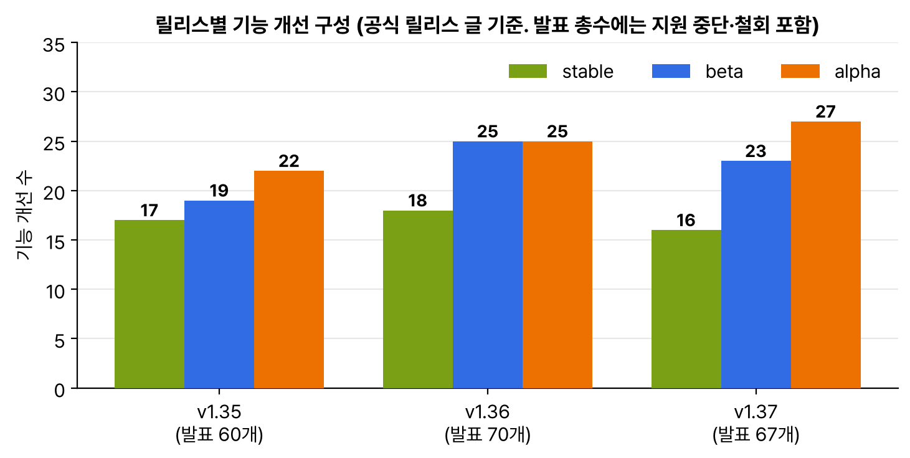

8월 26일에 v1.37이 나왔다. 이름은 Garhwal(गढ़वाल)로, 인도 우타라칸드주의 히말라야 지역이다. 로고는 그 풍경을 들여다보는 창문인데, 계단식 밭이 아래 단에 기대 위로 올라가는 모습을 릴리스가 앞선 작업 위에 쌓이는 것에 빗댔다. 집에 데바나가리 숫자로 १.३७이 적혀 있고, '37초 동안 로고를 보고 있으면 풍경이 움직인다'는 각주가 붙어 있었다. 같은 날 kind v0.33.0이 나와 기본 노드가 v1.37.0이 됐다. 후속 글 중에는 Metrics API v1과 Pod 인증서 GA를 골랐다.

## 요약

- v1.37의 기능 개선은 67개다. stable 16개, beta 23개, alpha 27개, 지원 중단과 제거 1개. 개발 주기는 5월 18일부터 8월 26일까지 15주였다.
- metrics.k8s.io가 v1으로 stable이 됐다. 필드는 v1beta1과 똑같다. kubectl top은 v1을 먼저 쓰고 없으면 v1beta1로 내려가지만, HPA 컨트롤러는 아직 v1beta1만 쓴다.
- Pod 인증서와 ClusterTrustBundle이 GA가 됐다. 서비스 어카운트 JWT 같은 '가진 사람이 곧 주인'인 토큰 대신, 개인 키를 파드 밖으로 내보내지 않는 X.509 인증서를 kubelet이 발급받아 넣어 준다.
- HPA의 0까지 줄이기가 beta로 기본 켜짐이 됐고, 매니페스트 기반 어드미션과 갱 스케줄링도 beta가 됐다. etcd RangeStream은 beta로 kube-apiserver에서 기본으로 켜진다.
- kube-dns가 지원 중단됐다. v1.40 뒤로는 새 패키지가 안 나올 예정이다.

## 1. 숫자로 본 v1.37


_각 릴리스 글의 머리말 숫자로 그렸다. v1.37은 alpha가 27개로 가장 많다_

이번에도 머리말과 졸업 목록 숫자가 달랐다. 머리말은 stable 16개인데 목록에는 17개가 적혀 있다. v1.35 때 반대 경우를 본 적이 있어서 이번엔 그러려니 했다. 기여한 곳은 212개 회사, 1,754명이라고 한다.

## 2. 지금까지 따라온 기능이 어디까지 왔나

1년 넘게 소식을 정리하다 보니, v1.37 목록 상당수가 예전에 alpha나 beta로 적어 둔 것들이었다.

| 기능 | 처음 정리한 때 | v1.37 |
|---|---|---|
| 노드 선언 기능(declaredFeatures) | v1.35 미리보기, alpha | stable. kubelet이 시작할 때 기능 게이트와 정적 설정만 보고 정한다 |
| KYAML | v1.35 때 beta | stable. kubectl get -o kyaml |
| 갱 스케줄링 | v1.35 alpha | beta. 워크로드 단위 선점과 PodGroup 대기열이 붙었다 |
| 매니페스트 기반 어드미션 | v1.36 alpha | beta. etcd가 없어도 정책이 동작한다 |
| HPA 0까지 줄이기 | v1.36 alpha | beta, 기본 켜짐. minReplicas: 0, Object나 External 지표만 |
| etcd RangeStream | etcd 3.7 정식 | kube-apiserver의 EtcdRangeStream beta, 기본 켜짐. watch 캐시 초기화가 주 사용처 |
| in-place 리사이즈 | v1.35 GA | 자리가 없어 Deferred된 리사이즈를 위해 낮은 우선순위 파드를 밀어내는 스케줄러 선점(alpha) |
| SELinuxMount | v1.37 미리보기 | stable. 볼륨을 같이 쓰는 파드의 SELinux 라벨이 다르면 seLinuxChangePolicy: Recursive |

새로 눈에 띈 것도 있다. watch 캐시 초기화가 stable이 되면서 API 서버가 감당 못 할 list, watch 요청에 HTTP 429를 돌려준다. 직접 만든 컨트롤러가 있다면 Retry-After를 보고 지수 백오프로 다시 시도하게 해야 한다. 파드 단위 체크포인트와 복원(alpha)은 CRI에 CheckpointPod, RestorePod가 생긴 것이고, StatefulSet에도 디플로이먼트처럼 Recreate 전략(alpha)이 생겼다. StatefulSet maxUnavailable은 v1.36에서 버그(kubernetes#137409) 때문에 기본으로 꺼졌다가 다시 켜졌다.

## 3. Metrics API v1

kubectl top과 HPA가 쓰는 metrics.k8s.io는 v1.6에 alpha, v1.8에 beta가 되고 9년 가까이 그대로였다. 이번 v1은 버전 이름만 바뀐 것이고 필드나 값의 의미는 그대로다.


flowchart LR
  T["kubectl top"] -->|"v1 먼저, 없으면 v1beta1"| AG["API 서버<br>집계 계층(APIService)"]
  H["HPA 컨트롤러"] -->|"v1.37에서는 v1beta1만"| AG
  AG --> MS["metrics-server 등 구현체<br>v1과 v1beta1을<br>같이 제공해야 함"]
  MS --> K["각 노드 kubelet의<br>리소스 지표"]


| 알아 둘 점 | 내용 |
|---|---|
| 리소스 | NodeMetrics(노드 CPU, 메모리), PodMetrics(파드와 컨테이너별) |
| 기능 게이트 | 필요 없다. 집계 계층으로 제공되니 구현체가 v1을 제공하고 APIService를 등록하면 된다 |
| 전환 기간 | 구현체는 v1과 v1beta1을 같이 제공하라고 한다. HPA가 아직 v1beta1만 보기 때문이다 |
| 범위 | 자동 확장과 기본 확인용의 작은 API. 모니터링 파이프라인이나 custom.metrics.k8s.io를 대신하지 않는다 |

```bash
kubectl get --raw /apis/metrics.k8s.io/v1/nodes
kubectl get --raw /apis/metrics.k8s.io/ | jq '.versions'
kubectl get apiservice v1.metrics.k8s.io v1beta1.metrics.k8s.io
```

기초 공부 때 '스케줄러는 실제 사용량이 아니라 requests로 자리를 계산하고, 사용량은 kubectl top으로 따로 본다(metrics-server 필요)'고 적었다. 그 kubectl top 뒤에 있던 API가 이제야 정식이 된 셈이다.

## 4. Pod 인증서와 ClusterTrustBundle GA

v1.35 때 beta로 정리한 Pod 인증서가 GA가 됐다. 공식 글이 왜 필요한지를 잘 설명해 줬다. 서비스 어카운트 JWT는 편하지만 bearer 토큰이라, 상대에게 인증하려고 토큰을 넘기는 순간 그 상대도 나인 척할 수 있다. X.509 인증서는 개인 키는 내가 갖고 있고 '키를 갖고 있다는 증명'만 보내니 그런 문제가 없다.


sequenceDiagram
  participant K as kubelet
  participant A as API 서버
  participant S as 서명자 컨트롤러
  participant P as 파드 파일 시스템
  K->>K: keyType대로 개인 키 생성
  K->>A: PodCertificateRequest 생성
  A->>A: 노드 제한 검사(이 노드의 파드인가)
  S->>A: 요청을 보고 발급 여부 결정
  S->>A: status.certificateChain, beginRefreshAt 채움
  K->>A: 발급된 인증서 가져옴
  K->>P: 개인 키와 인증서를 한 파일(credential bundle)로 기록
  Note over K,P: beginRefreshAt이 지나면 같은 과정을 반복해 교체


```yaml
apiVersion: v1
kind: Pod
metadata:
  name: cert-demo
  namespace: demo
spec:
  containers:
  - name: app
    image: busybox:1.37
    command: ["sh", "-c", "ls -l /var/run/identity; sleep 3600"]
    volumeMounts:
    - name: identity
      mountPath: /var/run/identity
      readOnly: true
  volumes:
  - name: identity
    projected:
      sources:
      - podCertificate:
          signerName: ahmedtd.github.io/tinycert-spiffe
          keyType: ED25519
          credentialBundlePath: credentialbundle.pem
      - clusterTrustBundle:
          signerName: ahmedtd.github.io/tinycert-spiffe
          labelSelector: {}
          path: trust-bundle.pem
```

| 알아 둘 점 | 내용 |
|---|---|
| 서명자 | 쿠버네티스 본체에는 아직 서명자가 없다. 써 보려면 글쓴이가 만든 Tinycert 같은 서드파티 서명자를 깔아야 한다(kind에도 된다) |
| 앞으로 | 서비스 DNS 이름용 서버 TLS 인증서, SPIFFE 클라이언트 인증서 서명자를 본체에 넣을 계획 |
| 수명 | 본체 서명자는 최대 24시간, 다른 서명자는 최대 91일 |
| 교체 | kubelet이 자동으로 바꿔 쓴다. 앱은 inotify나 주기적 확인으로 파일 변경을 다시 읽어야 한다. 키와 인증서를 한 파일로 받으면 교체 도중 짝이 안 맞는 문제를 피한다 |
| ClusterTrustBundle | 인증서를 검증할 신뢰 앵커 묶음. 서명자 이름과 라벨 셀렉터로 골라 파일로 받는다 |

위 파드 매니페스트는 v1.37 스키마로 검사해서 통과했다. Tinycert의 SPIFFE 서명자 이름을 넣었으니 실제로는 Tinycert를 먼저 설치해야 인증서가 들어온다.

## 내 클러스터에서 확인할 것

```bash
kubectl get apiservice | grep metrics.k8s.io
kubectl -n kube-system get deploy -l k8s-app=kube-dns -o wide        # IMAGES 칸이 coredns인지 kube-dns인지
kubectl get hpa -A -o custom-columns=NS:.metadata.namespace,HPA:.metadata.name,MIN:.spec.minReplicas
kubectl get podcertificaterequests -A 2>/dev/null | head
```

- metrics.k8s.io APIService가 v1beta1만 있어도 v1.37에서 kubectl top과 HPA는 그대로 동작한다. v1을 제공하는 metrics-server가 나오면 둘 다 제공하는 상태로 올린다.
- IMAGES가 kube-dns 이미지라면 CoreDNS로 옮길 계획을 세운다. CoreDNS도 같은 k8s-app=kube-dns 라벨을 쓰니 이미지로 구분한다.
- 큐를 처리하는 워크로드라면 HPA minReplicas: 0을 시험해 볼 만하다. CPU, 메모리 지표로는 0까지 안 된다.
- 직접 만든 컨트롤러가 API 서버의 429를 받으면 바로 재시도하지 말고 Retry-After를 따르는지 본다.

> **쉬운 설명**
>
> Metrics API v1은 9년 동안 '임시 정류장' 팻말을 달고 있던 버스 정류장에 정식 팻말을 단 것이다. 버스 노선(필드)은 그대로이고, 다만 HPA라는 버스는 아직 옛 팻말만 보고 서니 당분간 두 팻말을 같이 달아 둬야 한다. Pod 인증서는 건물 출입 방식을 바꾸는 것이다. 지금까지는 출입 카드(JWT)를 보여 주면 통과였는데, 카드를 보여 준 상대가 카드를 복사해 갈 수 있었다. 이제는 각자 지문(개인 키)을 등록해 두고, 문 앞에서는 지문을 찍어 '내가 맞다'는 증명만 보낸다. 지문 자체는 건네지 않는다.

## 용어 정리

| 용어 | 뜻 |
|---|---|
| 집계 계층(API aggregation) | metrics-server 같은 별도 서버의 API를 API 서버 경로 아래에 붙이는 방식. APIService로 등록한다 |
| NodeMetrics, PodMetrics | metrics.k8s.io의 노드, 파드 사용량 리소스 |
| bearer 토큰 | 가진 사람을 그대로 주인으로 인정하는 토큰 |
| PodCertificateRequest | kubelet이 파드용 인증서를 요청할 때 만드는 오브젝트 |
| ClusterTrustBundle | 서명자의 신뢰 앵커(CA 인증서) 묶음을 담는 클러스터 범위 오브젝트 |
| HTTP 429 | 요청이 너무 많다는 응답. Retry-After 헤더로 다시 시도할 시간을 알려 준다 |

## 참고 자료

- Kubernetes 블로그, Kubernetes v1.37: Garhwal: <https://kubernetes.io/blog/2026/08/26/kubernetes-v1-37-release/>
- Kubernetes 블로그, Metrics API graduates to stable: <https://kubernetes.io/blog/2026/08/27/kubernetes-v1-37-metrics-api-ga/>
- Kubernetes 블로그, Pod Certificates and Cluster Trust Bundles: <https://kubernetes.io/blog/2026/08/28/kubernetes-v1-37-pod-certificates-and-cluster-trust-bundles/>
- Kubernetes 문서, 리소스 지표 파이프라인: <https://kubernetes.io/docs/tasks/debug/debug-cluster/resource-metrics-pipeline/>
- Tinycert: <https://github.com/ahmedtd/tinycert>
- kind v0.33.0 릴리스: <https://github.com/kubernetes-sigs/kind/releases/tag/v0.33.0>
