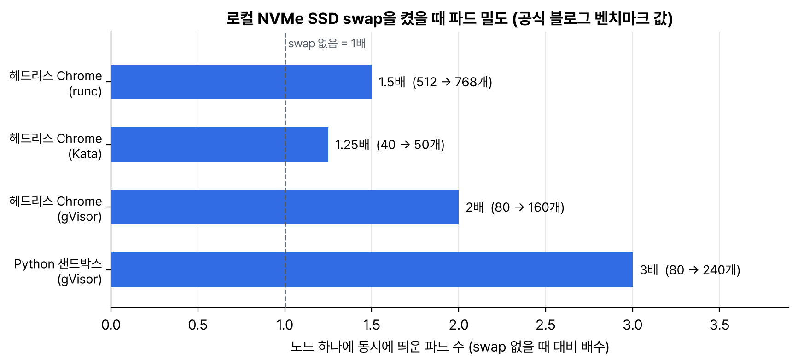

10월 첫 주에 노드 자원 관리 글이 두 편 나왔다. 하나는 'cgroup v2로의 전환, 알아야 할 것'으로, 그동안 소식마다 조금씩 나온 cgroup 이야기를 한 번에 묶어 준다. 다른 하나는 노드 swap을 로컬 NVMe SSD에 붙여 파드를 얼마나 더 띄울 수 있는지 잰 벤치마크다. 작년 10월에 swap 튜닝 글을 정리했으니 1년 만에 같은 주제다.

## 요약

- cgroup v1은 v1.31에 유지보수 모드, v1.35부터 kubelet 설정 failCgroupV1 기본값 true다. 이 글에 따르면 failCgroupV1: false 우회도 v1.38에서 없어질 예정이다.
- kubeadm은 v1.35 kubelet부터 init, join, upgrade 사전 검사에서 cgroup v1을 오류로 막는다. 예전 kubelet이면 경고만 낸다.
- cgroup v2 요구 사항은 커널 5.8 이상(메모리 QoS는 5.9 이상), containerd 1.4 이상이나 CRI-O 1.20 이상, 그리고 kubelet과 런타임의 cgroup 드라이버 일치다.
- cgroup v2에서 kubelet은 컨테이너 하나에서 OOM이 나면 그 컨테이너의 프로세스를 다 같이 죽인다(memory.oom.group). 일부 프로세스만 죽어 반쯤 살아 있는 컨테이너를 막는다.
- swap 벤치마크에서는 로컬 SSD swap으로 gVisor 파이썬 샌드박스를 80개에서 240개까지 띄웠다. 커널 빌드는 메모리 limit을 600MB에서 300MB로 줄여도 느려지지 않았지만, 200MB까지 줄이자 40% 넘게 느려졌다.

## 1. cgroup v2로 넘어갈 때

1년 동안 cgroup 이야기가 소식마다 조금씩 나왔다. 이번 글을 읽고 흩어져 있던 것을 시간순으로 다시 맞춰 봤다.

| 버전 | cgroup 관련 변화 | 내 노트 |
|---|---|---|
| v1.25 | cgroup v2 지원 stable | |
| v1.31 | cgroup v1 지원 유지보수 모드 | 기초 공부를 시작한 버전 |
| v1.34 | 런타임에서 cgroup 드라이버 자동 감지(KEP-4033) stable. PSI 지표 beta | 작년 10월 PSI, swap 정리 |
| v1.35 | failCgroupV1 기본 true. kubeadm 사전 검사에서 오류 | 작년 12월 미리보기 |
| v1.36 | PSI 지표 GA | 4월 릴리스 |
| v1.37 | 메모리 QoS beta | 8월 릴리스 |
| v1.38(예정) | failCgroupV1: false 우회 제거 예정 | |

글 일부는 v1.36 기준으로 쓰여 있었다(메모리 QoS를 alpha라고 적은 부분 등). v1.37 릴리스 글에서는 메모리 QoS가 beta로 올라갔다.

### cgroup v2라서 되는 것

| 기능 | 내용 |
|---|---|
| 메모리 QoS | memory.high로 Burstable 컨테이너를 limit 근처에서 먼저 늦춘다(memoryThrottlingFactor 기본 0.9). TieredReservation을 켜면 Guaranteed 파드 requests는 memory.min(강한 보호), Burstable은 memory.low(약한 보호)로 들어간다. BestEffort는 보호가 없다 |
| 컨테이너 단위 OOM | kubelet 기본 singleProcessOOMKill: false. 컨테이너 cgroup에 memory.oom.group을 걸어 OOM이면 그 컨테이너 프로세스를 다 같이 죽인다. 파드 전체가 아니라 컨테이너 단위다 |
| rootless 위임 | v2는 일반 사용자에게 컨트롤러를 공식적으로 위임할 수 있다. 9월에 정리한 rootless 모드가 여기에 기댄다 |
| PSI | KubeletPSI가 stable로 항상 켜져 있다. 커널 4.20 이상, CONFIG_PSI=y, psi=0으로 부팅하지 않았어야 한다 |
| CPU weight 새 변환식 | 2월에 정리한 runc 1.3.2, crun 1.23의 식 |
| 파드 단위 in-place 리사이즈 | 파드 cgroup과 컨테이너 cgroup 사이 순서를 맞춰 늘리고 줄인다. 정확한 합계 제한은 v2가 있어야 한다 |

하나 오해하지 말라는 점도 있었다. kubelet이 active_file 페이지 캐시를 회수 못 하는 메모리로 보는 바람에 I/O가 많은 워크로드가 메모리 압박으로 축출되는 오래된 문제(kubernetes#43916)는 cgroup v2로 옮긴다고 저절로 풀리지 않는다. I/O가 많은 컨테이너는 실제로 재 본 값으로 requests와 limits를 같게 주라고 한다.


flowchart TB
  subgraph r1[" "]
    direction LR
    A["4.5 (2016)<br>v2 io, memory, pids"] --> B["4.15<br>v2 cpu 컨트롤러"]
    B --> C["4.20<br>PSI"]
    C --> D["5.2<br>cgroup freezer<br>(이보다 오래된 커널은 비권장)"]
  end
  subgraph r2[" "]
    direction LR
    E["5.8<br>쿠버네티스 문서의 최소 버전<br>(루트 cgroup cpu.stat)"] --> F["5.9<br>memory.high livelock 수정<br>(메모리 QoS 권장)"]
    F --> G["5.19<br>memory.peak"]
  end
  r1 --> r2


### limit이 정말 cgroup에 들어갔는지 확인하기

이번 글에서 제일 쓸모 있었던 건 API 오브젝트부터 노드의 cgroup 파일까지 내려가며 확인하는 순서였다. CKA 때는 kubectl describe까지만 봤는데, 실제로 커널에 무슨 값이 들어갔는지 보는 법을 처음 정리했다.

```bash
kubectl get pod web -o jsonpath='{.spec.nodeName}{"\n"}'
kubectl get pod web -o jsonpath='{range .spec.containers[*]}{.name}{" spec\t"}{.resources}{"\n"}{end}'
kubectl get pod web -o jsonpath='{range .status.containerStatuses[*]}{.name}{" status\t"}{.resources}{"\n"}{end}'

# 그 노드에서 root로 (systemd 드라이버, cgroup v2, jq 필요)
CONTAINER_ID=$(crictl ps --label io.kubernetes.pod.namespace=default --label io.kubernetes.pod.name=web --name web -q | head -n1)
PID=$(crictl inspect "$CONTAINER_ID" | jq -r '.info.pid')
CGROUP="/sys/fs/cgroup$(awk -F: '$1=="0"{print $3}' /proc/$PID/cgroup)"
cat "$CGROUP/cpu.weight" "$CGROUP/cpu.max" "$CGROUP/memory.max"
```

| 층 | 어디에 무엇이 |
|---|---|
| 쿠버네티스 | spec.containers[].resources(원하는 값), status.containerStatuses[].resources(실제 반영된 값) |
| CRI | cpu_shares, cpu_quota, cpu_period, memory_limit_in_bytes. v2에서도 이름은 v1식이다 |
| OCI 스펙 | linux.resources.cpu.shares, quota, period, memory.limit. crictl inspect로 보이는 건 이 층이다 |
| systemd scope | CPUWeight, CPUQuotaPerSecUSec, MemoryMax |
| cgroup 파일 | cpu.weight(requests에서), cpu.max(limits를 '쿼터 주기'로), memory.max |

spec과 status를 따로 보는 이유는 in-place 리사이즈 때문이다. 원하는 값과 실제 값이 잠깐 다를 수 있다. 그리고 systemd 드라이버일 때 crictl inspect의 cgroupsPath는 파일 경로가 아니라 systemd 유닛 경로라서 그대로 cd하면 안 된다는 주의도 있었다.

## 2. 노드 swap으로 파드 밀도 늘리기

swap은 v1.34에서 GA가 됐지만 쿠버네티스에서 오래 금기였다. 이유는 둘이었다. cgroup v1은 메모리와 swap을 하나의 한도로 묶어서 컨테이너가 실제로 메모리를 얼마나 쓰는지 따로 볼 수 없었고, 디스크가 느렸다. 앞은 cgroup v2의 별도 swap 계정으로, 뒤는 NVMe 로컬 SSD로 풀렸다는 게 이 글의 출발점이다. 특히 에이전트 샌드박스처럼 처음 뜰 때 메모리를 크게 쓰고 다음 프롬프트까지 오래 노는 워크로드에서 효과가 컸다.


_공식 글의 벤치마크 표와 본문 숫자로 그렸다. 3월에 정리한 Agent Sandbox 위에서 잰 값이다_

| 워크로드 | swap 없음 | 로컬 SSD swap | 메모 |
|---|---|---|---|
| 리눅스 커널 빌드 | 메모리 limit 600MB가 최소(433초) | 300MB로도 됨(374초) | 200MB까지 줄이면 실제로 쓰는 메모리까지 swap으로 밀려 40% 넘게 느려졌다 |
| 헤드리스 Chrome(runc) | 512개에서 실패 | 768개 | c4-standard-32(32 vCPU, 120GB) 노드 |
| 헤드리스 Chrome(Kata) | 40개 | 50개 | 그 뒤로는 CPU가 먼저 찼다 |
| 헤드리스 Chrome(gVisor) | 80개 | 160개 | |
| 파이썬 샌드박스(gVisor) | 80개 | 240개 | 실행마다 약 375MiB 상주 |

커널 빌드 결과를 보면 swap은 잠깐 튀는 메모리를 받아 주는 보험이지, 계속 쓰는 메모리를 대신하는 게 아니다. 최고 밀도에서 늘어난 지연도 swap I/O보다는 파드끼리 CPU를 다투느라 생긴 것이라고 했다.

```yaml
apiVersion: kubelet.config.k8s.io/v1beta1
kind: KubeletConfiguration
failSwapOn: false
memorySwap:
  swapBehavior: LimitedSwap
```

LimitedSwap에서는 Burstable 파드만 swap을 쓴다. 그래서 효과를 보려면 memory limits를 requests보다 크게 줘야 한다. 작년 10월 swap 튜닝 글에서 정리한 min_free_kbytes, watermark_scale_factor 조정은 이번 글에 없었지만, 메모리가 빠르게 늘 때 OOM이 먼저 오는 문제는 그대로라 같이 봐야 할 것 같다.

## 내 클러스터에서 확인할 것

```bash
kubectl get nodes -o custom-columns=NAME:.metadata.name,KERNEL:.status.nodeInfo.kernelVersion,RUNTIME:.status.nodeInfo.containerRuntimeVersion
stat -fc %T /sys/fs/cgroup/                                                # 노드에서. cgroup2fs면 v2
grep -E 'failCgroupV1|singleProcessOOMKill|failSwapOn|swapBehavior' /var/lib/kubelet/config.yaml
```

- 커널이 5.8보다 낮거나 stat 결과가 tmpfs면 v1.38 전에 노드 OS부터 바꾼다. failCgroupV1: false로 버티고 있다면 그 우회가 v1.38에서 없어질 예정이다.
- singleProcessOOMKill: true가 있다면 일부러 v1 시절 동작을 고른 것인지 확인한다.
- swap을 켤 노드는 디스크가 NVMe 로컬 SSD인지부터 본다. 느린 디스크면 이 벤치마크 결과를 기대하면 안 된다.

> **쉬운 설명**
>
> cgroup v1에서 v2로 가는 건 아파트 관리비 정산 방식을 바꾸는 것과 같다. 예전엔 전기, 수도, 난방 계량기가 따로 놀아서 합쳐 보기 어려웠는데(v1의 여러 계층), 새 방식은 집마다 계량기 하나로 다 본다(하나의 계층). 그래서 '이 집이 전기 때문에 기다린 시간(PSI)'이나 '난방은 최소 이만큼 보장(memory.min)' 같은 새 서비스가 가능해졌다. swap은 집 안 옷장이 꽉 찰 때 쓰는 아파트 창고다. 철 지난 옷(놀고 있는 메모리)을 창고에 두면 집에 사람을 더 들일 수 있지만, 매일 입는 옷까지 창고에 넣으면 아침마다 오르내리느라 늦는다(200MB 커널 빌드).

## 용어 정리

| 용어 | 뜻 |
|---|---|
| failCgroupV1 | cgroup v1 노드에서 kubelet을 시작하지 않게 하는 설정. v1.35부터 기본 true |
| cgroup 드라이버 | kubelet과 런타임이 cgroup을 만드는 방식. systemd 또는 cgroupfs. 둘이 같아야 한다 |
| memory.high, memory.min, memory.low | cgroup v2 메모리 파일. 늦추기 시작하는 선, 강한 보호, 약한 보호 |
| memory.oom.group | OOM 때 cgroup 안 프로세스를 함께 죽이게 하는 cgroup v2 설정 |
| LimitedSwap | Burstable 파드에만 requests 비율에 맞춰 swap을 허용하는 kubelet swap 동작 |
| 파드 밀도 | 노드 하나에 동시에 띄울 수 있는 파드 수 |

## 참고 자료

- Kubernetes 블로그, The Shift to cgroup v2 in Kubernetes: What You Need to Know: <https://kubernetes.io/blog/2026/10/06/kubernetes-cgroups-v2-shift/>
- Kubernetes 블로그, Scaling Kubernetes Workloads with Node Swap: <https://kubernetes.io/blog/2026/10/05/scaling-kubernetes-workloads-with-node-swap/>
- Kubernetes 문서, cgroup v2: <https://kubernetes.io/docs/concepts/architecture/cgroups/>
- Kubernetes 문서, 스왑 메모리 관리: <https://kubernetes.io/docs/concepts/cluster-administration/swap-memory-management/>
- KEP-5573, cgroup v1 지원 제거: <https://github.com/kubernetes/enhancements/issues/5573>
