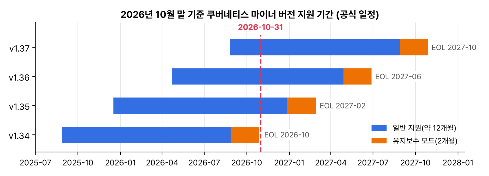

10월 중순부터 말까지 쿠버네티스 블로그에 글이 세 편 올라왔다. 하나는 Kueue를 쓰는 클러스터에서 Job이 계속 Pending일 때 어디부터 봐야 하는지 Headlamp 플러그인으로 따라가는 글이고, 나머지 둘은 적합성(conformance) 이야기다. 워크로드의 동작 기준을 만드는 Workload Conformance 워킹 그룹이 새로 생겼고, AI Conformance는 워킹 그룹을 닫고 SIG Architecture 하위 프로젝트로 옮겨 갔다. 그 사이 10월 27일에 v1.34 지원이 끝났다.

## 요약

- Kueue가 관리하는 클러스터에서 Job이 안 뜨면 파드보다 Kueue Workload의 Admitted 조건을 먼저 본다. 승인 전에는 Job이 suspend 상태라 파드가 아예 없을 수 있다.
- Headlamp용 Kueue 플러그인 0.1.0-alpha가 나왔다. Workload, LocalQueue, ClusterQueue, ResourceFlavor, Cohort를 링크로 이어서 읽기 전용으로 보여 준다.
- Workload Conformance WG가 생겼다. 워크로드가 런타임에 지켜야 할 동작의 명세, 시험 방법, 시험 도구를 만든다. 첫 안정 명세와 동작하는 시험은 두세 릴리스 안에 내는 게 목표다.
- AI Conformance는 워킹 그룹을 보관(archive)하고 SIG Architecture 하위 프로젝트가 됐다. 인증받은 플랫폼은 몇 달 사이 18개에서 31개로 늘었다.
- v1.34가 10월 27일에 지원이 끝났다. 패치를 받는 버전은 v1.35, v1.36, v1.37이고, v1.35도 12월 28일에 유지보수 모드로 들어간다. etcd는 10월 22일에 v3.7.3, v3.6.16, v3.5.35가 나왔다.

## 1. Job이 Pending인데 파드가 없을 때

KCNA 트러블슈팅을 정리할 때 파드가 Pending이면 describe의 Events에서 FailedScheduling부터 본다고 적었다. Kueue를 쓰는 클러스터에서는 그 앞에 단계가 하나 더 있다. LocalQueue를 지정한 Job이 들어오면 Kueue는 Workload 오브젝트를 만들고, 큐의 할당량에 들어갈 때까지 Job을 suspend로 잡아 둔다. 승인(admission)이 나지 않았으면 파드가 만들어지지도 않았으니 FailedScheduling 이벤트도 없다.


flowchart TB
  subgraph r1["Kueue 단계"]
    direction LR
    J["Job 제출<br>queue-name 라벨"] --> W["Workload 생성<br>Job은 suspend"]
    W --> Q{"할당량에<br>들어가나"}
    Q -->|아니오| P["QuotaReserved=False<br>파드 없음"]
  end
  subgraph r2["스케줄러 단계"]
    direction LR
    A["Admitted=True<br>suspend 해제"] --> S{"노드를<br>찾나"}
    S -->|아니오| F["파드 Pending<br>FailedScheduling"]
    S -->|예| R["파드 실행"]
  end
  r1 -->|할당량에 들어가면| r2


글은 Workload부터 보라고 한다. Workload 목록에서 해당 Job의 것을 찾고, 상태와 조건 메시지를 읽고, 거기 연결된 LocalQueue와 ClusterQueue로 따라간다.

| 보이는 상태 | 뜻 | 다음에 볼 곳 |
|---|---|---|
| Workload가 없다 | 네임스페이스를 잘못 골랐거나, Job이 LocalQueue로 들어가지 않았거나, Workload를 읽을 권한이 없다 | Job의 kueue.x-k8s.io/queue-name 라벨, 네임스페이스, 내 권한 |
| QuotaReserved=False(Pending) | 할당량을 잡지 못했다. 조건 메시지에 이유가 적힌다 | LocalQueue, ClusterQueue의 할당량과 사용량 |
| Inadmissible | 지금 큐 설정으로는 들어갈 수 없다. 큐가 다루지 않는 자원, 맞지 않는 ResourceFlavor, 멈춘 큐, admission check 등 | ClusterQueue, ResourceFlavor, Cohort |
| Admitted=True인데 파드가 Pending | Kueue 단계는 끝났다 | Job과 파드의 Events(스케줄러 쪽) |

글에 나온 예는 계산 연습으로 좋았다. parallelism: 3에 파드마다 CPU 1개를 요청하는 Job은 Kueue에게 CPU 3개, 파드 3개짜리 요청 하나다(메모리는 합쳐서 600MiB). ClusterQueue의 nominal quota가 CPU 2개, 파드 2개라 들어갈 수 없고, Kueue는 Job을 suspend로 둔다. 노드에 자리가 남아 있어도 결과는 같다. 파드 템플릿 하나만 보고 CPU 1개인데 왜 안 뜨는지 고민하면 엉뚱한 곳을 보게 된다.

할당량이 한 덩어리가 아닐 때도 있다. ResourceFlavor는 GPU 노드처럼 자원의 종류를 노드 라벨, 테인트, 톨러레이션으로 표현하고, Cohort는 ClusterQueue끼리 남는 할당량을 빌려 쓰게 묶는다. 그래서 막힌 이유가 자기 할당량이 없어서인지, 빌려 올 수 없어서인지, 맞는 flavor가 없어서인지를 나눠 봐야 한다.

Headlamp 화면에서 따라가는 길을 명령으로 옮기면 이렇다. 글에 같이 실린 표를 옮겼다.

| 질문 | 명령 |
|---|---|
| Workload가 승인됐나 | kubectl describe workload <이름> -n <네임스페이스> |
| 어느 LocalQueue로 들어갔나 | kubectl get localqueue <이름> -n <네임스페이스> -o yaml |
| 할당량은 어느 ClusterQueue가 주나 | kubectl get clusterqueue <이름> -o yaml |
| flavor나 공유 할당량이 문제인가 | kubectl get resourceflavor <이름> -o yaml, kubectl get cohort <이름> -o yaml |
| 승인 뒤에 무슨 일이 있었나 | kubectl describe job <이름> -n <네임스페이스>, kubectl describe pod <이름> -n <네임스페이스> |

플러그인은 0.1.0-alpha라 Kueue v1beta2 리소스를 읽기만 한다. 만들기, 고치기, 멈추기, 지우기는 플러그인 자체 기능으로는 없고, Workload의 소유자(Job)도 아직 링크가 아니라 Kind/name 글자로만 나온다. 화면에 보이는 범위는 Headlamp에 로그인한 계정의 쿠버네티스 권한을 따른다. CNCF LFX 멘토십 2026년 2기에서 만든 플러그인이라고 한다.

하나 헷갈린 게 있었다. 1월에 정리한 갱 스케줄링에도 Workload라는 리소스가 나왔다. 그쪽은 scheduling.k8s.io 그룹의 쿠버네티스 내장 API이고, 이번 글의 Workload는 kueue.x-k8s.io 그룹의 Kueue 리소스다. 이름만 같고 다른 오브젝트다.

## 2. 적합성 시험이 세 갈래가 됐다

KCNA 공부 때 Certified Kubernetes를 배포판이 쿠버네티스 API를 제대로 구현했는지 확인하는 인증으로 외웠다. 이번 두 글을 읽고 나니 비슷한 이름이 셋이 됐다.

| 이름 | 무엇을 확인하나 | 맡는 곳 |
|---|---|---|
| Certified Kubernetes | 배포판이나 관리형 서비스가 쿠버네티스 API를 제대로 구현했는지 | CNCF 적합성 프로그램. 시험은 SIG Architecture가 관리 |
| Kubernetes AI Conformance | 클러스터가 AI·ML 워크로드를 돌릴 기반(DRA를 통한 가속기 지원 등)을 갖췄는지 | CNCF 인증 프로그램. 요구 사항은 이제 SIG Architecture 하위 프로젝트 |
| Workload Conformance(준비 중) | 워크로드가 런타임에 지켜야 할 동작 | Workload Conformance WG. SIG Architecture와 SIG Apps가 후원 |

### Workload Conformance WG

출발점은 운영자들이 노드 유지보수나 업그레이드 전에 앱마다 손으로 확인하는 일이다. 평범하게 노드를 drain했다가 앱이 중단을 견디지 못한다는 걸 알게 되고, 업그레이드 뒤에 없어진 API 버전을 쓰던 앱이 깨진다. 필요 없는 권한을 달라고 하거나, 쓰지도 않는 자원을 잡아 두는 워크로드도 있다. 쿠버네티스 문서에 보안이나 중단 대비 내용은 이미 있지만, 운영자는 같은 점검을 매번 되풀이하고 앱 관리자는 환경마다 같은 질문을 받는다.

| 항목 | 내용 |
|---|---|
| 만들 것 | 쿠버네티스 마이너 버전마다 워크로드 동작 명세, 요구 사항마다 실행 중인 워크로드에 돌릴 시험 방법, 그 시험을 구현한 업스트림 도구 |
| 다룰 범위 | 보안, 중단 중 복원력, 자원 사용, 네트워킹, 스토리지, API 사용, 관찰 가능성. 구체적인 요구 사항은 아직 정하지 않았다 |
| 이미 정한 규칙 | 모든 요구 사항에는 시험 바이너리가 돌릴 수 있는 객관적인 시험이 있어야 한다. 주관적인 항목은 명세에 넣지 않는다 |
| 빼는 것 | 앱이 무엇을 하는지(로직), Certified Kubernetes가 이미 확인하는 것, 특정 패키징 형식이나 정책 엔진, 보안 스캐너 같은 벤더 도구 |
| 조직 | SIG Architecture가 하위 프로젝트로 명세와 도구를 맡고, SIG Apps가 앱 쪽 관점을 낸다 |
| 목표 | 두세 릴리스 안에 첫 안정 명세와 동작하는 시험 |

모임은 격주 수요일 15:00 UTC, 한국 시간으로는 목요일 자정이다. 읽으면서 기초 공부 때 정리한 PodDisruptionBudget이 떠올랐다. drain할 때 앱이 버티는지 같은 걸 운영자가 앱마다 확인하는 대신 시험 바이너리로 확인하게 하겠다는 것으로 이해했다. 다만 어떤 요구 사항이 들어갈지는 아직 하나도 정해지지 않았으니, 실제 명세가 나와야 알 수 있다.

### AI Conformance는 SIG Architecture로

인터뷰 형식의 글이었다. AI Conformance는 CNCF 프로그램으로 시작했고, 요구 사항(KAR, Kubernetes AI Requirements)을 정하고 인증 절차를 띄우려고 워킹 그룹을 만들었다. 그 목표를 달성해서 워킹 그룹은 보관했고, 계속 맡아야 할 일은 SIG Architecture 하위 프로젝트로 옮겼다. SIG Architecture가 이미 쿠버네티스 적합성과 API 설계 원칙을 맡고 있어서라고 한다.


flowchart LR
  A["KubeCon NA 2025<br>프로그램 발표<br>인증 플랫폼 18개"] --> B["KubeCon EU 2026<br>인증 플랫폼 31개"]
  B --> C["2026년 10월<br>WG 보관<br>SIG Architecture 하위 프로젝트"]


AI 인프라는 빨리 바뀌고 쿠버네티스 API는 오래 안정적이어야 해서, 요구 사항을 두 단계로 둔다고 했다. 새 개념은 권장(SHOULD)으로 먼저 넣고, API가 안정되고 생태계가 따라오면 필수(MUST)로 올린다. 시험 대상도 특정 AI 프레임워크나 모델 서버가 아니라 DRA를 통한 가속기 지원 같은 인프라 층이다.

KCNA 커뮤니티 구조를 정리할 때 SIG, WG, 하위 프로젝트를 표로만 외웠다. 워킹 그룹은 기한이 있는 모임이고 계속 남는 일은 SIG가 맡는다는 게, 실제로 WG가 닫히고 하위 프로젝트로 넘어가는 걸 보니 그려진다.

## 3. v1.34 지원 종료와 10월 패치


_kubernetes.io 패치 릴리스 페이지의 유지보수 모드, EOL 날짜로 그렸다. 빨간 점선이 이 글을 쓴 날이고, v1.34는 나흘 전에 끝났다_

작년 9월에 정리한 v1.34 Of Wind & Will이 10월 27일로 지원이 끝났다. 8월 27일부터 두 달 동안 유지보수 모드였다. GitHub 릴리스로는 10월 28일에 v1.37.2, v1.36.6, v1.35.10, v1.34.13이 같이 올라왔다. 지금 패치를 받는 버전은 v1.35, v1.36, v1.37인데, v1.35도 12월 28일에 유지보수 모드로 들어가서 내년 2월 28일에 끝난다. v1.38이 12월 16일에 나오면 그 뒤로는 v1.36부터가 넉넉한 선택지다.

etcd는 10월 22일에 v3.7.3, v3.6.16, v3.5.35가 같이 나왔다. v3.7.3에는 9월에 정리한 RangeStream 관련 수정이 들어 있다.

| 변경 | 내용 |
|---|---|
| keys-only RangeStream 데이터 경합 수정 | 키만 받는 RangeStream 요청에서 생기던 경합 |
| MVCC Hash와 Restore 사이 데이터 경합 수정 | 저장소 해시 계산과 스냅샷 복원이 겹칠 때 |
| 성능 회귀 수정 | 리더가 팔로워에게 MsgApp 메시지를 역순으로 보내서 느려지던 문제 |
| 의존성 | Go 1.26.10으로 빌드. golang.org/x/net, OpenTelemetry 패키지를 보안 권고에 맞춰 올렸다 |

## 내 클러스터에서 확인할 것

```bash
kubectl version                                   # Server Version이 v1.34.x면 지원이 끝났다
kubectl get workloads.kueue.x-k8s.io -A           # Kueue가 있으면 Workload 목록
kubectl get workload <이름> -n <네임스페이스> \
  -o jsonpath='{range .status.conditions[*]}{.type}={.status} {.reason}: {.message}{"\n"}{end}'
kubectl get clusterqueue                          # 대기 중인 Workload 수
kubectl -n kube-system exec etcd-<노드> -- etcd --version   # kubeadm 클러스터
```

- 서버가 v1.34면 마이너 버전을 하나씩 올려서 적어도 v1.36까지 간다. v1.35도 12월 말에 유지보수 모드로 들어간다.
- Workload에 Admitted=True가 있는데 파드가 Pending이면 Kueue 단계는 끝난 것이니 파드 Events로 넘어간다. Admitted가 없으면 파드를 찾지 말고 조건 메시지부터 읽는다.
- etcd 3.7을 쓰고 kube-apiserver의 EtcdRangeStream이 켜져 있다면(v1.37 기본값) 3.7.3으로 올려 둔다.

> **쉬운 설명**
>
> Kueue는 놀이공원 매표소 대기 줄이고, kube-scheduler는 입장한 손님에게 놀이기구 자리를 정해 주는 안내원이다. 단체 손님(Job) 3명이 왔는데 지금 들여보낼 수 있는 인원(ClusterQueue 할당량)이 2명이면, 매표소는 단체를 통째로 기다리게 한다. 아직 입장하지 않았으니 안내원에게 물어봐도 모른다(FailedScheduling 없음). 입장 허락(Admitted)을 받고도 못 타고 있을 때부터가 안내원 쪽 문제다. Workload Conformance는 공원 시설 점검표와 별개로 손님이 지켜야 할 규칙('안전바를 내릴 수 있어야 한다')을 정하고, 그걸 기계로 확인하려고 한다.

## 용어 정리

| 용어 | 뜻 |
|---|---|
| Kueue | 배치 작업을 큐와 할당량으로 승인해 실행 시점을 정하는 kubernetes-sigs 프로젝트 |
| Workload(Kueue) | Kueue가 Job마다 만드는 오브젝트. 요청 자원과 승인 상태를 담는다. kueue.x-k8s.io 그룹 |
| LocalQueue | 네임스페이스 안에서 Job이 들어가는 큐. ClusterQueue에 연결된다 |
| ClusterQueue | 클러스터 범위의 할당량과 승인 정책 |
| ResourceFlavor | GPU 노드 같은 자원의 종류. 노드 라벨, 테인트 등으로 표현한다 |
| Cohort | 남는 할당량을 서로 빌려 쓰는 ClusterQueue 묶음 |
| 적합성(conformance) | 정해진 명세를 따르는지 자동 시험으로 확인하는 것 |
| KAR | Kubernetes AI Requirements. AI Conformance의 요구 사항 단위 |

## 참고 자료

- Kubernetes 블로그, Why Is My Kubernetes Job Still Pending? Tracing Kueue Admission with Headlamp: <https://kubernetes.io/blog/2026/10/14/tracing-kueue-admission-with-headlamp/>
- Kubernetes 블로그, Announcing the Workload Conformance Working Group: <https://kubernetes.io/blog/2026/10/27/announcing-workload-conformance-wg/>
- Kubernetes 블로그, From Working Group to SIG Architecture: spotlight on AI Conformance: <https://kubernetes.io/blog/2026/10/29/sig-arch-ai-conformance-2026/>
- AI Conformance 저장소: <https://github.com/kubernetes-sigs/ai-conformance>
- Kubernetes 문서, 패치 릴리스: <https://kubernetes.io/releases/patch-releases/>
- etcd 3.7 변경 기록: <https://github.com/etcd-io/etcd/blob/main/CHANGELOG/CHANGELOG-3.7.md>

