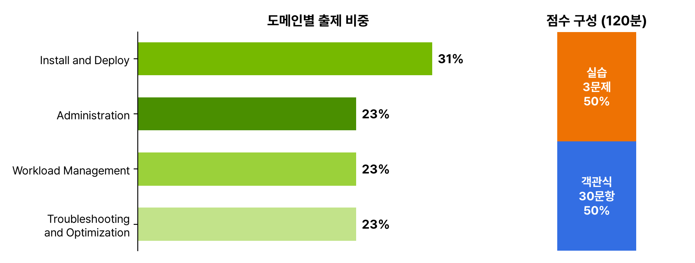

쿠버네티스 쪽 자격증을 하나씩 쌓다 보니 그 아래에서 GPU를 실제로 돌리는 쪽이 궁금해졌다. Agent Substrate를 정리하면서도 결국 GPU 워커를 어떻게 다루느냐로 이야기가 내려갔다. NVIDIA 자격증 중에 AI 인프라 운영을 다루는 NCP-AIO가 있어서 시험 페이지부터 읽었다. 쿠버네티스는 범위의 일부일 뿐이고, BCM, Slurm, MIG, DCGM, InfiniBand, BlueField DPU처럼 처음 보는 이름이 대부분이었다.

## 요약

- 정식 이름은 NVIDIA-Certified Professional: AI Operations다. NVIDIA는 중급(intermediate) 자격으로 소개한다.
- 온라인 감독 시험이고, 120분 안에 객관식 30문항과 실습 3문제를 모두 푼다. 두 부분이 50%씩이고 합산해서 합격, 불합격만 알려 준다. 응시료는 500달러, 영어로만 본다.
- 실습은 가상 머신에서 푼다. BCM의 Slurm으로 클러스터 문제 해결, 쿠버네티스로 워크로드 실행, BCM으로 노드 추가가 나온다고 공식 페이지에 적혀 있다.
- 도메인은 Install and Deploy 31%, Administration 23%, Workload Management 23%, Troubleshooting and Optimization 23%다.
- 공식 페이지는 NVIDIA 장비가 있는 데이터센터 운영 경력 2~3년을 권장 조건으로 적어 뒀다. 자격은 2년 유효하고, 갱신하려면 시험을 다시 봐야 한다.

## 1. 시험 정보 (2026년 11월 확인)

| 항목 | 내용 |
|---|---|
| 형식 | 온라인 원격 감독. 객관식 30문항과 실습 3문제 |
| 시간 | 120분. 실습 환경은 시험이 시작되면 자동으로 준비되고, 두 부분을 이 시간 안에 다 끝내야 한다 |
| 점수 | 객관식 50%, 실습 50%를 합쳐 합격, 불합격만 나온다. 점수는 알려 주지 않고, 주제별, 부분별 성적표를 준다 |
| 응시료 | 500달러 |
| 언어 | 영어 |
| 권장 조건 | NVIDIA 하드웨어가 있는 데이터센터 운영 경력 2~3년 |
| 유효 기간 | 2년. 갱신은 같은 시험을 다시 보는 방식 |
| 접수 | Certiverse 계정을 만들어 접수한다 |
| 결과 | 끝나면 화면에 나오고, 24시간 안에 메일과 Credly 배지가 온다 |

NVIDIA 자격증 공통 규정도 같이 읽었다.

| 규정 | 내용 |
|---|---|
| 예약 | 최대 60일 앞까지 잡을 수 있다 |
| 취소와 변경 | 24시간 전까지만 된다. 변경한 날짜는 응시료를 낸 날부터 두 달 안이어야 한다 |
| 휴식 | 원격 감독 시험은 쉬는 시간이 없다 |
| 재응시 | 떨어지면 다시 사서 14일 뒤부터 볼 수 있고, 같은 시험은 12개월에 다섯 번까지다 |
| 언어 지원 | 모국어로 시험이 없으면 시험 전에 추가 시간을 요청할 수 있다. 건별로 승인한다 |

CKA는 터미널로만 푸는 실기였고 KCNA, KCSA는 객관식만 있었는데, NCP-AIO는 둘을 섞었다. 30문항을 빨리 끝내야 실습에 시간이 남는다. 객관식이 한 문항에 2분꼴이라고 쳐도 60분이 들고, 남은 60분에 실습 세 문제를 풀어야 한다.

## 2. 출제 범위

_공식 시험 페이지의 도메인 비중과 시험 구조로 그렸다_

| 도메인 | 비중 | 공식 페이지의 세부 주제 |
|---|---:|---|
| Install and Deploy | 31% | BCM 설치와 설정, BCM으로 NVIDIA 호스트에 쿠버네티스 설치, NGC 컨테이너 배포, 클라우드 VMI 컨테이너 배포, AI 데이터센터의 스토리지 요구 사항, DPU-Arm에 DOCA 서비스 배포 |
| Administration | 23% | Fleet Command 관리, Slurm 클러스터 관리, AI 워크로드용 데이터센터 구조 설계, Run:ai 관리, AI와 HPC용 MIG 설정 |
| Workload Management | 23% | 쿠버네티스 클러스터 관리, DCGM, NVSM, nvidia-smi로 문제 찾기, BCM과 클러스터 프로비저닝 관리 |
| Troubleshooting and Optimization | 23% | Docker, NVLink·NVSwitch의 Fabric Manager, BCM, Magnum IO 구성 요소, 스토리지 성능 문제 해결 |

쿠버네티스는 범위 곳곳에 나오지만 따로 떼어 보면 많지 않다. 쿠버네티스를 직접 설치하는 게 아니라 BCM으로 설치하고, 파드보다 GPU와 노드, 네트워크 쪽 문제를 더 많이 다룬다. 낯선 이름이 많아서 도메인별로 정리하기 전에 배경 지식부터 네 편으로 나눠 묶었다.

| 배경 지식 글 | 이어지는 주제 |
|---|---|
| [GPU 서버 안쪽: NVLink, NVSwitch, Fabric Manager, MIG](../01-gpu-서버-안쪽-nvlink와-mig/) | MIG 설정, Fabric Manager 문제 해결 |
| [서버 밖으로: InfiniBand, GPUDirect, 스토리지, BlueField DPU](../02-서버-밖으로-infiniband와-gpudirect/) | 스토리지 요구 사항과 성능, Magnum IO, DOCA 서비스 배포 |
| [GPU 소프트웨어 스택: 드라이버, Container Toolkit, NGC, GPU Operator, DCGM](../03-gpu-소프트웨어-스택과-관리-도구/) | NGC와 VMI 컨테이너 배포, Docker 문제 해결, DCGM, NVSM, nvidia-smi |
| [클러스터 관리와 스케줄링: BCM, Slurm, Run:ai, Fleet Command](../04-클러스터-관리와-스케줄링-bcm과-slurm/) | BCM 설치와 노드 추가, Slurm, 쿠버네티스 설치, Run:ai, Fleet Command |

## 3. NVIDIA 자격증 안에서의 위치

NVIDIA 자격증은 Associate(NCA)와 Professional(NCP) 두 단계로 나뉜다. AI 인프라 분야만 추리면 이렇다.

| 자격 | 이름 | 단계 | 응시료, 시간 |
|---|---|---|---|
| NCA-AIIO | AI Infrastructure and Operations | Associate | 125달러, 1시간 |
| NCA-APC | AI Power and Cooling | Associate | 125달러, 1시간 |
| NCP-AII | AI Infrastructure | Professional | 400달러, 2시간 |
| NCP-AIO | AI Operations | Professional | 500달러, 2시간 |
| NCP-AIN | AI Networking | Professional | 500달러, 2시간 |
| NCP-ARI | AI Rack and Interconnect | Professional | 400달러, 2시간 |

NCP-AII가 장비를 설치하고 검증하는 쪽이라면, NCP-AIO는 이미 깔린 인프라를 모니터링하고 문제를 고치고 최적화하는 쪽이다. 선수 자격은 없어서 Associate를 건너뛰고 바로 볼 수 있다.

공식 학습 경로에는 자기 주도 과정인 AI Infrastructure & Operations Fundamentals와 여러 날짜리 AI Operations Professional Workshop이 있다. 워크숍에서는 DCGM, InfiniBand, BlueField DPU, GPU 가상화를 직접 다룬다고 한다. 시험 페이지 아래에는 바로 답과 해설을 보여 주는 연습 문제(Learning Mode)도 있다.

## 4. 내가 이미 아는 것과 새로 알아야 할 것

| 영역 | 이미 정리한 것 | 새로 정리할 것 |
|---|---|---|
| 쿠버네티스 | CKA, CKAD, KCNA 준비 때 클러스터 관리, 스케줄링, 트러블슈팅 | BCM으로 설치하기, GPU Operator, MIG를 쿠버네티스에 노출하는 방식 |
| 컨테이너 | Docker, containerd, CRI, OCI | NVIDIA Container Toolkit, NGC 레지스트리 |
| 클라우드 | AWS SAA의 EC2, 스토리지, 네트워크 | 클라우드 VMI, GPU 인스턴스 |
| 하드웨어와 네트워크 | 거의 없음 | GPU 서버 구조, NVLink, NVSwitch, InfiniBand, DPU |
| 클러스터 관리 | 거의 없음 | BCM, Slurm, Run:ai, Fleet Command |

CKA 때 스태틱 파드를 외운 게 DPU 쪽에서 다시 나오고(DOCA 서비스가 스태틱 파드로 뜬다), KCSA에서 본 공동 책임 모델이 Run:ai on DGX Cloud 문서에 그대로 나온다. 이런 연결은 배경 지식 글마다 적었다.

## 용어 정리

| 용어 | 뜻 |
|---|---|
| NCP | NVIDIA-Certified Professional. NVIDIA 자격증의 전문가 단계 |
| NCA | NVIDIA-Certified Associate. 입문 단계 |
| 실습(performance-based test) | 가상 머신에서 주어진 상황을 직접 해결하는 문제 |
| BCM | Base Command Manager. NVIDIA의 클러스터 관리 도구. 예전 이름은 Bright Cluster Manager |
| Slurm | HPC에서 널리 쓰는 작업 스케줄러 |
| Certiverse | NVIDIA 시험 접수와 응시를 맡는 플랫폼 |

## 참고 자료

- NVIDIA, AI Operations 자격 시험(NCP-AIO): <https://www.nvidia.com/en-us/learn/certification/ai-operations-professional/>
- NVIDIA, 자격증 목록과 자주 묻는 질문: <https://www.nvidia.com/en-us/learn/certification/>
- NVIDIA Academy: <https://academy.nvidia.com/>

