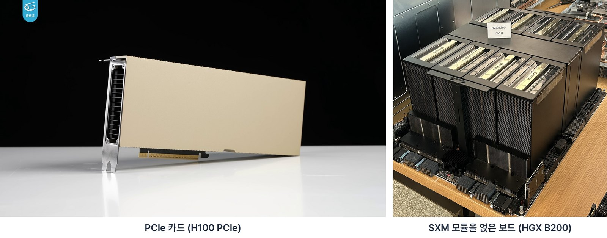
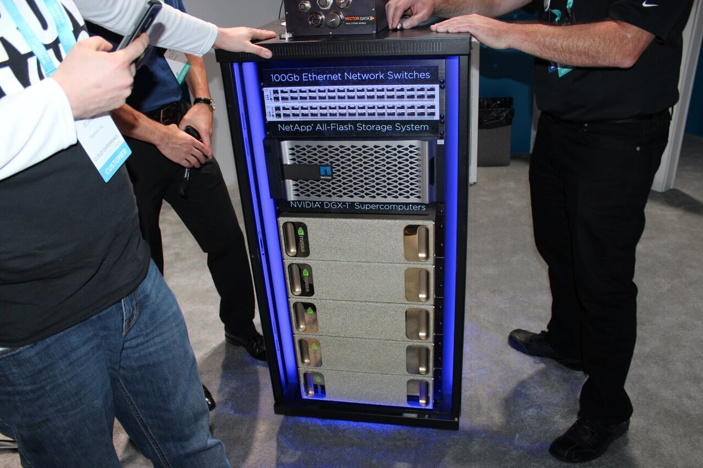
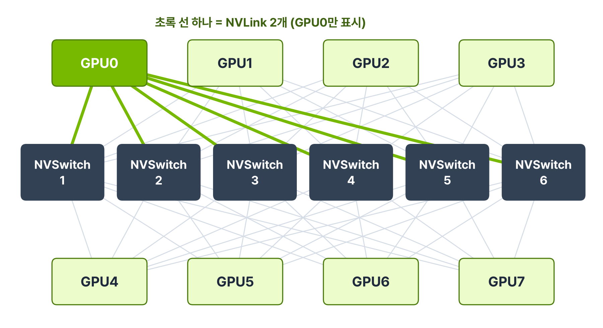
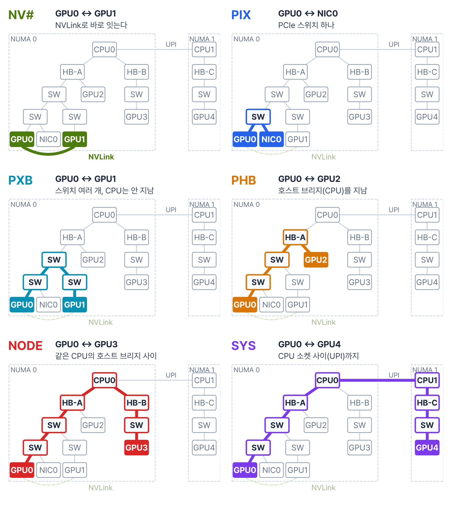
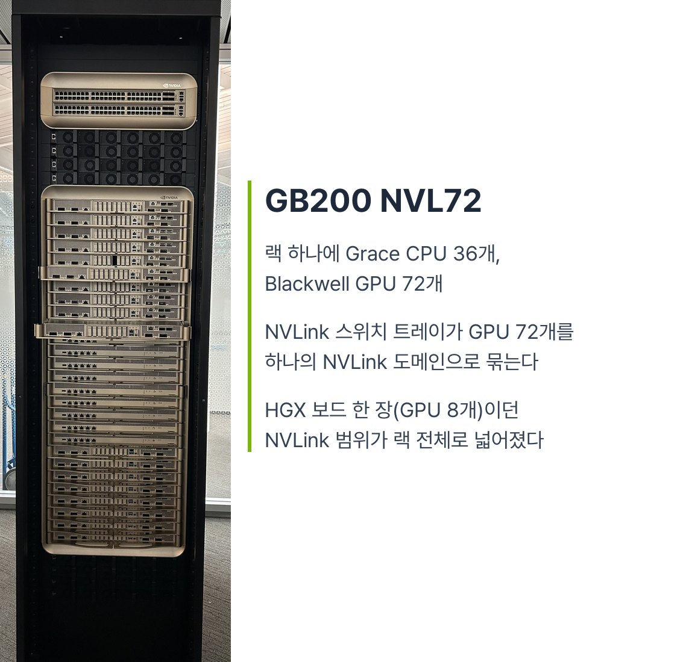
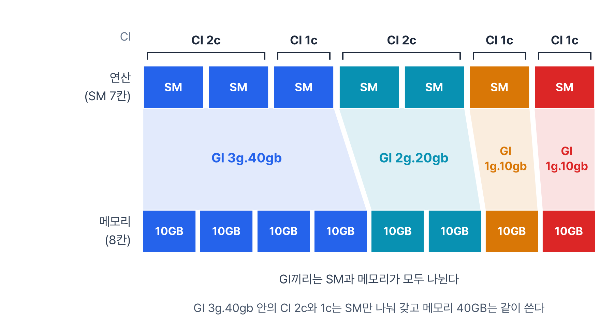

쿠버네티스에서 GPU는 resources.limits에 적는 nvidia.com/gpu: 1 한 줄이었다. NCP-AIO 범위에는 그 한 줄 아래가 나온다. 서버 안에서 GPU끼리 어떻게 이어져 있는지, 그 연결을 누가 관리하는지, GPU 하나를 어떻게 나눠 쓰는지다. Fabric Manager 문제 해결과 MIG 설정이 시험 주제에 그대로 들어 있어서 이 둘을 중심으로 정리했다.

## 요약

- 데이터센터 GPU는 PCIe 카드형과, 보드에 바로 얹는 SXM 모듈형으로 나뉜다. 8-GPU 보드는 GPU끼리 NVLink와 NVSwitch로 묶는다.
- nvidia-smi topo -m은 GPU와 NIC 사이가 얼마나 가까운지 보여 준다. NV#이 가장 가깝고 PIX, PXB, PHB, NODE, SYS 순으로 멀어진다.
- NVSwitch 시스템에서는 Fabric Manager(nvidia-fabricmanager)가 NVLink 패브릭을 맡는다. 이 서비스가 없거나 멈추면 새 CUDA 작업이 cudaErrorSystemNotReady로 실패한다. 드라이버 R620 전에는 Fabric Manager 버전이 드라이버 버전과 같아야 했다.
- MIG는 Ampere 이후 GPU를 최대 7개의 GPU 인스턴스로 나눈다. 인스턴스마다 메모리 경로가 분리돼 서로 성능을 간섭하지 않는다.
- MIG 구성은 재부팅하면 사라진다. 쿠버네티스에서는 GPU Operator의 MIG Manager가 노드 라벨을 보고 구성을 다시 만든다.

## 1. GPU 서버의 모양

| 형태 | 설명 |
|---|---|
| PCIe 카드 | 일반 서버의 PCIe 슬롯에 꽂는다. GPU끼리는 기본적으로 PCIe로 통신한다 |
| SXM 모듈 | GPU 보드에 바로 얹는 모듈. 8개를 한 보드에 올리고 NVSwitch로 모두 잇는다 |
| HGX | 서버 제조사가 자기 서버에 넣는 NVIDIA GPU 보드(예: HGX A100 8-GPU) |
| DGX | NVIDIA가 직접 만든 완제품 서버. 안에 HGX와 같은 GPU 보드가 들어 있다 |


_왼쪽 PCIe 카드는 아래쪽 금색 단자를 서버의 PCIe 슬롯에 꽂는다. 오른쪽 HGX B200 보드는 큰 방열판 여덟 개 아래에 GPU가 SXM 모듈로 하나씩 얹혀 있고, 보드째 서버에 들어간다. 사진: 왼쪽 [极客湾Geekerwan](https://commons.wikimedia.org/wiki/File:NVIDIA_H100_%28%E6%9E%81%E5%AE%A2%E6%B9%BEGeekerwan%29_014.png), [CC BY 3.0](https://creativecommons.org/licenses/by/3.0/), 오른쪽 [Pokiiri](https://commons.wikimedia.org/wiki/File:Nvidia_DGX-B200-HGX.jpg), [CC BY-SA 4.0](https://creativecommons.org/licenses/by-sa/4.0/). 두 사진의 크기를 맞춰 나란히 붙이고 이름을 달았다_


_2018년 전시 장비. 아래쪽 금색 서버들이 DGX-1이고, 위에 NetApp 올플래시 스토리지와 100GbE 스위치가 같이 들어 있다. 사진: [Qdrddr](https://commons.wikimedia.org/wiki/File:NetApp_ONTAP_AI.jpg), [CC BY-SA 4.0](https://creativecommons.org/licenses/by-sa/4.0/)_

Fabric Manager 가이드에 나온 예를 보면, DGX A100과 HGX A100 8-GPU 보드는 A100 8개와 2세대 NVSwitch 6개로 이뤄져 있다. GPU마다 보드 위 NVSwitch 각각에 NVLink가 연결돼서, 어느 GPU 쌍이든 같은 대역폭으로 통신한다.


_GPU마다 NVLink 12개를 NVSwitch 6개에 2개씩 나눠 잇는다. GPU끼리 직접 잇는 선은 없고 모두 스위치를 거쳐서, 어느 두 GPU를 골라도 거리가 같다(topo -m에서 NV12)_

## 2. GPU끼리 얼마나 가까운가: nvidia-smi topo -m

```bash
nvidia-smi topo -m      # GPU, NIC 사이 연결 행렬과 CPU, NUMA 친화도
```

행렬 칸에 찍히는 약어가 연결 방식이다. 가까운 순서로 적었다.

| 약어 | 뜻 |
|---|---|
| NV# | NVLink #개를 묶은 연결. NV12면 NVLink 12개 |
| PIX | PCIe 스위치 하나만 지난다 |
| PXB | PCIe 스위치 여러 개를 지나지만 CPU의 호스트 브리지는 안 지난다 |
| PHB | PCIe 호스트 브리지(보통 CPU)를 지난다 |
| NODE | 같은 NUMA 노드 안에서 호스트 브리지 사이를 지난다 |
| SYS | CPU 소켓 사이 연결(QPI, UPI)까지 지난다 |


_가상의 2소켓 서버 하나로 여섯 경로를 그렸다. HB는 PCIe 호스트 브리지, SW는 PCIe 스위치다. 아래 칸으로 갈수록 지나는 장치가 늘어난다. PXB 칸과 NV# 칸은 같은 GPU0과 GPU1 사이라서, 두 GPU가 NVLink로도 이어져 있으면 topo -m은 NV#로 보여 준다_

GPU 사이만 보는 게 아니다. 표에 NIC도 같이 나와서, 노드 사이 통신을 할 GPU와 NIC가 PIX처럼 가까이 붙어 있는지 확인할 때 쓴다. 다음 글의 GPUDirect RDMA가 이 거리에 크게 좌우된다.

## 3. NVSwitch와 Fabric Manager

NVSwitch는 GPU 여러 개를 NVLink로 전부 잇는 스위치 칩이다. 이 스위치들로 이뤄진 패브릭을 설정하고 지켜보는 프로세스가 Fabric Manager(FM)다. 가이드에 적힌 FM의 일은 이렇다.

- NVSwitch 포트 사이 라우팅을 설정한다(4세대 NVSwitch 이전).
- GPU 쪽 라우팅과 포트 맵을 설정한다.
- GPU 드라이버와 함께 GPU를 초기화한다.
- NVLink, NVSwitch 오류를 감시한다.

FM은 nvidia-fabricmanager라는 systemd 서비스로 돈다.

```bash
sudo systemctl status nvidia-fabricmanager
sudo journalctl -u nvidia-fabricmanager
nvidia-smi -q -i 0 | grep -i -A 2 Fabric     # H100 이후: State가 Completed, Status가 Success면 정상
```

시험 범위가 'Fabric Manager 문제 해결'이라 장애 쪽을 자세히 봤다.

| 상황 | 결과와 확인할 것 |
|---|---|
| FM 서비스가 멈추거나 종료됨 | 새 CUDA 작업이 cudaErrorSystemNotReady로 실패한다. 이미 돌던 작업을 같이 끝낼지는 ABORT_CUDA_JOBS_ON_FM_EXIT 설정이 정한다 |
| 드라이버와 FM 버전이 안 맞음 | FM은 시작할 때 로드된 드라이버 버전을 검사하고, 맞지 않으면 종료한다. 드라이버 R620 이전에는 FM 패키지 버전이 드라이버 패키지 버전과 같아야 하고, R620부터는 FM 버전이 따로 매겨진다 |
| NVSwitch나 트렁크 NVLink 고장 | 기본 설정이면 FM이 시스템을 초기화하지 않고 끝나서 모든 CUDA 실행이 cudaErrorSystemNotReady가 된다. FM_STAY_RESIDENT_ON_FAILURES=1이면 오류가 있어도 계속 떠 있다 |
| 서비스를 중간에 멈춤 | 패브릭 상태를 잃는다. 다시 띄울 때는 가이드의 GPU 리셋 절차를 따라야 한다 |

H100 세대부터는 NVLink 학습을 GPU와 NVSwitch 하드웨어가 직접 한다(ALI). 그래도 GPU가 패브릭에 등록돼야 NVLink 피어 통신이 되고, 등록 상태가 nvidia-smi -q의 Fabric 항목에 나온다. 등록 중이면 State가 In Progress다. B200, B300 세대부터는 InfiniBand에서 온 NVLink Subnet Manager(NVLSM)가 스위치 라우팅을 맡고, FM 서비스가 필요하면 NVLSM도 같이 띄운다.


flowchart TB
  A["CUDA 작업이<br>cudaErrorSystemNotReady"] --> B{"NVSwitch가 있는<br>시스템인가"}
  B -->|아니오| X["FM과 무관.<br>드라이버, 컨테이너 쪽 확인"]
  B -->|예| C{"nvidia-fabricmanager<br>가 active인가"}
  C -->|아니오| D["journalctl -u nvidia-fabricmanager<br>드라이버와 버전 호환 확인 후 기동"]
  C -->|예| E["nvidia-smi -q의 Fabric 상태,<br>NVLink, NVSwitch 오류 확인"]


Blackwell 세대에서는 NVSwitch가 서버 밖으로 나온다. GB200 NVL72는 NVLink 스위치를 별도 트레이로 만들어 랙에 넣고, 랙 하나의 GPU 72개를 하나의 NVLink 도메인으로 묶는다.


_사진: [Pokiiri](https://commons.wikimedia.org/wiki/File:Nvidia_DGX_GB200.jpg), [CC BY-SA 4.0](https://creativecommons.org/licenses/by-sa/4.0/). 크기를 줄이고 오른쪽에 설명을 덧붙였다_

## 4. MIG: GPU 하나를 나눠 쓰기

MIG(Multi-Instance GPU)는 Ampere 세대부터(compute capability 8.0 이상) 들어간 기능이다. GPU 하나를 최대 7개의 GPU 인스턴스로 나누고, 인스턴스마다 온칩 크로스바 포트, L2 캐시, 메모리 컨트롤러, DRAM 주소 버스를 따로 준다. 그래서 한 인스턴스의 작업이 다른 인스턴스의 지연이나 처리량에 영향을 주지 않는다.

| 지원 GPU(일부) | 최대 인스턴스 수 |
|---|---:|
| A100(40GB, 80GB), H100, H200, B200, B300, GB200 | 7 |
| A30, RTX PRO 6000 Blackwell | 4 |

용어가 두 층이다.

| 층 | 설명 |
|---|---|
| GPU 인스턴스(GI) | 메모리 슬라이스와 연산 슬라이스(SM 묶음)를 묶은 단위. 메모리와 엔진 성능이 보장된다 |
| 컴퓨트 인스턴스(CI) | GI의 SM을 다시 나눈 것. 같은 GI 안의 CI끼리는 메모리와 엔진을 같이 쓰고, SM만 따로 가진다 |

프로필 이름은 '연산 슬라이스 수g.메모리'다. H100 80GB의 GI 프로필을 옮겼다.

| 프로필 | 메모리 | SM | 만들 수 있는 개수 |
|---|---|---|---:|
| 1g.10gb | 1/8 | 1/7 | 7 |
| 1g.20gb | 1/4 | 1/7 | 4 |
| 2g.20gb | 2/8 | 2/7 | 3 |
| 3g.40gb | 4/8 | 3/7 | 2 |
| 4g.40gb | 4/8 | 4/7 | 1 |
| 7g.80gb | 전체 | 7/7 | 1 |


_H100 80GB를 3g.40gb, 2g.20gb, 1g.10gb 두 개로 나눈 예. 메모리 한 칸이 10GB라서 프로필 이름 뒤쪽 숫자가 메모리 크기다. 실제로 어느 칸을 쓰는지는 GPU의 배치 규칙(nvidia-smi mig -lgipp)이 정하고, 그림은 순서대로 붙여 그렸다_

설정 순서는 가이드의 예를 따라 적었다.

```bash
sudo nvidia-smi -i 0 -mig 1          # MIG 모드 켜기
nvidia-smi mig -lgip                 # 만들 수 있는 GI 프로필 목록
sudo nvidia-smi mig -cgi 9,3g.20gb -C   # 프로필 ID나 이름으로 GI를 만들고, -C로 기본 CI까지 같이 만든다
nvidia-smi mig -lgi                  # 만든 GI 확인
nvidia-smi -L                        # MIG 장치 UUID 목록
sudo nvidia-smi mig -dci && sudo nvidia-smi mig -dgi   # 지울 때는 CI를 먼저, 그다음 GI
```

예제의 3g.20gb는 A100 40GB의 프로필 이름이다. 프로필 ID와 이름이 GPU 모델마다 달라서 먼저 -lgip로 확인해야 한다.

헷갈리기 쉬운 지점이 몇 개 있었다.

- MIG 모드만 켜서는 CUDA 작업을 못 돌린다. GI와 CI를 만들어야 한다.
- Ampere(A100, A30)는 MIG 모드를 켤 때 GPU 리셋이 필요하다. Hopper부터는 리셋 없이 바로 적용된다.
- DGX처럼 모니터링 에이전트가 GPU를 쓰고 있으면 리셋이 안 돼서 MIG 모드가 pending enable 상태로 남는다. GPU를 쓰는 프로세스를 멈추거나 재부팅해야 한다.
- 만든 MIG 장치는 재부팅하면 사라진다. 다시 만드는 일은 mig-parted 같은 도구에 맡긴다.

### 쿠버네티스에서 MIG

GPU Operator를 설치할 때 MIG 전략을 고른다. 전략은 MIG 장치를 쿠버네티스 자원으로 어떻게 보여 줄지를 정할 뿐, MIG 모드를 켜지는 않는다. MIG 모드를 켜고 장치를 만드는 건 MIG Manager가 한다.

| 전략 | 자원 이름 | 조건 |
|---|---|---|
| single | MIG 장치 하나하나를 nvidia.com/gpu로 | 노드의 GPU가 모두 MIG 모드이고 같은 프로필이어야 한다 |
| mixed | nvidia.com/mig-1g.10gb처럼 프로필별 자원 | 프로필을 섞을 수 있다. MIG를 끈 GPU는 nvidia.com/gpu로 나온다 |

노드 라벨 nvidia.com/mig.config의 기본값은 all-disabled다. all-1g.10gb처럼 원하는 구성으로 바꾸면 MIG Manager가 그 노드의 GPU를 다시 나눈다. KCNA를 공부하면서 정리한 '원하는 상태를 적어 두면 컨트롤러가 맞춘다'는 방식이 라벨 하나로 동작한다.

```bash
kubectl label node gpu-node-1 nvidia.com/mig.config=all-1g.10gb --overwrite
kubectl get node gpu-node-1 -o jsonpath='{.metadata.labels.nvidia\.com/mig\.config\.state}'   # success가 되면 적용 끝
```

MIG 말고 시분할(time-slicing)로 GPU를 나눠 쓰는 방법도 있다. 이쪽은 하드웨어로 나누지 않아서 메모리와 장애가 격리되지 않는다. 격리가 필요하면 MIG를 쓴다.

## 5. persistence mode

드라이버는 GPU를 쓰는 프로그램이 없으면 내려갔다가 다음 프로그램이 올 때 다시 초기화된다. persistence mode를 켜면(sudo nvidia-smi -pm 1) 드라이버가 계속 올라가 있어서 작업이 시작할 때 초기화 지연이 없다. nvidia-smi 출력의 Persistence-M 칸이 이 값이다.

> **쉬운 설명**
>
> GPU 서버를 사무실 층으로 보면 GPU 8개는 방 8개다. PCIe로 이어진 방은 복도를 돌아서 가야 하고, NVSwitch로 이어진 방은 가운데 큰 홀을 통해 어느 방이든 바로 간다. Fabric Manager는 이 홀의 출입 체계를 세팅하는 관리인이라, 관리인이 출근하지 않으면 홀이 잠겨서 새 작업을 시작할 수 없다(cudaErrorSystemNotReady). MIG는 큰 방 하나에 벽을 세워 최대 7칸으로 나누는 공사다. 칸마다 출입문, 냉난방, 전기 계량기가 따로라서 옆 칸이 시끄러워도 내 칸은 영향을 받지 않는다. 다만 공사 도면을 따로 보관하지 않으면 건물 점검(재부팅) 뒤 벽이 다 사라진다.

## 용어 정리

| 용어 | 뜻 |
|---|---|
| SXM | GPU 보드에 직접 얹는 데이터센터 GPU 모듈 형식 |
| HGX, DGX | NVIDIA GPU 보드(HGX)와 NVIDIA 완제품 서버(DGX) |
| NVLink | GPU끼리, GPU와 CPU를 잇는 NVIDIA의 고속 연결 |
| NVSwitch | 여러 GPU를 NVLink로 모두 잇는 스위치 칩 |
| Fabric Manager | NVSwitch 패브릭을 설정하고 감시하는 서비스(nvidia-fabricmanager) |
| ALI | Autonomous Link Initialization. 하드웨어가 NVLink 학습을 직접 하는 방식(H100 이후) |
| MIG | Multi-Instance GPU. GPU를 격리된 인스턴스로 나누는 기능 |
| GI, CI | MIG의 GPU 인스턴스와 그 안을 나눈 컴퓨트 인스턴스 |
| persistence mode | 사용 중인 프로그램이 없어도 드라이버를 올려 두는 설정 |

## 복습 문제

**1.** An administrator runs nvidia-smi topo -m and sees NV12 between GPU0 and GPU1. What does this mean?

- A. Both GPUs sit behind a single PCIe switch on the board.
- B. The GPUs are linked by a bonded group of 12 NVLinks.
- C. The GPUs belong to NUMA nodes 1 and 2 respectively.
- D. Traffic crosses the CPU interconnect between sockets.

**2.** On an HGX A100 8-GPU server, new CUDA jobs fail with cudaErrorSystemNotReady right after a driver update. What should be checked first?

- A. Whether MIG mode is enabled on every GPU in the system.
- B. Whether the container image includes the full CUDA toolkit.
- C. Whether persistence mode has been disabled on all GPUs.
- D. Whether Fabric Manager is running and compatible.

**3.** Which statement about MIG on an H100 80GB GPU is correct?

- A. Up to seven 1g.10gb GPU instances can be created on it.
- B. Created MIG devices persist across reboots by default.
- C. Enabling MIG mode alone is enough to run CUDA workloads.
- D. Each compute instance gets its own dedicated memory slices.

**4.** A Kubernetes cluster uses the GPU Operator with the mixed MIG strategy. How is a 1g.10gb MIG device advertised to the scheduler?

- A. As an nvidia.com/gpu resource on the node
- B. As a node label value of nvidia.com/mig.config
- C. As an nvidia.com/mig-1g.10gb resource on the node
- D. As a GPU entry in the node's Slurm gres.conf file

**5.** What does a compute instance (CI) do inside a MIG GPU instance (GI)?

- A. It assigns separate memory controllers to each workload.
- B. It divides the GI's SMs while sharing the GI's memory.
- C. It spreads one GPU's resources across two servers.
- D. It replaces the GI after MIG mode is turned off.

## 답과 풀이

1. **B** NV#은 묶인 NVLink 개수다. PCIe 스위치 하나는 PIX, 소켓 사이를 지나면 SYS다.
2. **D** NVSwitch 시스템에서 FM이 없거나 드라이버와 호환되지 않으면 새 CUDA 작업이 cudaErrorSystemNotReady로 실패한다. R620 전 드라이버는 FM 버전이 드라이버 버전과 같아야 한다.
3. **A** H100 80GB는 1g.10gb를 7개까지 만들 수 있다. MIG 장치는 재부팅하면 사라지고, MIG 모드를 켠 뒤 GI와 CI를 만들어야 CUDA를 돌릴 수 있다.
4. **C** mixed 전략은 프로필별 자원 이름을 쓴다. single 전략이면 nvidia.com/gpu로 보인다. nvidia.com/mig.config는 원하는 구성을 적는 라벨이다.
5. **B** CI는 GI의 SM을 나누고 메모리와 엔진은 같은 GI 안에서 공유한다. 메모리 격리는 GI 단위다.

## 참고 자료

- NVIDIA, Multi-Instance GPU User Guide: <https://docs.nvidia.com/datacenter/tesla/mig-user-guide/latest/index.html>
- NVIDIA, Fabric Manager User Guide: <https://docs.nvidia.com/datacenter/tesla/fabric-manager-user-guide/index.html>
- NVIDIA, nvidia-smi 문서: <https://docs.nvidia.com/deploy/nvidia-smi/index.html>
- NVIDIA, GPU Operator with MIG: <https://docs.nvidia.com/datacenter/cloud-native/gpu-operator/latest/gpu-operator-mig.html>

