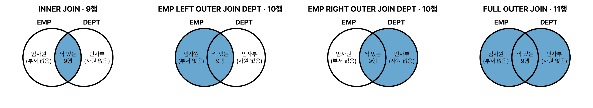

ANSI/ISO 표준 조인 문법을 정리하고, 외부 조인에서 ON 조건과 WHERE 조건이 결과를 어떻게 다르게 만드는지를 중심으로 봤다. 결과는 실제 실행 결과.

## 요약

- 표준 조인은 FROM 절에서 조인 방식과 조인 조건을 명시한다. 조인 조건(ON)과 일반 조건(WHERE)이 분리되어 읽기 쉽다.
- INNER JOIN은 양쪽에 짝이 있는 행만, OUTER JOIN은 짝이 없는 행도 보여 준다.
- NATURAL JOIN과 USING은 같은 이름의 열로 조인하고, 그 열 앞에 별칭을 붙일 수 없다.
- 외부 조인에서 조건을 ON에 쓰느냐 WHERE에 쓰느냐에 따라 결과가 달라진다.

## 1. 조인 종류별 결과 행 수

예제 데이터로 각 조인의 결과 행 수를 비교하면 차이가 한눈에 보인다. 사원 10명 가운데 임사원은 부서가 없고, 부서 4개 가운데 인사부는 사원이 없다.

| 조인 | SQL | 결과 행 수 | 설명 |
|---|---|---|---|
| CROSS JOIN | `EMP CROSS JOIN DEPT` | 40 | 10 × 4 모든 조합 |
| INNER JOIN | `EMP E JOIN DEPT D ON E.DEPTNO = D.DEPTNO` | 9 | 짝이 있는 사원만(임사원 제외) |
| LEFT OUTER JOIN | `EMP E LEFT JOIN DEPT D ON ...` | 10 | 모든 사원(임사원은 부서 NULL) |
| RIGHT OUTER JOIN | `EMP E RIGHT JOIN DEPT D ON ...` | 10 | 짝 있는 9행 + 사원 없는 인사부 |
| FULL OUTER JOIN | `EMP E FULL JOIN DEPT D ON ...` | 11 | 9행 + 임사원 + 인사부 |


_조인 종류별로 결과에 남는 영역(파란색). 벤 다이어그램은 짝을 맞추는 조인을 단순화한 그림이라, 한쪽 행이 여러 행과 짝지어지는 경우까지 보여 주지는 못한다_

## 2. INNER JOIN

```sql
SELECT E.ENAME, D.DNAME
  FROM EMP E
 INNER JOIN DEPT D ON E.DEPTNO = D.DEPTNO
 WHERE E.DEPTNO = 20;
```

`INNER`는 생략할 수 있다(`JOIN`만 써도 INNER JOIN). ON 절에는 조인 조건을, WHERE 절에는 일반 조건을 쓴다. 비등가 조인도 ON에 쓸 수 있다(`ON E.SAL BETWEEN S.LOSAL AND S.HISAL`).

## 3. NATURAL JOIN과 USING

**NATURAL JOIN**은 두 테이블에서 **이름이 같은 모든 열**로 등가 조인한다.

```sql
SELECT DEPTNO, ENAME, DNAME FROM EMP NATURAL JOIN DEPT WHERE DEPTNO = 10;
```

| DEPTNO | ENAME | DNAME |
|---|---|---|
| 10 | 김대표 | 기획부 |

**USING**은 같은 이름의 열 가운데 원하는 열만 골라 조인한다.

```sql
SELECT DEPTNO, E.ENAME, D.DNAME FROM EMP E JOIN DEPT D USING (DEPTNO) WHERE DEPTNO = 10;
```

| DEPTNO | ENAME | DNAME |
|---|---|---|
| 10 | 김대표 | 기획부 |

| 규칙 | NATURAL JOIN | USING |
|---|---|---|
| 조인 열 | 이름이 같은 모든 열 | 괄호 안에 지정한 열 |
| 조인 열에 별칭 붙이기 | 불가(`E.DEPTNO` 오류) | 불가 |
| ON 절과 함께 쓰기 | 불가 | 불가 |
| 결과의 조인 열 | 하나로 합쳐져 한 번만 나온다 | 하나로 합쳐져 한 번만 나온다 |
| 데이터 타입 | 같은 이름의 열은 타입도 같아야 한다 | |

반면 ON 절로 조인하면 `SELECT *`에 DEPTNO가 두 번(E.DEPTNO, D.DEPTNO) 나온다.

## 4. CROSS JOIN

조인 조건 없이 모든 행을 조합하는 카티션 곱이다. 의도적으로 모든 조합이 필요할 때(예: 모든 직원 × 모든 교육 과정) 쓴다.

```sql
SELECT COUNT(*) FROM EMP CROSS JOIN DEPT;   -- 40
```

## 5. OUTER JOIN

```sql
SELECT E.ENAME, D.DNAME
  FROM EMP E
  FULL OUTER JOIN DEPT D ON E.DEPTNO = D.DEPTNO
 WHERE E.ENAME IS NULL OR D.DNAME IS NULL OR E.EMPNO = 1001
 ORDER BY E.EMPNO;
```

| ENAME | DNAME |
|---|---|
| 김대표 | 기획부 |
| 임사원 | (NULL) |
| (NULL) | 인사부 |

| 종류 | 기준 | Oracle 방식 |
|---|---|---|
| LEFT OUTER JOIN | 왼쪽 테이블의 모든 행 | 오른쪽 열에 `(+)` |
| RIGHT OUTER JOIN | 오른쪽 테이블의 모든 행 | 왼쪽 열에 `(+)` |
| FULL OUTER JOIN | 양쪽 테이블의 모든 행 | 표현할 수 없음 |

`OUTER`는 생략할 수 있다(`LEFT JOIN`).

### ON 조건과 WHERE 조건의 차이

외부 조인에서 가장 많이 나오는 함정이다. '급여 5000 이상인 사원' 조건을 어디에 쓰느냐에 따라 결과가 달라진다.

```sql
-- ① 조건을 ON에: 조인하는 단계에서 사원을 거른다. 부서는 모두 남는다
SELECT D.DNAME, E.ENAME
  FROM DEPT D
  LEFT JOIN EMP E ON D.DEPTNO = E.DEPTNO AND E.SAL >= 5000
 ORDER BY D.DEPTNO;
```

| DNAME | ENAME |
|---|---|
| 기획부 | 김대표 |
| 개발부 | 이부장 |
| 영업부 | 박부장 |
| 인사부 | (NULL) |

```sql
-- ② 조건을 WHERE에: 조인한 뒤 결과 행을 거른다
SELECT D.DNAME, E.ENAME
  FROM DEPT D
  LEFT JOIN EMP E ON D.DEPTNO = E.DEPTNO
 WHERE E.SAL >= 5000
 ORDER BY D.DEPTNO;
```

| DNAME | ENAME |
|---|---|
| 기획부 | 김대표 |
| 개발부 | 이부장 |
| 영업부 | 박부장 |

②에서는 인사부 행의 E.SAL이 NULL이라 `E.SAL >= 5000`이 UNKNOWN이 되어 빠졌다. 결과적으로 내부 조인과 같아졌다.

> **쉬운 설명**
>
> ON 조건은 '짝을 찾을 때 이 조건에 맞는 사람만 짝으로 인정해', WHERE 조건은 '짝을 다 맞춘 뒤 이 조건에 안 맞는 줄은 지워'이다. LEFT JOIN은 왼쪽 표의 줄을 지키겠다는 약속인데, WHERE에서 오른쪽 열로 거르면 그 약속이 깨져서 짝 없는 줄까지 지워진다.

## 헷갈렸던 것들

- NATURAL JOIN과 USING의 조인 열에는 별칭을 붙일 수 없다.
- NATURAL JOIN은 이름이 같은 **모든** 열로 조인한다. 이름은 같은데 뜻이 다른 열이 있으면 의도와 다른 결과가 나온다.
- ON 절로 조인하면 SELECT *에 조인 열이 양쪽에서 두 번 나오고, NATURAL JOIN과 USING은 한 번만 나온다.
- CROSS JOIN의 결과 행 수는 두 테이블 행 수의 곱이다.
- 외부 조인에서 안쪽 테이블(NULL로 채워질 쪽)의 조건을 WHERE에 쓰면 내부 조인처럼 바뀐다.
- FULL OUTER JOIN은 LEFT와 RIGHT 결과의 합집합(중복 제거)과 같다.

## 용어 정리

| 용어 | 뜻 |
|---|---|
| INNER JOIN | 양쪽에 짝이 있는 행만 |
| NATURAL JOIN | 이름이 같은 모든 열로 하는 등가 조인 |
| USING | 지정한 같은 이름 열로 하는 등가 조인 |
| CROSS JOIN | 모든 조합(카티션 곱) |
| LEFT / RIGHT / FULL OUTER JOIN | 왼쪽 / 오른쪽 / 양쪽의 짝 없는 행도 포함 |

## 복습 문제

**1.** 다음 SQL 가운데 오류가 나는 것은?

① `SELECT E.DEPTNO FROM EMP E NATURAL JOIN DEPT D;` ② `SELECT DEPTNO FROM EMP NATURAL JOIN DEPT;` ③ `SELECT DEPTNO FROM EMP JOIN DEPT USING (DEPTNO);` ④ `SELECT E.DEPTNO FROM EMP E JOIN DEPT D ON E.DEPTNO = D.DEPTNO;`

**2.** A 테이블 5행, B 테이블 3행일 때 `A CROSS JOIN B`의 결과 행 수는?

① 3 ② 5 ③ 8 ④ 15

**3.** 사원 10명 가운데 1명은 부서가 없고, 부서 4개 가운데 1개는 사원이 없다. 부서가 있는 9명은 모두 실제로 있는 부서에 속한다. `EMP FULL OUTER JOIN DEPT`의 결과 행 수는?

① 9 ② 10 ③ 11 ④ 40

**4.** 다음 두 SQL의 결과에 대한 설명으로 옳은 것은?

```sql
-- (가)
SELECT D.DNAME, E.ENAME FROM DEPT D LEFT JOIN EMP E ON D.DEPTNO = E.DEPTNO AND E.JOB = 'CLERK';
-- (나)
SELECT D.DNAME, E.ENAME FROM DEPT D LEFT JOIN EMP E ON D.DEPTNO = E.DEPTNO WHERE E.JOB = 'CLERK';
```

① (가)는 모든 부서가 나오고, (나)는 CLERK가 있는 부서만 나온다 ② 두 SQL의 결과는 항상 같다 ③ (나)는 모든 부서가 나오고, (가)는 CLERK가 있는 부서만 나온다 ④ 둘 다 오류다

## 답과 풀이

1. ① NATURAL JOIN의 조인 열에는 별칭을 붙일 수 없다.
2. ④ 5 × 3 = 15행이다.
3. ③ 짝 있는 9행 + 부서 없는 사원 1행 + 사원 없는 부서 1행 = 11행이다.
4. ① ON 조건은 조인 단계에서 사원만 거르고 부서는 모두 남기지만, WHERE 조건은 조인 뒤에 걸러 짝 없는 부서를 지운다.

## 참고 자료

- 한국데이터산업진흥원 데이터자격검정, SQLD 출제기준: <https://www.dataq.or.kr>
- Oracle Database SQL Language Reference, SELECT(join_clause): <https://docs.oracle.com/en/database/oracle/oracle-database/23/sqlrf/SELECT.html>
