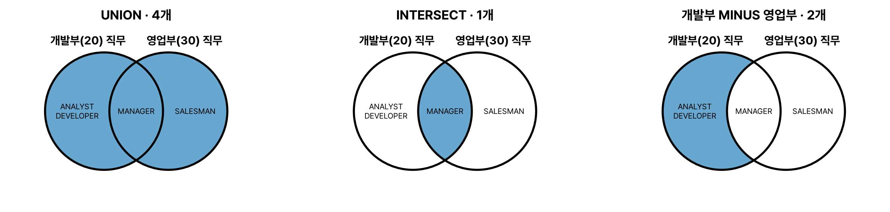

집합 연산자는 UNION과 UNION ALL의 차이, 결과 열 이름과 정렬 규칙이 자주 나온다. 결과는 실제 실행 결과.

## 요약

- 집합 연산자는 두 개 이상의 SELECT 결과를 하나로 합친다.
- UNION은 합집합(중복 제거), UNION ALL은 중복을 남긴 합집합, INTERSECT는 교집합, MINUS(EXCEPT)는 차집합이다.
- 각 SELECT의 열 개수와 데이터 타입이 맞아야 하고, 결과의 열 이름은 첫 번째 SELECT를 따른다.
- ORDER BY는 맨 마지막에 한 번만 쓴다.

## 1. 집합 연산자의 종류

예제로 개발부(20)와 영업부(30)의 직무를 비교한다. 개발부는 MANAGER, ANALYST, DEVELOPER, DEVELOPER, 영업부는 MANAGER, SALESMAN, SALESMAN, SALESMAN이다.


_개발부 직무와 영업부 직무에 집합 연산자를 적용한 결과(파란 영역)_

| 연산자 | 뜻 | 중복 | 정렬 |
|---|---|---|---|
| UNION | 합집합 | 제거 | 중복 제거 과정에서 정렬될 수 있지만 보장되지 않는다 |
| UNION ALL | 합집합 | 그대로 남김 | 하지 않는다 |
| INTERSECT | 교집합 | 제거 | |
| MINUS(Oracle), EXCEPT(SQL Server) | 차집합 | 제거 | |

### UNION과 UNION ALL

```sql
SELECT JOB FROM EMP WHERE DEPTNO = 20
UNION
SELECT JOB FROM EMP WHERE DEPTNO = 30
ORDER BY 1;
```

| JOB |
|---|
| ANALYST |
| DEVELOPER |
| MANAGER |
| SALESMAN |

```sql
SELECT JOB FROM EMP WHERE DEPTNO = 20
UNION ALL
SELECT JOB FROM EMP WHERE DEPTNO = 30;
```

| JOB |
|---|
| MANAGER |
| ANALYST |
| DEVELOPER |
| DEVELOPER |
| MANAGER |
| SALESMAN |
| SALESMAN |
| SALESMAN |

UNION은 양쪽 사이의 중복(MANAGER)뿐 아니라 **한쪽 안의 중복**(DEVELOPER 2개, SALESMAN 3개)도 없앤다. UNION ALL은 8행을 그대로 이어 붙인다. UNION ALL은 중복 제거를 위한 정렬 작업이 없어 더 빠르므로, 중복이 없다는 것이 확실하면 UNION ALL을 쓴다. UNION ALL 결과의 순서는 보장되지 않는다.

### INTERSECT와 MINUS

```sql
SELECT JOB FROM EMP WHERE DEPTNO = 20
INTERSECT
SELECT JOB FROM EMP WHERE DEPTNO = 30;
```

| JOB |
|---|
| MANAGER |

```sql
SELECT JOB FROM EMP WHERE DEPTNO = 20
MINUS
SELECT JOB FROM EMP WHERE DEPTNO = 30
ORDER BY 1;
```

| JOB |
|---|
| ANALYST |
| DEVELOPER |

MINUS는 순서를 바꾸면 결과가 달라진다. 영업부 MINUS 개발부는 SALESMAN 하나다.

## 2. 집합 연산자의 규칙

- 각 SELECT 문의 **열 개수**가 같아야 한다.
- 같은 위치의 열은 **데이터 타입**이 서로 호환되어야 한다.
- 결과의 열 이름(헤더)은 **첫 번째 SELECT**의 열 이름이나 별칭을 따른다.
- ORDER BY는 **맨 마지막**에 한 번만 쓸 수 있고, 첫 번째 SELECT의 열 이름, 별칭, 순서 번호로 정렬한다.
- 연산자 사이에 우선순위가 없으면 위에서부터 차례로 계산한다. INTERSECT가 섞여 있으면 Oracle과 SQL Server의 처리가 다를 수 있으니 괄호로 순서를 분명히 해 두는 게 안전하다.

```sql
SELECT ENAME AS 이름, SAL FROM EMP WHERE DEPTNO = 10
UNION ALL
SELECT DNAME, DEPTNO FROM DEPT WHERE DEPTNO = 40
ORDER BY 이름;
```

결과의 열 이름은 '이름', 'SAL'이고, 두 번째 SELECT의 DNAME과 DEPTNO 값이 그 아래에 들어간다. 열의 뜻이 달라도 개수와 타입만 맞으면 합쳐진다는 점을 보여 주는 예다.

> **쉬운 설명**
>
> 두 반의 장래희망 목록을 합친다고 생각하면 쉽다. UNION은 겹치는 것을 지운 '서로 다른 장래희망 목록', UNION ALL은 지우지 않고 그대로 이어 붙인 목록, INTERSECT는 두 반 모두에 있는 장래희망, MINUS는 우리 반에만 있는 장래희망이다.

## 헷갈렸던 것들

- UNION은 한쪽 결과 안의 중복도 제거한다.
- UNION ALL은 중복을 남기고 정렬하지 않아 빠르다.
- 결과 열 이름은 첫 번째 SELECT를 따른다.
- ORDER BY는 마지막에 한 번만 쓸 수 있다. 중간에 쓰면 오류다.
- Oracle의 차집합은 MINUS, SQL Server와 표준은 EXCEPT이다.
- MINUS는 순서에 따라 결과가 달라진다.

## 용어 정리

| 용어 | 뜻 |
|---|---|
| UNION | 중복을 제거한 합집합 |
| UNION ALL | 중복을 남긴 합집합 |
| INTERSECT | 교집합 |
| MINUS / EXCEPT | 차집합 |

## 복습 문제

**1.** 테이블 A의 COL 값이 (1, 1, 2), 테이블 B의 COL 값이 (2, 3)일 때 `SELECT COL FROM A UNION SELECT COL FROM B`의 결과 행 수는?

① 2 ② 3 ③ 4 ④ 5

**2.** 1번과 같은 데이터에서 `UNION ALL`의 결과 행 수는?

① 3 ② 4 ③ 5 ④ 6

**3.** 1번과 같은 데이터에서 `SELECT COL FROM A MINUS SELECT COL FROM B`의 결과는?

① 1, 1 ② 2 ③ 1 ④ 3

**4.** 집합 연산자에 대한 설명으로 옳지 않은 것은?

① 각 SELECT의 열 개수가 같아야 한다 ② 결과의 열 이름은 마지막 SELECT를 따른다 ③ ORDER BY는 마지막에 한 번만 쓴다 ④ UNION ALL은 중복을 제거하지 않는다

## 답과 풀이

1. ② 중복을 없앤 1, 2, 3의 3행이다.
2. ③ 1, 1, 2, 2, 3의 5행이다.
3. ③ A에만 있는 값은 1이고, MINUS는 중복을 제거해 한 행만 남는다.
4. ② 결과의 열 이름은 첫 번째 SELECT를 따른다.

## 참고 자료

- 한국데이터산업진흥원 데이터자격검정, SQLD 출제기준: <https://www.dataq.or.kr>
- Oracle Database SQL Language Reference, The UNION [ALL], INTERSECT, MINUS Operators: <https://docs.oracle.com/en/database/oracle/oracle-database/23/sqlrf/The-UNION-ALL-INTERSECT-MINUS-Operators.html>
