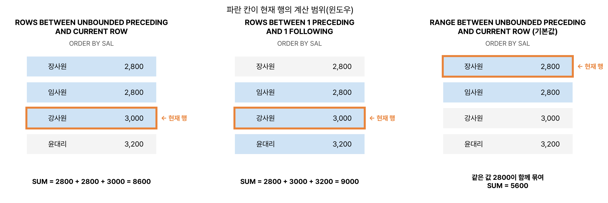

RANK, DENSE_RANK, ROW_NUMBER의 차이와 WINDOWING 절(ROWS, RANGE)은 매회 나온다고 보면 된다. 결과는 예제 테이블로 실행한 그대로다.

## 요약

- 윈도우 함수는 행을 줄이지 않고, 각 행 옆에 순위나 누적합 같은 계산 결과를 붙인다.
- 문법은 `함수() OVER (PARTITION BY 그룹 ORDER BY 정렬 WINDOWING 절)`이다.
- 순위 함수 RANK, DENSE_RANK, ROW_NUMBER는 동점을 다루는 방식이 다르다.
- 집계 함수(SUM, AVG 등)도 OVER와 함께 쓰면 윈도우 함수가 되고, WINDOWING 절로 계산 범위를 정한다.
- LAG와 LEAD는 앞뒤 행의 값을, FIRST_VALUE와 LAST_VALUE는 범위의 첫 값과 끝 값을 가져온다.

## 1. 기본 문법

```sql
SELECT 윈도우함수(인수) OVER (
         [PARTITION BY 열]          -- 그룹 나누기
         [ORDER BY 열 [ASC|DESC]]   -- 그룹 안의 순서
         [WINDOWING 절]              -- 계산할 행의 범위
       )
  FROM 테이블;
```

| 함수 종류 | 함수 |
|---|---|
| 순위 함수 | RANK, DENSE_RANK, ROW_NUMBER |
| 집계 함수 | SUM, MAX, MIN, AVG, COUNT |
| 행 순서 함수 | FIRST_VALUE, LAST_VALUE, LAG, LEAD |
| 비율 함수 | RATIO_TO_REPORT, PERCENT_RANK, CUME_DIST, NTILE |

GROUP BY는 그룹마다 한 행으로 줄이지만, 윈도우 함수는 원래 행 수를 그대로 유지한다. 윈도우 함수는 SELECT 절과 ORDER BY 절에서만 쓸 수 있고 WHERE 절에는 쓸 수 없다. 윈도우 함수 결과로 거르려면 인라인 뷰로 감싸야 한다.

## 2. 순위 함수

```sql
SELECT ENAME, SAL,
       RANK()       OVER (ORDER BY SAL DESC) AS RNK,
       DENSE_RANK() OVER (ORDER BY SAL DESC) AS DRNK,
       ROW_NUMBER() OVER (ORDER BY SAL DESC, EMPNO) AS RN
  FROM EMP
 ORDER BY SAL DESC, EMPNO;
```

| ENAME | SAL | RNK | DRNK | RN |
|---|---|---|---|---|
| 김대표 | 9000 | 1 | 1 | 1 |
| 이부장 | 6000 | 2 | 2 | 2 |
| 박부장 | 5800 | 3 | 3 | 3 |
| 최과장 | 4500 | 4 | 4 | 4 |
| 조과장 | 4000 | 5 | 5 | 5 |
| 정대리 | 3500 | 6 | 6 | 6 |
| 윤대리 | 3200 | 7 | 7 | 7 |
| 강사원 | 3000 | 8 | 8 | 8 |
| 장사원 | 2800 | 9 | 9 | 9 |
| 임사원 | 2800 | 9 | 9 | 10 |

| 함수 | 동점 처리 | 동점 다음 순위 | 동점 (90, 80, 80, 70)의 결과 |
|---|---|---|---|
| RANK | 같은 순위 | 동점 수만큼 건너뛴다 | 1, 2, 2, 4 |
| DENSE_RANK | 같은 순위 | 건너뛰지 않는다 | 1, 2, 2, 3 |
| ROW_NUMBER | 서로 다른 순위 | 연속 | 1, 2, 3, 4 |

예제에서는 동점이 맨 끝이라 RANK와 DENSE_RANK의 차이가 드러나지 않지만, 장사원과 임사원이 RANK로는 둘 다 9위, ROW_NUMBER로는 9위와 10위로 갈렸다. ROW_NUMBER는 동점일 때 순서가 정해지지 않으므로 `EMPNO`처럼 정렬 기준을 하나 더 주는 것이 좋다.

### PARTITION BY

```sql
SELECT DEPTNO, ENAME, SAL,
       RANK() OVER (PARTITION BY DEPTNO ORDER BY SAL DESC) AS 부서내순위
  FROM EMP
 WHERE DEPTNO IN (20, 30)
 ORDER BY DEPTNO, SAL DESC;
```

| DEPTNO | ENAME | SAL | 부서내순위 |
|---|---|---|---|
| 20 | 이부장 | 6000 | 1 |
| 20 | 최과장 | 4500 | 2 |
| 20 | 정대리 | 3500 | 3 |
| 20 | 강사원 | 3000 | 4 |
| 30 | 박부장 | 5800 | 1 |
| 30 | 조과장 | 4000 | 2 |
| 30 | 윤대리 | 3200 | 3 |
| 30 | 장사원 | 2800 | 4 |

PARTITION BY로 부서마다 순위를 새로 매겼다.

## 3. 집계 함수와 WINDOWING 절

```sql
SELECT DEPTNO, ENAME, SAL,
       SUM(SAL) OVER (PARTITION BY DEPTNO) AS 부서합계,
       SUM(SAL) OVER (PARTITION BY DEPTNO ORDER BY SAL
                      ROWS BETWEEN UNBOUNDED PRECEDING AND CURRENT ROW) AS 누적
  FROM EMP
 WHERE DEPTNO IN (20, 30)
 ORDER BY DEPTNO, SAL;
```

| DEPTNO | ENAME | SAL | 부서합계 | 누적 |
|---|---|---|---|---|
| 20 | 강사원 | 3000 | 17000 | 3000 |
| 20 | 정대리 | 3500 | 17000 | 6500 |
| 20 | 최과장 | 4500 | 17000 | 11000 |
| 20 | 이부장 | 6000 | 17000 | 17000 |
| 30 | 장사원 | 2800 | 15800 | 2800 |
| 30 | 윤대리 | 3200 | 15800 | 6000 |
| 30 | 조과장 | 4000 | 15800 | 10000 |
| 30 | 박부장 | 5800 | 15800 | 15800 |

ORDER BY가 없으면 파티션 전체가 계산 범위라 모든 행에 부서 합계가 붙고, ORDER BY와 WINDOWING 절을 주면 처음부터 현재 행까지의 누적합이 된다.

### WINDOWING 절

| 표현 | 뜻 |
|---|---|
| ROWS | 물리적인 행 개수로 범위를 정한다 |
| RANGE | 정렬 기준 값으로 범위를 정한다. 값이 같은 행은 함께 묶인다 |
| UNBOUNDED PRECEDING | 파티션의 첫 행 |
| UNBOUNDED FOLLOWING | 파티션의 마지막 행 |
| CURRENT ROW | 현재 행 |
| n PRECEDING / n FOLLOWING | 현재 행보다 n행(또는 값 n만큼) 앞 / 뒤 |

`ORDER BY`만 쓰고 WINDOWING 절을 생략하면 기본값은 `RANGE BETWEEN UNBOUNDED PRECEDING AND CURRENT ROW`이다. RANGE는 정렬 값이 같은 행을 함께 묶어서, 동점이 있으면 ROWS와 결과가 달라진다.

```sql
SELECT ENAME, SAL,
       SUM(SAL) OVER (ORDER BY SAL) AS RANGE_기본,
       SUM(SAL) OVER (ORDER BY SAL, EMPNO ROWS UNBOUNDED PRECEDING) AS ROWS_누적
  FROM EMP
 WHERE SAL <= 3200
 ORDER BY SAL, EMPNO;
```

| ENAME | SAL | RANGE_기본 | ROWS_누적 |
|---|---|---|---|
| 장사원 | 2800 | 5600 | 2800 |
| 임사원 | 2800 | 5600 | 5600 |
| 강사원 | 3000 | 8600 | 8600 |
| 윤대리 | 3200 | 11800 | 11800 |

급여 2800인 두 사람은 RANGE에서 같은 값으로 묶여 둘 다 5600이 됐다.


_같은 네 행에서 WINDOWING 절에 따라 달라지는 계산 범위. RANGE는 정렬 값이 같은 행(2800)을 함께 묶는다_

```sql
SELECT ENAME, SAL,
       AVG(SAL) OVER (ORDER BY SAL ROWS BETWEEN 1 PRECEDING AND 1 FOLLOWING) AS 이동평균
  FROM EMP
 WHERE DEPTNO = 20
 ORDER BY SAL;
```

| ENAME | SAL | 이동평균 |
|---|---|---|
| 강사원 | 3000 | 3250 |
| 정대리 | 3500 | 3666.67 |
| 최과장 | 4500 | 4666.67 |
| 이부장 | 6000 | 5250 |

앞 1행, 현재 행, 뒤 1행의 평균이다. 첫 행은 앞 행이 없어 (3000 + 3500) / 2 = 3250이다. Oracle은 3666.66666…처럼 소수를 길게 보여 주는데, 여기서는 둘째 자리까지 적었다.

## 4. 행 순서 함수

```sql
SELECT ENAME, HIREDATE, SAL,
       LAG(SAL)        OVER (ORDER BY HIREDATE) AS 이전,
       LEAD(SAL, 1, 0) OVER (ORDER BY HIREDATE) AS 다음
  FROM EMP
 WHERE DEPTNO = 30
 ORDER BY HIREDATE;
```

| ENAME | HIREDATE | SAL | 이전 | 다음 |
|---|---|---|---|---|
| 박부장 | 2016-07-15 | 5800 | (NULL) | 4000 |
| 조과장 | 2018-05-10 | 4000 | 5800 | 3200 |
| 윤대리 | 2021-04-12 | 3200 | 4000 | 2800 |
| 장사원 | 2023-03-02 | 2800 | 3200 | 0 |

`LAG(열, n, 기본값)`은 n행 앞, `LEAD`는 n행 뒤의 값이다. n을 생략하면 1, 기본값을 생략하면 NULL이다. LEAD에 기본값 0을 줘서 마지막 행이 0이 되었다.

```sql
SELECT DEPTNO, ENAME, SAL,
       FIRST_VALUE(ENAME) OVER (PARTITION BY DEPTNO ORDER BY SAL DESC) AS 최고,
       LAST_VALUE(ENAME)  OVER (PARTITION BY DEPTNO ORDER BY SAL DESC) AS LAST_기본,
       LAST_VALUE(ENAME)  OVER (PARTITION BY DEPTNO ORDER BY SAL DESC
                                ROWS BETWEEN UNBOUNDED PRECEDING AND UNBOUNDED FOLLOWING) AS 최저
  FROM EMP
 WHERE DEPTNO = 30
 ORDER BY SAL DESC;
```

| DEPTNO | ENAME | SAL | 최고 | LAST_기본 | 최저 |
|---|---|---|---|---|---|
| 30 | 박부장 | 5800 | 박부장 | 박부장 | 장사원 |
| 30 | 조과장 | 4000 | 박부장 | 조과장 | 장사원 |
| 30 | 윤대리 | 3200 | 박부장 | 윤대리 | 장사원 |
| 30 | 장사원 | 2800 | 박부장 | 장사원 | 장사원 |

LAST_VALUE는 기본 범위가 '처음부터 **현재 행까지**'라서, 아무 설정 없이 쓰면 자기 자신이 나온다(LAST_기본 열). 파티션의 진짜 마지막 값을 얻으려면 범위를 `UNBOUNDED FOLLOWING`까지 넓혀야 한다.

## 5. 비율 함수

```sql
SELECT ENAME, SAL,
       ROUND(RATIO_TO_REPORT(SAL) OVER (), 3) AS RATIO,
       ROUND(PERCENT_RANK() OVER (ORDER BY SAL), 3) AS PR,
       ROUND(CUME_DIST() OVER (ORDER BY SAL), 3) AS CD,
       NTILE(3) OVER (ORDER BY SAL DESC, EMPNO) AS NT
  FROM EMP
 WHERE DEPTNO = 30
 ORDER BY SAL DESC;
```

| ENAME | SAL | RATIO | PR | CD | NT |
|---|---|---|---|---|---|
| 박부장 | 5800 | 0.367 | 1 | 1 | 1 |
| 조과장 | 4000 | 0.253 | 0.667 | 0.75 | 1 |
| 윤대리 | 3200 | 0.203 | 0.333 | 0.5 | 2 |
| 장사원 | 2800 | 0.177 | 0 | 0.25 | 3 |

| 함수 | 뜻 | 예제 |
|---|---|---|
| RATIO_TO_REPORT(열) | 전체 합계에서 차지하는 비율(Oracle 전용) | 5800 / 15800 = 0.367 |
| PERCENT_RANK() | (순위 − 1) / (행 수 − 1). 처음이 0, 마지막이 1 | 조과장: (3 − 1) / 3 = 0.667 |
| CUME_DIST() | 현재 값 이하인 행의 비율(누적 분포). 0보다 크고 1 이하 | 윤대리: 2 / 4 = 0.5 |
| NTILE(n) | 행을 n개 그룹으로 나눈 번호. 나머지는 앞 그룹부터 하나씩 더 준다 | 4행을 3그룹 → 2, 1, 1행 |

> **쉬운 설명**
>
> 반 성적표에 각 학생의 이름과 점수를 그대로 둔 채, 옆 칸에 '반 등수', '반 평균', '앞 번호 학생 점수'를 적어 넣는 것이 윈도우 함수다. GROUP BY가 '반별 평균 표'로 성적표를 요약해 버린다면, 윈도우 함수는 성적표는 그대로 두고 정보만 덧붙인다.

## 헷갈렸던 것들

- RANK는 동점 뒤 순위를 건너뛰고(1, 2, 2, 4), DENSE_RANK는 건너뛰지 않고(1, 2, 2, 3), ROW_NUMBER는 동점에도 다른 번호를 준다(1, 2, 3, 4).
- 윈도우 함수는 WHERE 절에 쓸 수 없다.
- ORDER BY만 있고 WINDOWING 절이 없으면 기본값은 RANGE UNBOUNDED PRECEDING부터 CURRENT ROW까지다.
- RANGE는 값이 같은 행을 묶고, ROWS는 행 하나하나를 센다.
- LAST_VALUE를 기본 범위로 쓰면 현재 행의 값이 나온다.
- LAG, LEAD의 기본 오프셋은 1, 기본값은 NULL이다.
- PERCENT_RANK는 0부터 시작하고, CUME_DIST는 0보다 큰 값부터 시작한다.

## 용어 정리

| 용어 | 뜻 |
|---|---|
| 윈도우 함수 | 행을 유지한 채 행 사이의 계산 결과를 붙이는 함수 |
| PARTITION BY | 윈도우 함수의 그룹을 나누는 절 |
| WINDOWING 절 | 계산할 행의 범위를 정하는 절(ROWS, RANGE) |
| LAG / LEAD | 앞 / 뒤 행의 값 |
| NTILE | 행을 n개 그룹으로 나누는 함수 |

## 복습 문제

점수 데이터가 (100, 90, 90, 80)일 때 1~3번에 답해 보자.

**1.** `RANK() OVER (ORDER BY 점수 DESC)`로 80점의 순위는?

① 3 ② 2 ③ 1 ④ 4

**2.** `DENSE_RANK() OVER (ORDER BY 점수 DESC)`로 80점의 순위는?

① 2 ② 3 ③ 4 ④ 5

**3.** `SUM(점수) OVER (ORDER BY 점수 DESC)`로 두 번째 행(90점)의 값은?

① 190 ② 360 ③ 280 ④ 90

**4.** 다음 중 윈도우 함수를 쓸 수 없는 곳은?

① WHERE 절 ② SELECT 절 ③ ORDER BY 절 ④ 인라인 뷰의 SELECT 절

## 답과 풀이

1. ④ 90점이 공동 2위라 다음 순위는 4위다.
2. ② 건너뛰지 않으므로 3위다.
3. ③ 기본 범위가 RANGE라 값이 같은 두 90점이 함께 묶여, 100 + 90 + 90 = 280이다.
4. ① 윈도우 함수는 WHERE 절에 쓸 수 없다.

## 참고 자료

- 한국데이터산업진흥원 데이터자격검정, SQLD 출제기준: <https://www.dataq.or.kr>
- Oracle Database SQL Language Reference, Analytic Functions: <https://docs.oracle.com/en/database/oracle/oracle-database/23/sqlrf/Analytic-Functions.html>
